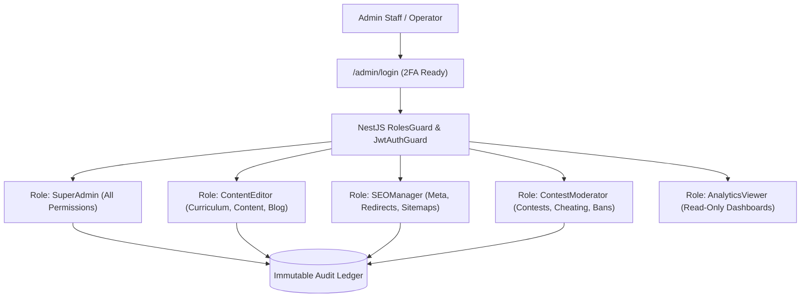
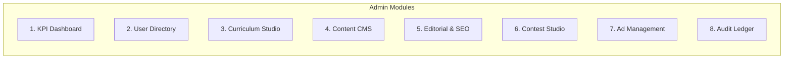

# Typing Typhon — Administrative Control Panel Specification

**Document Version:** 1.0.0  
**Status:** Approved Architectural Baseline  
**Base Route:** `/admin` (Isolated Protected Next.js Layout + NestJS RBAC Guards)  
**Security Standard:** Strict Server-Side Authorization + Immutable Audit Ledger  
**Date:** October 2026  

---

## 1. Administrative Architecture & Role-Based Access Control (RBAC)

The Admin Panel is a dedicated, decoupled operations console integrated into the Next.js frontend and powered by NestJS high-privilege endpoints.

### 1.1 Permission Matrix by Role

| Administrative Module | SuperAdmin | ContentEditor | SEOManager | ContestModerator | AnalyticsViewer |
| :--- | :---: | :---: | :---: | :---: | :---: |
| **System Overview & KPI Dashboards** | Full | Read | Read | Read | Read |
| **User Directory & Account Bans** | Full | None | None | Suspend Only | None |
| **Curriculum Studio (Stages & Lessons)**| Full | Full | None | None | Read |
| **Practice Content CMS (Quotes & Code)**| Full | Full | None | None | Read |
| **Blog & Editorial CMS** | Full | Full | Full | None | Read |
| **SEO Meta, Redirects & Sitemaps** | Full | Edit | Full | None | None |
| **Contests & Anti-Cheat Moderation** | Full | None | None | Full | Read |
| **Certificate Revocation & Audit** | Full | None | None | Revoke Only | Read |
| **Ad Placement Toggles & Config** | Full | None | None | None | Read |
| **Administrative Audit Logs** | Read/Export| None | None | None | None |

---

## 2. Core Functional Modules

### 2.1 Module 1: Executive KPI Dashboard (`/admin`)
* **Real-Time Operational Pulse:**
  * Active typists online (WebSocket/polling connection count).
  * 24-hour completed typing tests and average platform WPM.
  * Guest vs. Registered user completion ratio.
  * New user registrations (daily, weekly, monthly).
* **System Health Indicators:**
  * API latency ($p50, p95, p99$).
  * Database connection pool utilization and Redis memory consumption.
  * Background job queue depth (PDF generation, certificate signing).

### 2.2 Module 2: User Management & Data Protection (`/admin/users`)
* **User Search & Inspection:** Search by email, username, or UUID. View account verification state, registration date, total tests taken, and active role assignments.
* **Account Moderation:**
  * Suspend / Unsuspend user account with mandatory reason log.
  * Invalidate all active sessions (emergency token revocation).
* **GDPR Self-Service Compliance Tool:** Process requested user data exports (JSON download) and execute permanent cryptographic data deletion.

### 2.3 Module 3: Curriculum & Lesson Studio (`/admin/curriculum`)
* **Visual Stage Organizer:** Drag-and-drop hierarchy to reorder curriculum stages (Home Row, Top Row, Bottom Row, Numbers, Symbols).
* **Lesson & Exercise Editor:**
  * Define target keys (e.g., `['d', 'k']`).
  * Assign target fingers (e.g., `Left Middle`, `Right Middle`).
  * Configure pass criteria (minimum accuracy percentage, minimum WPM).
  * Configure automated repetition strings and synthesized practice words.

### 2.4 Module 4: Practice Content & Corpus Manager (`/admin/practice-content`)
* **Corpus Repositories:**
  * **Word Sets:** Manage 200, 1k, and 10k frequency dictionaries.
  * **Sentence Corpi:** Verified, natural-language sentence banks tagged by difficulty.
  * **Quotes Library:** Attributed literature and historical quotes with verified public domain provenance.
  * **Code Snippets:** Syntax-highlighted programming snippets (JavaScript, TypeScript, Python, Rust, SQL, HTML/CSS).
* **Automated Sanitization:** Ingestion pipelines validate against offensive tokens and formatting anomalies before publishing.

### 2.5 Module 5: SEO & Editorial Publishing Suite (`/admin/blog`, `/admin/seo`)
* **Markdown/MDX Editorial Studio:** Full-featured article editor with live preview, word count, reading time calculator, and table of contents generation.
* **SEO Optimizer Card:** Real-time Google SERP preview (Desktop & Mobile), keyword density checker, and missing alt-text detector.
* **Redirect & Canonical Manager:** CRUD table for 301/302 redirects preventing broken inbound links.

### 2.6 Module 6: Contests & Competitive Anti-Cheat Studio (`/admin/contests`)
* **Contest Scheduler:** Launch daily, weekly, or seasonal competitions with designated seed text and strict duration windows.
* **Suspicious Submission Flagging:**
  * Displays automated alerts for submissions flagged by the telemetry engine:
    * Standard deviation of IKI $< 5\text{ms}$ (Macro/bot signature).
    * Speeds exceeding $220\text{WPM}$.
    * Impossible acceleration curves.
* **One-Click Void & Disqualification:** Remove fraudulent entries from public leaderboards with automatic audit log creation.

### 2.7 Module 7: Advertising Configuration (`/admin/ads`)
* **Slot Identifier Manager:** Input approved Google AdSense slot IDs for designated containers (`banner_results_bottom`, `sidebar_blog_rail`, `leaderboard_learn_hub`).
* **Emergency Ad Kill-Switch:** Instantly suppress all display ad units across the entire platform in the event of layout regressions or policy disputes.

### 2.8 Module 8: Immutable Audit Ledger (`/admin/audit-logs`)
* Every administrative modification writes an immutable record to `audit_logs` storing:
  * `actorUserId`, `actionType`, `targetEntity`, `targetId`, `timestamp`, `ipAddress`, and `diffJSON` (capturing before and after states).
* Audit logs are read-only and cannot be updated or purged via the admin interface.
