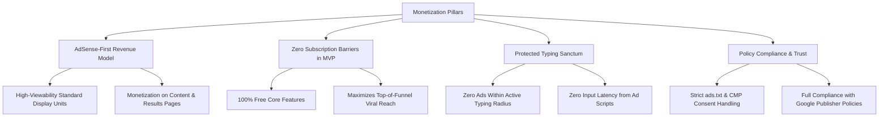
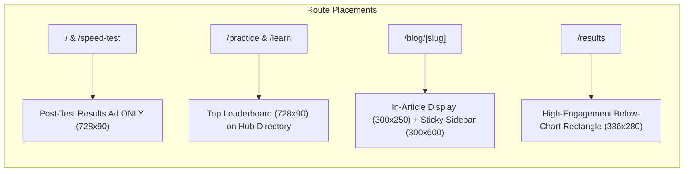
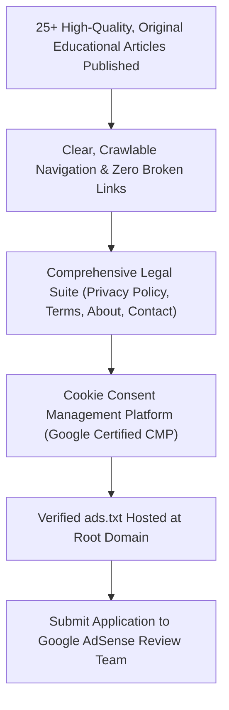

# Typing Typhon — Advertising & Google AdSense Monetization Strategy

**Document Version:** 1.0.0  
**Status:** Approved Business Baseline  
**Monetization Horizon:** Advertising-First (AdSense + Direct Educational Sponsorships)  
**Subscription Status in MVP:** STRICTLY EXCLUDED (No paywalls or paid tiers)  
**Date:** October 2026  

---

## 1. Monetization Philosophy & Business Strategy

Typing Typhon is founded on the thesis that **touch-typing education and speed benchmarking must remain fundamentally free and accessible to every learner on earth**.

Rather than restricting tests or analytics behind a monthly paywall, the platform monetizes through **privacy-compliant, non-intrusive display advertising** powered by the Google AdSense publisher network.



---

## 2. Protected Viewport & Placement Principles

Google publisher policies strictly prohibit layouts that encourage accidental clicks or obscure interactive content. Furthermore, input latency is the primary failure mode of typing websites. Typing Typhon enforces four non-negotiable advertising laws:

### 2.1 The Four Governing Laws of Ad Placement
1. **The Active Typing Canvas is an Inviolate Sanctuary:** Under no circumstances will any display banner, anchor ad, or overlay appear within $120\text{px}$ of the typing canvas.
2. **Zero In-Session Execution:** When a user strikes the first character of a typing test, any scheduled ad tag refresh cycles are instantly paused to prevent JavaScript garbage collection stutters during keystroke tracking.
3. **Strict Prevention of Cumulative Layout Shift (CLS):** Every ad container must have fixed CSS wrapper dimensions (`width` and `min-height`) with `aspect-ratio` reserving exact bounding boxes before the external ad snippet resolves.
4. **Unambiguous Demarcation:** Every unit must feature a subtle, standardized `ADVERTISEMENT` header label in 10px slate typography.

---

## 3. Route-by-Route Ad Placement Inventory



| Route Category | Approved Ad Formats | Viewport Location | Policy Safeguard |
| :--- | :--- | :--- | :--- |
| **Homepage & Instant Speed Test (`/`)** | 728x90 (Desktop) / 320x50 (Mobile) | Rendered **exclusively after test completion** beneath the performance graph. | Canvas is 100% ad-free during test. |
| **Curriculum Hub (`/learn`)** | 728x90 Leaderboard | Header banner above stage selection directory. | Zero ads inside individual active lessons (`/learn/[stage]/[lessonId]`). |
| **Practice Hub (`/practice`)** | 300x250 Medium Rectangle | Right rail on mode selector screen. | Removed when user launches a practice session. |
| **Educational Blog (`/blog/[slug]`)** | 300x600 Half-Page + In-Article Units | Desktop sticky sidebar and after paragraph 3 & 7 of long-form articles. | High editorial density; naturally compliant with AdSense article standards. |
| **Test Results View (`/results`)** | 336x280 Large Rectangle | Centered directly beneath letter accuracy breakdown. | User has finished typing; viewability is near 100% without annoyance. |

---

## 4. Google AdSense Approval Readiness Checklist

To guarantee swift account approval and avoid "Low-Value Content" rejections, development must satisfy this checklist prior to submitting the domain:



### 4.1 Readiness Criteria
* **[ ] Content Depth:** A minimum of 20 high-value, original articles on touch-typing ergonomics, keyboard switch mechanics, and speed improvement techniques must be live and indexed.
* **[ ] Legal Disclosures:** Privacy policy explicitly detailing:
  * Google AdSense third-party cookie usage.
  * Google DART cookie opt-out links.
  * CCPA / GDPR user privacy disclosures.
* **[ ] Clean Site Structure:** Working navigation across all header/footer links with zero generic lorem ipsum placeholders.
* **[ ] ads.txt Integration:** Statically served at `https://typingtyphon.com/ads.txt`:
  ```text
  google.com, pub-XXXXXXXXXXXXXXXX, DIRECT, f08c47fec0942fa0
  ```
* **[ ] Certified CMP:** Integration of a Google-certified Consent Management Platform (e.g., Funding Choices, Complianz, or Cookiebot) to handle EU/UK ePrivacy regulations.

---

## 5. Financial Modeling & Revenue Mechanics

*Note: Advertising RPM (Revenue Per Mille / Revenue per 1,000 pageviews) varies significantly by geographic tier.*

### 5.1 Estimated Blended RPM by Geographic Tier
* **Tier 1 (US, UK, CA, AU):** Estimated $4.50 – $9.00 RPM (higher on long-form blog articles; lower on fast-refresh speed tests).
* **Tier 2 (EU, JP, KR):** Estimated $2.50 – $5.00 RPM.
* **Tier 3 (Global / Emerging Markets):** Estimated $0.60 – $1.80 RPM.
* **Initial Blended Target RPM:** **$2.50 – $3.50** across global traffic.

### 5.2 Monetization Risk Management
1. **Ad Blocker Impact:** Between 20% to 40% of tech-savvy typists employ browser ad blockers. The platform **will not** deploy aggressive anti-adblock walls that lock users out; instead, it will display a polite self-hosted patronage notice: *"Typing Typhon is 100% free. Please consider whitelisting us to support continuous development."*
2. **Click Fraud Mitigation:** Zero incentive structures (no rewards, fake currency, or contest advantages) tied to ad interactions. Strict audit logs protect publisher reputation.
