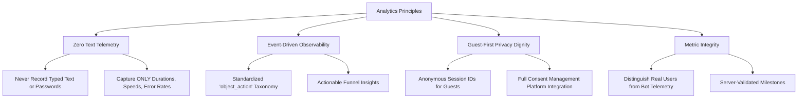
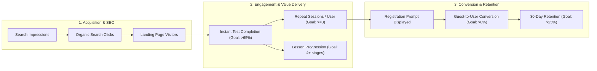

# Typing Typhon — Product Analytics & Measurement Plan

**Document Version:** 1.0.0  
**Status:** Approved Measurement Baseline  
**Compliance Standard:** GDPR / CCPA / Privacy-First (Zero Keystroke / Text Logging)  
**Primary Engine:** Google Analytics 4 (GA4) + Privacy-Compliant Server Telemetry  
**Date:** October 2026  

---

## 1. Analytics Philosophy & Data Privacy Safeguards

The measurement strategy for **Typing Typhon** is engineered to optimize user learning curves, track product engagement, and evaluate organic search funnel efficiency **without violating user privacy**.

---

## 2. Standardized Event Taxonomy

All product events follow the strict lowercase snake_case standard: `[entity]_[action]`.

| Event Name | Trigger Condition | Parameters Logged | Business Value |
| :--- | :--- | :--- | :--- |
| **`test_started`** | User strikes first valid keystroke on speed test or practice. | `mode`, `duration_seconds`, `is_guest`, `language` | Measures top-of-funnel typing volume. |
| **`test_completed`** | Timer expires or passage finishes. | `net_wpm`, `gross_wpm`, `accuracy_pct`, `mode`, `duration_seconds`, `is_guest`, `weak_keys_count` | Core engagement & skill metric. |
| **`test_replayed`** | User clicks "Restart" or presses `Tab+Enter`. | `mode`, `previous_wpm`, `is_guest` | Measures habit loop & repetition velocity. |
| **`lesson_started`** | User opens an interactive lesson exercise. | `stage_slug`, `lesson_id`, `target_keys` | Tracks curriculum onboarding. |
| **`lesson_completed`** | User finishes repetition drill with pass/fail. | `lesson_id`, `passed`, `accuracy_pct`, `attempts_count` | Measures curriculum difficulty & drop-off. |
| **`weak_key_drill_generated`**| User clicks "Practice Weak Keys" on results screen. | `keys_targeted_count`, `weak_keys_array` | Diagnostic engine utility & adoption. |
| **`game_started`** | User launches a typing mini-game. | `game_slug`, `difficulty` | Gamification engagement. |
| **`contest_submitted`** | User completes daily/weekly challenge. | `contest_id`, `net_wpm`, `accuracy_pct`, `rank` | Competitive participation volume. |
| **`certificate_generated`** | User claims a verifiable certificate. | `wpm`, `accuracy_pct`, `duration_seconds`, `is_guest` | Viral credential sharing & credibility. |
| **`account_prompt_displayed`**| Non-blocking registration banner appears. | `trigger_reason` (`5_sessions`, `streak_milestone`), `session_count` | Evaluates prompt frequency & placement. |
| **`account_prompt_clicked`** | User clicks "Create Free Account" from banner. | `trigger_reason`, `source_page` | Measures prompt interest. |
| **`account_registered`** | New user account created. | `auth_method` (`google`, `github`, `email`), `had_guest_data` | Key conversion metric. |
| **`guest_history_migrated`** | Local IndexedDB sessions merged to cloud. | `records_migrated_count`, `elapsed_days_in_guest` | Validates migration pipeline health. |

---

## 3. Core Business & Product KPIs

### 3.1 KPI Definitions & Targets
1. **Instant Test Completion Rate:** $\frac{\text{test\_completed}}{\text{test\_started}} \ge 70\%$.
2. **Guest-to-Account Conversion Rate:** $\frac{\text{account\_registered (from guest)}}{\text{unique guests with} \ge 3 \text{ tests}} \ge 8.0\%$.
3. **Weekly Repeat Rate:** Percentage of weekly active visitors who complete tests on $\ge 2$ distinct days.
4. **WPM Velocity Delta:** Average net WPM increase among learners who complete Stages 1–5 of the curriculum (Target: $+15\text{ WPM}$ within 30 days).
5. **Ad Viewability Rate:** Active ad unit viewability $\ge 70\%$ without causing typing interference.

---

## 4. Google Search Console & Organic Performance Tracking

* **Monitored Metrics:** Total impressions, average position, click-through rate (CTR), and crawl anomalies.
* **Target Indexing Coverage:** 100% of generated static routes and dynamic curriculum pages indexed within 45 days of launch.
* **Core Web Vitals Monitoring:** Field data monitored via Google Search Console CWV report, alerting if $p75$ LCP exceeds $2.0\text{s}$ or CLS exceeds $0.05$.
