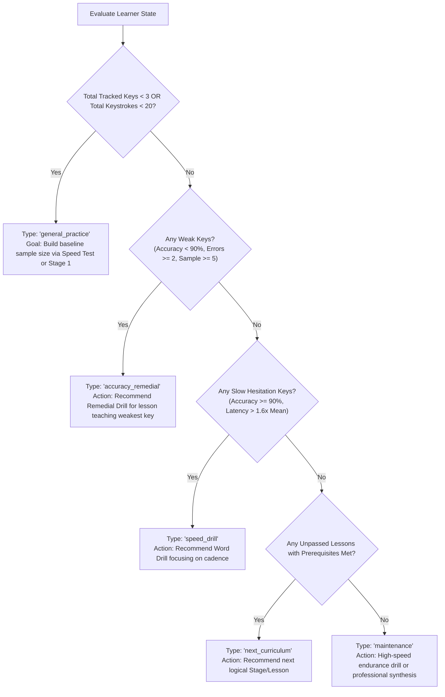

# Typing Typhon — Analytics Specification & Recommendation Engine

**Document Version:** 1.0.0  
**Status:** Approved & Implemented  
**Author:** Telemetry Architecture & Cognitive UX Engineering  
**Date:** October 2026  
**Scope:** Per-Key Metrics, Honest Confidence Gating & Deterministic Practice Recommendations

---

## 1. Ethical Principles of Typing Telemetry

1. **Honest Metric Reporting:**  
   Never claim definitive mastery or diagnose weakness without sufficient statistical evidence. A key with 1 or 2 attempts must NEVER be labeled weak or strong.
2. **Deterministic Recommendation Engine:**  
   Recommendations are rule-based, reproducible, and fully auditable. No opaque LLM or AI dependency is involved.
3. **Zero Raw Keystroke Snooping:**  
   Typing Typhon never stores sensitive raw timestamp telemetry or arbitrary typed strings on backend servers. Telemetry aggregates (attempts, error counts, latency averages) are stored locally in guest browser storage (`key_analytics_v1`) or optionally synchronized to authenticated accounts.
4. **Transparent Speed Distinction:**  
   The platform clearly separates **Net Words Per Minute** (productive speed after error penalties) from **Gross Words Per Minute** (raw motor output speed), and distinguishes **accuracy flaws** (wrong finger choices) from **hesitation latency** (slow reaction times).

---

## 2. Metric Mathematical Definitions

### A. Net WPM vs. Gross WPM

$$\text{Gross WPM} = \frac{\text{Total Keystrokes} / 5}{\text{Duration in Minutes}}$$

$$\text{Net WPM} = \max\left(0, \frac{(\text{Total Keystrokes} / 5) - \text{Uncorrected Errors}}{\text{Duration in Minutes}}\right)$$

* **Standard Word Length:** 5 keystrokes (including spaces and punctuation) as defined by standard typing pedagogy.
* **Error Penalty Rule:** Exactly 1 word (5 keystrokes) is deducted from productive output for every **uncorrected error** remaining at the end of the test.
* **Backspace Correction Incentive:** Errors corrected during the test using Backspace do NOT incur the 1-word Net WPM penalty, accurately reflecting real-world professional typing productivity.

### B. Per-Key Accuracy & Attempt Metrics

For every individual key $k \in \text{Keyboard}$:

$$\text{Accuracy Pct}(k) = \begin{cases} 100.0 & \text{if } \text{Total Attempts}(k) = 0 \\ \operatorname{round}\left(\frac{\text{Correct}(k)}{\text{Total Attempts}(k)} \times 100, 1\right) & \text{otherwise} \end{cases}$$

Where:
* $\text{Total Attempts}(k) = \text{Correct}(k) + \text{Error Count}(k)$
* $\text{Correct}(k)$: Keystrokes matching the target character on first or subsequent attempt.
* $\text{Error Count}(k)$: Keystrokes where a mismatched character was struck when $k$ was expected.
* $\text{Corrected Count}(k)$: Instances where an error on character $k$ was undone using Backspace.

### C. Inter-Keystroke Interval (IKI) & Hesitation Latency

For every character $k$:
* $\text{Inter-Keystroke Interval } (\text{IKI}_i) = t_i - t_{i-1}$ (milliseconds elapsed since preceding keystroke).
* Outlier clamping: Intervals $> 2000\text{ ms}$ (e.g. learner pauses, tab-switching) are clamped to prevent skewing averages.
* $\text{Average Latency}(k) = \frac{1}{N} \sum_{i=1}^N \text{IKI}_i$

---

## 3. Statistical Confidence Gating

To prevent hasty conclusions on tiny sample sizes, every tracked key is assigned an explicit confidence classification:

| Confidence Level | Sample Size Threshold | Diagnostic Permitted | UI Display & Badge |
| :--- | :--- | :--- | :--- |
| **`insufficient`** | $N < 5$ attempts | **None** — Gated from weak/strong classification | `INSUFFICIENT` (Slate badge) |
| **`low`** | $5 \le N < 15$ attempts | Preliminary trend indicator only | `LOW` (Amber badge) |
| **`moderate`** | $15 \le N < 30$ attempts | Reliable accuracy baseline | `MODERATE` (Sky blue badge) |
| **`high`** | $N \ge 30$ attempts | Definitive neuromuscular mastery evaluation | `HIGH` (Emerald badge) |

### Key Classification Rules

* **Weak Key (Accuracy Focus):**
  $$\text{Accuracy Pct} < 90.0\% \quad \text{AND} \quad \text{Error Count} \ge 2 \quad \text{AND} \quad \text{Confidence} \ne \text{'insufficient'}$$
* **Slow Hesitation Key (Speed Focus):**
  $$\text{Accuracy Pct} \ge 90.0\% \quad \text{AND} \quad \text{Average Latency} > 1.6 \times \text{Overall Mean Latency} \quad \text{AND} \quad \text{Confidence} \ne \text{'insufficient'}$$
* **Strong Key (Mastery):**
  $$\text{Accuracy Pct} \ge 96.0\% \quad \text{AND} \quad \text{Error Count} \le 1 \quad \text{AND} \quad \text{Confidence} \in \{\text{'moderate'}, \text{'high'}\}$$

---

## 4. Deterministic Recommendation Decision Tree

The recommendation engine (`generatePracticeRecommendation`) executes a deterministic priority waterfall:



### Recommendation Output Contract (`PracticeRecommendation`)

```typescript
export interface PracticeRecommendation {
  type: PracticeRecommendationType; // 'accuracy_remedial' | 'speed_drill' | 'next_curriculum' | 'maintenance' | 'general_practice'
  title: string;
  reason: string;
  targetKeys: string[];
  suggestedLessonId?: string;
  suggestedDrillType?: 'intro' | 'word' | 'remedial';
  priorityScore: number;
}
```

---

## 5. Storage & Persistence Contracts

### Storage Keys
* `key_analytics_v1`: JSON dictionary `Record<string, KeyMetricAggregate>` stored in `localStorage`.
* `curriculum_v1`: JSON dictionary `Record<string, LessonProgress>` storing best accuracy, best Net WPM, and pass status.
* `guest_sessions_v1`: Array of completed guest test summaries.

### API & Migration Synchronization
When an optional account is registered or authenticated:
1. `POST /api/v1/auth/register` or `POST /api/v1/auth/login` accepts guest session arrays and migrates them safely into PostgreSQL.
2. In-flight attempts remain idempotent: duplicates are rejected via unique composite constraints.
3. Offline recovery: If backend connectivity fails, local storage remains operational with zero interruption to active typing.
