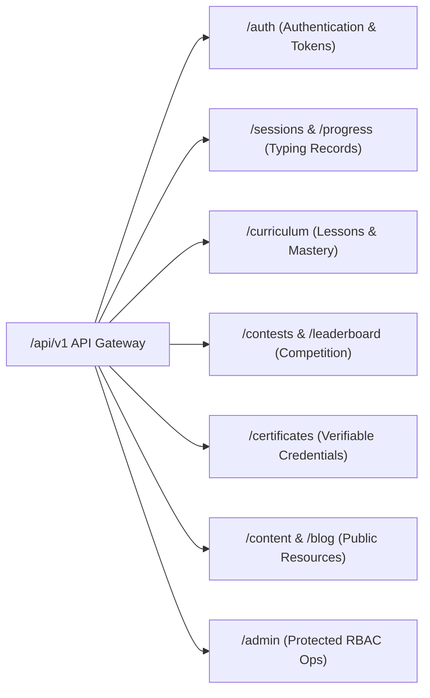

# Typing Typhon — REST API Specification

**Document Version:** 1.0.0  
**API Baseline:** REST v1 (`/api/v1`)  
**Standard Protocols:** HTTPS, JSON, RFC 7807 (Problem Details for Errors)  
**Authentication:** HTTP-Only Secure Cookies (JWT Access + Refresh) or Bearer Header  
**Date:** October 2026  

---

## 1. Global API Standards & Conventions

### 1.1 Base URL & Content Negotiation
* Base URL: `https://api.typingtyphon.com/api/v1` (Production) or `http://localhost:4000/api/v1` (Development).
* Standard Headers:
  * `Content-Type: application/json`
  * `Accept: application/json`
  * `X-Client-Version: 1.0.0`

### 1.2 Standard Success Response Envelope
All standard successful 2xx responses return:
```json
{
  "success": true,
  "data": { ... },
  "meta": {
    "timestamp": "2026-10-16T12:00:00.000Z",
    "requestId": "req_a1b2c3d4"
  }
}
```

### 1.3 Standard Error Envelope (RFC 7807)
Failed requests return an HTTP 4xx or 5xx code with a structured body:
```json
{
  "success": false,
  "error": {
    "type": "https://typingtyphon.com/errors/invalid-keystroke-telemetry",
    "title": "Unprocessable Entity",
    "status": 422,
    "detail": "Inter-keystroke intervals show zero variance, indicating automated input.",
    "instance": "/api/v1/contests/daily/submit",
    "timestamp": "2026-10-16T12:00:00.000Z"
  }
}
```

---

## 2. API Groups & Endpoint Inventory



---

### Group 1: System Health & Status
* **`GET /health`**
  * **Auth:** None (Public)
  * **Response:** `{ "status": "ok", "uptime": 12849, "timestamp": "..." }`
* **`GET /health/ready`**
  * **Auth:** None (Public)
  * **Checks:** PostgreSQL connectivity, Redis ping, disk storage buffer.

---

### Group 2: Authentication & Profile (`/auth`)
* **`POST /auth/register`**
  * **Auth:** Public
  * **Body:** `{ "email": "user@example.com", "password": "SecurePassword123!", "username": "speedy_tom" }`
  * **Validation:** Email format, password $\ge 8$ chars (with 1 uppercase, 1 symbol), username alphanumeric $3\dots 20$ chars.
  * **Response:** 201 Created `{ "user": { "id": "...", "username": "speedy_tom", "email": "..." } }` + sets JWT cookies.
* **`POST /auth/login`**
  * **Auth:** Public
  * **Body:** `{ "email": "user@example.com", "password": "SecurePassword123!" }`
  * **Rate Limit:** 5 requests / minute per IP.
  * **Response:** 200 OK + sets access token (15m) & refresh token (30d) cookies.
* **`POST /auth/refresh`**
  * **Auth:** Refresh Token Cookie
  * **Response:** 200 OK (rotates tokens and issues fresh access cookie).
* **`POST /auth/logout`**
  * **Auth:** Authenticated
  * **Response:** 200 OK (clears cookies, invalidates refresh token in DB).
* **`GET /auth/me`**
  * **Auth:** Authenticated (Optional — returns `{ authenticated: false }` for guests).
  * **Response:** 200 OK `{ "user": { "id": "...", "username": "...", "roles": ["User"] } }`

---

### Group 3: Typing Sessions & Guest Migration (`/sessions`, `/progress`)
* **`POST /sessions/submit`**
  * **Auth:** Authenticated (Optional; guests submit local sessions here upon test completion if cloud logging enabled).
  * **Body:**
    ```json
    {
      "sessionType": "speed_test",
      "durationSeconds": 60,
      "netWpm": 84.50,
      "grossWpm": 88.00,
      "accuracyPct": 96.02,
      "totalKeystrokes": 440,
      "correctKeystrokes": 422,
      "errorCount": 7,
      "mode": "words",
      "textSeed": "seed_english_200_a9f1",
      "timeSeries": [
        { "s": 1, "w": 70, "e": 0 },
        { "s": 2, "w": 75, "e": 1 }
      ],
      "perKeyStats": [
        { "key": "e", "attempts": 45, "errors": 1, "avgLatencyMs": 95 },
        { "key": "b", "attempts": 12, "errors": 3, "avgLatencyMs": 180 }
      ]
    }
    ```
  * **Validation:** $0 \le \text{netWpm} \le 280$, $0 \le \text{accuracyPct} \le 100$, duration $\in [15, 30, 60, 120]$.
  * **Response:** 201 Created `{ "sessionId": "uuid", "isPersonalBest": true }`
* **`GET /sessions/history`**
  * **Auth:** Authenticated
  * **Query Params:** `page=1&limit=20&mode=words&sort=completedAt:desc`
  * **Response:** 200 OK `{ "items": [...], "total": 142, "page": 1, "totalPages": 8 }`
* **`POST /progress/migrate`**
  * **Auth:** Authenticated
  * **Body:** `{ "guestSessions": [ { ...sessionObject1 }, { ...sessionObject2 } ] }`
  * **Validation:** Maximum 50 records per batch; deduplication by timestamp & seed hash.
  * **Response:** 200 OK `{ "migratedCount": 8, "skippedCount": 0 }`

---

### Group 4: Curriculum & Touch-Typing Education (`/curriculum`)
* **`GET /curriculum/stages`**
  * **Auth:** Public
  * **Response:** 200 OK `[ { "id": "...", "slug": "home-row", "title": "Home Row Foundations", "lessonCount": 6 } ]`
* **`GET /curriculum/lessons/:id`**
  * **Auth:** Public
  * **Response:** 200 OK `{ "id": "...", "title": "Keys F & J", "targetKeys": ["f", "j"], "exercises": [...] }`
* **`POST /curriculum/lessons/:id/submit`**
  * **Auth:** Authenticated (Guest state maintained locally in IndexedDB)
  * **Body:** `{ "lessonId": "uuid", "accuracyPct": 98.5, "wpm": 32.0, "timeSpentSeconds": 45 }`
  * **Response:** 200 OK `{ "passed": true, "keyMasteryUpdated": { "f": "mastered", "j": "mastered" }, "nextLessonId": "uuid" }`

---

### Group 5: Contests & Competitive Integrity (`/contests`, `/leaderboard`)
* **`GET /contests/active`**
  * **Auth:** Public
  * **Response:** 200 OK `{ "daily": { "id": "uuid", "endsInSeconds": 43200 }, "weekly": { ... } }`
* **`POST /contests/:id/start`**
  * **Auth:** Authenticated
  * **Response:** 200 OK `{ "contestSessionToken": "signed_jwt_token", "seedText": "...", "duration": 60 }`
* **`POST /contests/:id/submit`**
  * **Auth:** Authenticated
  * **Body:**
    ```json
    {
      "contestSessionToken": "signed_jwt_token",
      "netWpm": 105.2,
      "accuracyPct": 99.1,
      "keystrokeTiming": [112, 98, 140, 105, 88, 115]
    }
    ```
  * **Validation:** Anti-cheat variance check on `keystrokeTiming` ($\sigma \ge 5\text{ms}$).
  * **Response:** 200 OK `{ "rank": 7, "percentile": 99.4, "disqualified": false }`
* **`GET /leaderboard/global`**
  * **Auth:** Public
  * **Query Params:** `duration=60&period=all-time&limit=50`
  * **Response:** 200 OK `[ { "rank": 1, "username": "lightning", "wpm": 164.2, "accuracy": 99.4 } ]`

---

### Group 6: Verifiable Certificates (`/certificates`)
* **`POST /certificates/issue`**
  * **Auth:** Authenticated or Guest with Valid Qualifying Session ID
  * **Body:** `{ "sessionId": "uuid", "candidateName": "Jane Doe" }`
  * **Validation:** Underlying session must have `duration >= 60`, `netWpm >= 40`, `accuracyPct >= 95.0`.
  * **Response:** 201 Created `{ "certificateCode": "TYPHON-2026-9F8A", "verificationUrl": "https://typingtyphon.com/verify/TYPHON-2026-9F8A" }`
* **`GET /certificates/verify/:code`**
  * **Auth:** Public
  * **Response:** 200 OK `{ "valid": true, "candidateName": "Jane Doe", "wpm": 85.4, "accuracy": 98.2, "issueDate": "2026-10-16" }`

---

### Group 7: Administrative APIs (`/admin`)
* **`GET /admin/metrics/overview`**
  * **Auth:** RBAC (`SuperAdmin`, `Auditor`)
  * **Response:** 200 OK `{ "dau": 4200, "totalTestsCompleted": 85000, "avgWpm": 54.2, "activeContestants": 412 }`
* **`PATCH /admin/users/:id/status`**
  * **Auth:** RBAC (`SuperAdmin`, `ContestModerator`)
  * **Body:** `{ "isActive": false, "reason": "Confirmed macro script automation" }`
  * **Response:** 200 OK `{ "userId": "...", "status": "suspended" }`
* **`POST /admin/curriculum/lessons`**
  * **Auth:** RBAC (`SuperAdmin`, `ContentEditor`)
  * **Body:** Create/Update lesson payloads.
