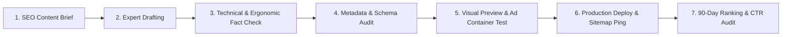
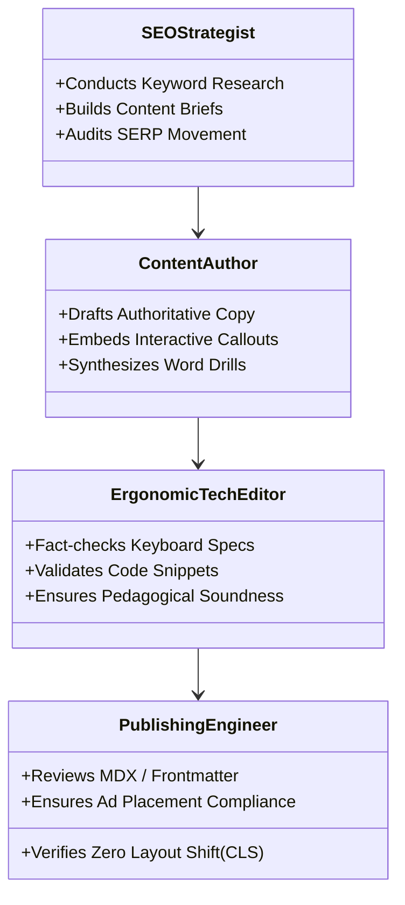

# Typing Typhon — Content Operations & Editorial Workflow

**Document Version:** 1.0.0  
**Status:** Approved Operational Baseline  
**Publishing Engine:** Next.js MDX / Headless CMS via NestJS  
**Date:** October 2026  

---

## 1. Editorial Philosophy & Standards

High-quality, authoritative educational content is the cornerstone of **Typing Typhon’s SEO strategy and Google AdSense compliance**. 

Search engines and users reward content that demonstrates **E-E-A-T (Experience, Expertise, Authoritativeness, and Trustworthiness)**.



---

## 2. Standardized SEO Content Brief Template

Every educational guide, blog post, or lesson overview must be initiated using this structured brief:

```markdown
# SEO Content Brief: [Target Primary Keyword]

## 1. Metadata & Target Metrics
- **Primary Keyword:** e.g., "how to touch type without looking"
- **Search Intent:** Informational (Educational Beginner)
- **Target Word Count:** 1,800 – 2,400 words
- **Target URL Slug:** `/blog/how-to-touch-type-without-looking`
- **Page Title (<title>):** How to Touch Type Without Looking: Step-by-Step Guide (2026)
- **Meta Description:** Master touch typing without glancing at your keyboard. Learn home row anchors, muscle memory drills, and progressive speed techniques.
- **Canonical URL:** `https://typingtyphon.com/blog/how-to-touch-type-without-looking`
- **Structured Data:** `Article`, `FAQPage`, `BreadcrumbList`

## 2. Heading Structure (H1, H2, H3)
- H1: How to Touch Type Without Looking: A Complete Muscle-Memory Guide
  - H2: The Neuro-Muscular Foundation of Touch Typing
  - H2: Step 1: Positioning Your Hands on the Home Row
    - H3: Why the F and J Tactile Bumps Exist
    - H3: The Resting Finger Assignment Chart
  - H2: Step 2: Breaking the Habit of Peeking at the Keyboard
  - H2: Step 3: Radial Reaches to the Top and Bottom Rows
  - H2: Step 4: Daily Practice Routines for Rapid Improvement
  - H2: Frequently Asked Questions (FAQ)

## 3. Mandatory Internal Links
- Link to `/learn/home-row` (Anchor: "Start with our interactive home row lesson")
- Link to `/speed-test/60-seconds` (Anchor: "Take a 60-second baseline typing test")
- Link to `/guide/keyboard-layout` (Anchor: "Complete finger placement guide")

## 4. Visual & Media Assets Required
- Custom SVG/PNG diagram illustrating Home Row finger rests with zero peeking.
- Callout card: "Interactive Drill: Try Typing Typhon's Stage 1 Free".
```

---

## 3. Educational Rigor & Fact-Checking Guidelines

1. **Ergonomic & Physical Accuracy:**
   * Claims regarding typing ergonomics, carpal tunnel prevention, and wrist positioning must reference established occupational health guidelines (e.g., OSHA computer workstation checklists).
   * Neutral wrist alignment and floating forearms must be emphasized over resting wrists on hard table edges.
2. **Quotes & Literary Text Sourcing:**
   * Practice quotes in `/practice/quotes` must be sourced strictly from public domain literature (e.g., Project Gutenberg) or properly attributed with verified historical accuracy.
   * Offensive, inflammatory, or copyrighted texts are strictly excluded from the corpus.
3. **Programming Code Snippets:**
   * Code snippets used in `/practice/code` must be syntactically valid and represent modern idiomatic practices in Python, TypeScript, SQL, Rust, and Go.

---

## 4. Editorial Roles & Team Responsibilities



| Role | Core Ownership | Deliverable Hand-Off |
| :--- | :--- | :--- |
| **SEO Strategist** | Keyword clustering, search intent analysis, content briefs. | Delivers completed Markdown brief. |
| **Content Author** | Long-form drafting, engaging tone, student-friendly analogies. | Delivers draft MDX article. |
| **Ergonomic / Tech Editor** | Fact-checking, anatomical accuracy, programming syntax review. | Delivers verified, annotated draft. |
| **Publishing Engineer** | MDX compilation, image optimization, schema validation, and deployment. | Live URL in production sitemap. |

---

## 5. Content Refresh & Evergreen Maintenance Schedule

* **Monthly Ranking Audit:** Review top 10 landing pages in Google Search Console. If average ranking drops $> 3$ positions, audit SERP competitors and refresh headings/depth.
* **Quarterly Corpus Expansion:** Add 100 new verified public domain quotes and 50 new coding syntax snippets to the practice database.
* **Annual Date & Guideline Updates:** Update all "2026 Guide" titles and benchmarks to maintain contemporary search relevance.
