# Typing Typhon — Curriculum Expansion Specification (Stages 1–6)

**Document Version:** 1.0.0  
**Status:** Approved & Implemented  
**Author:** Full-Stack Architecture & Pedagogical Engineering  
**Date:** October 2026  
**Scope:** Stages 1–6 (25 Total Lessons, 75 Exercises)

---

## 1. Pedagogical Rationale & Motor Acquisition Framework

Touch typing is the acquisition of **neuromuscular motor programming (muscle memory)**, not arbitrary intellectual character recall.

Typing Typhon explicitly rejects alphabetical order ($A \to Z$) instruction. Teaching alphabetically forces awkward, cross-row finger leaps (e.g., $A$ left pinky home row $\to B$ left index bottom row diagonal $\to C$ left middle bottom row) before the baseline tactile anchor has stabilized.

### Core Pedagogical Principles

1. **The Tactile Home Row Anchor ($F$ and $J$):**
   Physical keyboards feature tactile bumps (nibs) on the $F$ and $J$ keys. Hand position is anchored through these indices. Every keystroke is executed as a radial extension (upward, downward, lateral) that immediately rebounds to the home row baseline.
2. **Radial Reach Pairing:**
   Keys are introduced in symmetrical bilateral pairs (e.g., Left Middle $E$ / Right Middle $I$; Left Index $R$ / Right Index $U$). This develops balanced bilateral coordination across both cerebral hemispheres.
3. **Immediate Authentic Word Synthesis:**
   Drills immediately synthesize newly introduced keys into authentic English words using exclusively previously mastered characters. No untaught characters appear prematurely.
4. **Remedial Feedback Loops:**
   When a learner fails the accuracy gate ($\ge 96\%$) or speed gate ($\ge 15\text{--}25\text{ WPM}$), a dedicated remedial accuracy drill is immediately available to correct motor confusion before bad habits fossilize.
5. **Opposite-Hand Shift Rule:**
   Capitalization requires bilateral coordination: striking a character with the left hand requires holding the Right Shift key with the right pinky, and vice versa. Single-handed contortions (e.g., stretching left pinky to Left Shift while striking $T$ with left index) are actively discouraged through bilateral drill design.

---

## 2. Stable Lesson Schema & Architecture Contract

Curriculum data is strictly separated from UI presentation and maintained in `@typingtyphon/contracts/src/curriculumData.ts`.

### Schema Definition (`CurriculumLesson`)

```typescript
export interface CurriculumLesson {
  /** Stable identifier: `lesson-{stageNumber}-{lessonNumber}` */
  id: string;
  stageNumber: number;
  stageSlug: string;
  title: string;
  description: string;
  learningObjective: string;
  targetKeys: string[];
  targetFingers: Record<string, FingerAssignment>;
  introDrill: string[];      // 7-8 focused character coordination tokens
  wordDrill: string[];       // 8-10 authentic dictionary words using taught keys
  remedialDrill: string[];   // 5-6 deliberate remedial repetition tokens
  passThreshold: {
    minAccuracyPct: number;  // Mandatory accuracy gate (typically 96.0%)
    minWpm: number;          // Baseline minimum cadence (15.0 to 25.0 WPM)
  };
  prerequisiteLessonIds: string[]; // Strict directed acyclic graph (DAG)
}
```

### Stable Identifier Convention

All lessons utilize immutable identifiers conforming to `lesson-{stageNumber}-{lessonIndex}` (e.g., `lesson-1-1`, `lesson-3-1`, `lesson-6-4`). 
- **Persistence Safety:** Guest progress stored in `localStorage` under `curriculum_v1` and database records in PostgreSQL `LessonAttempt` are keyed by this stable ID.
- **Backward Compatibility:** Curriculum additions or copy modifications never invalidate previously completed learner records.

---

## 3. Curriculum Stages & Lesson Breakdown (Stages 1–6)

### Stage 1: Home Row Anchors & Baseline Position (5 Lessons)
* **Objective:** Anchor all 8 fingers to baseline home row keys ($A, S, D, F, J, K, L, ;$) and spacebar thumb coordination.
* **Target Keys:** `f`, `j`, `d`, `k`, `s`, `l`, `a`, `;`
* **Lessons:**
  1. `lesson-1-1` — Keys F and J (Tactile Anchors): Index fingers on nibs ($\ge 96\%$ Acc, $\ge 15$ WPM).
  2. `lesson-1-2` — Keys D and K (Middle Fingers): Adjacent finger grounding ($\ge 96\%$ Acc, $\ge 15$ WPM).
  3. `lesson-1-3` — Keys S and L (Ring Fingers): Independent ring motor development ($\ge 96\%$ Acc, $\ge 15$ WPM).
  4. `lesson-1-4` — Keys A and Semicolon (Pinkies): Peripheral home row anchors ($\ge 96\%$ Acc, $\ge 15$ WPM).
  5. `lesson-1-5` — Home Row Word Synthesis: All 8 keys combined (`ask`, `dad`, `fall`, `salad`, `flask`) ($\ge 96\%$ Acc, $\ge 18$ WPM).

### Stage 2: Home Row Lateral Reaches (2 Lessons)
* **Objective:** Stretch index fingers horizontally inward to $G$ and $H$ with instant muscle-memory rebound to $F$ and $J$.
* **Target Keys:** `g`, `h`
* **Lessons:**
  1. `lesson-2-1` — Keys G and H (Inward Index Reach) ($\ge 96\%$ Acc, $\ge 18$ WPM).
  2. `lesson-2-2` — Complete Home Row Fluency: Synthesizing all 10 home row letters (`glad`, `half`, `shall`, `glass`, `dash`) ($\ge 96\%$ Acc, $\ge 20$ WPM).

### Stage 3: Top Row Keys & Reaches (5 Lessons)
* **Objective:** Master upward diagonal reaches from home row anchors to high-frequency vowels and consonants.
* **Target Keys:** `e`, `i`, `r`, `u`, `t`, `y`, `w`, `o`, `q`, `p`
* **Lessons:**
  1. `lesson-3-1` — Keys E and I (Middle Finger Upward): High frequency vowels $E$ (from $D$) and $I$ (from $K$) (`feed`, `seed`, `hide`, `silk`, `file`) ($\ge 96\%$ Acc, $\ge 20$ WPM).
  2. `lesson-3-2` — Keys R and U (Index Finger Upward): Direct upward index extensions to $R$ and $U$ (`user`, `surf`, `fire`, `rude`, `rule`) ($\ge 96\%$ Acc, $\ge 22$ WPM).
  3. `lesson-3-3` — Keys T and Y (Index Inward-Upward): Long diagonal upward-inward index reaches to $T$ and $Y$ (`they`, `year`, `city`, `stay`, `duty`) ($\ge 96\%$ Acc, $\ge 22$ WPM).
  4. `lesson-3-4` — Keys W and O (Ring Finger Upward): Ring finger extensions to $W$ and $O$ (`who`, `word`, `flow`, `wood`, `slow`, `grow`) ($\ge 96\%$ Acc, $\ge 22$ WPM).
  5. `lesson-3-5` — Keys Q and P (Pinky Finger Upward): Outermost top row reaches to $Q$ and $P$ (`quick`, `play`, `drop`, `hope`, `keep`) ($\ge 96\%$ Acc, $\ge 22$ WPM).

### Stage 4: Bottom Row Keys & Reaches (6 Lessons)
* **Objective:** Coordinate downward diagonal reaches to the bottom row without compromising wrist posture.
* **Target Keys:** `v`, `m`, `c`, `,`, `x`, `.`, `z`, `/`, `b`, `n`
* **Lessons:**
  1. `lesson-4-1` — Keys V and M (Index Finger Downward): Reaches to $V$ (from $F$) and $M$ (from $J$) (`view`, `move`, `more`, `make`, `save`) ($\ge 96\%$ Acc, $\ge 22$ WPM).
  2. `lesson-4-2` — Key C and Comma (Middle Finger Downward): Downward reaches to $C$ (from $D$) and `,` (from $K$) (`cat`, `come`, `call`, `calm`, `cold`) ($\ge 96\%$ Acc, $\ge 22$ WPM).
  3. `lesson-4-3` — Key X and Period (Ring Finger Downward): Ring finger downward motion to $X$ (from $S$) and `.` (from $L$) (`six`, `next`, `text`, `box`, `fix`, `axe`) ($\ge 96\%$ Acc, $\ge 22$ WPM).
  4. `lesson-4-4` — Key Z and Forward Slash (Pinky Downward): Pinky downward stabilization to $Z$ and `/` (`zero`, `zone`, `size`, `maze`, `lazy`) ($\ge 96\%$ Acc, $\ge 20$ WPM).
  5. `lesson-4-5` — Keys B and N (Extended Index Downward): Extended inward-downward reaches to $B$ and $N$ (`best`, `burn`, `blue`, `bone`, `bank`) ($\ge 96\%$ Acc, $\ge 22$ WPM).
  6. `lesson-4-6` — Complete Lower Alphabet Synthesis: Full 26-letter lower-case integration across varied vocabulary ($\ge 96\%$ Acc, $\ge 24$ WPM).

### Stage 5: Number Row Fundamentals (3 Lessons)
* **Objective:** Master vertical upward reaches to the top numeric row ($1\text{--}0$) without looking down at the keyboard.
* **Target Keys:** `1`, `2`, `3`, `4`, `5`, `6`, `7`, `8`, `9`, `0`
* **Lessons:**
  1. `lesson-5-1` — Numbers 4, 5, 6, 7 (Index Finger Numeric Reaches): Numeric anchors struck by left index ($4, 5$) and right index ($6, 7$) ($\ge 94\%$ Acc, $\ge 18$ WPM).
  2. `lesson-5-2` — Numbers 2, 3, 8, 9 (Middle & Ring Reaches): Reaches to $3, 8$ (middle) and $2, 9$ (ring) ($\ge 94\%$ Acc, $\ge 18$ WPM).
  3. `lesson-5-3` — Numbers 1, 0 & Numeric Sequences: Outermost numbers $1$ and $0$ with real-world multi-digit sequences and years ($\ge 94\%$ Acc, $\ge 20$ WPM).

### Stage 6: Shift Coordination, Capitalization & Punctuation (4 Lessons)
* **Objective:** Master bilateral Shift key coordination for capitalization, sentence termination punctuation, and upper numeric symbols.
* **Target Keys:** `Shift`, `!`, `?`, `"`, `'`, `:`, `;`, `-`, `(`, `)`, `$`, `%`, `&`
* **Lessons:**
  1. `lesson-6-1` — Bilateral Shift Coordination (Capital Letters): Opposite-hand Shift rule (Hold Right Shift for left-hand caps, Hold Left Shift for right-hand caps) ($\ge 95\%$ Acc, $\ge 20$ WPM).
  2. `lesson-6-2` — Sentence Punctuation & Quotes: Capital letters combined with periods, commas, apostrophes, and quotation marks (`"`, `'`, `,`, `.`) ($\ge 95\%$ Acc, $\ge 20$ WPM).
  3. `lesson-6-3` — Number Row Shift Symbols: Currency, percentages, parentheses, and exclamations (`!`, `$`, `%`, `&`, `(`, `)`) ($\ge 92\%$ Acc, $\ge 18$ WPM).
  4. `lesson-6-4` — Professional Text & Code Syntax Mastery: Real-world technical, legal, and conversational typing combining all 4 rows ($\ge 95\%$ Acc, $\ge 25$ WPM).

---

## 4. Prerequisite Dependency Graph

The curriculum forms a strict Directed Acyclic Graph (DAG) preventing circular dependencies and ensuring prerequisite mastery:

```mermaid
graph TD
    subgraph Stage1["Stage 1: Home Row Anchors"]
        L1_1["1.1: F, J"] --> L1_2["1.2: D, K"]
        L1_2 --> L1_3["1.3: S, L"]
        L1_3 --> L1_4["1.4: A, ;"]
        L1_4 --> L1_5["1.5: Anchor Synthesis"]
    end

    subgraph Stage2["Stage 2: Lateral Reaches"]
        L1_5 --> L2_1["2.1: G, H"]
        L2_1 --> L2_2["2.2: Home Row Fluency"]
    end

    subgraph Stage3["Stage 3: Top Row Reaches"]
        L2_2 --> L3_1["3.1: E, I"]
        L3_1 --> L3_2["3.2: R, U"]
        L3_2 --> L3_3["3.3: T, Y"]
        L3_3 --> L3_4["3.4: W, O"]
        L3_4 --> L3_5["3.5: Q, P"]
    end

    subgraph Stage4["Stage 4: Bottom Row Reaches"]
        L3_5 --> L4_1["4.1: V, M"]
        L4_1 --> L4_2["4.2: C, ,"]
        L4_2 --> L4_3["4.3: X, ."]
        L4_3 --> L4_4["4.4: Z, /"]
        L4_4 --> L4_5["4.5: B, N"]
        L4_5 --> L4_6["4.6: Alphabet Synthesis"]
    end

    subgraph Stage5["Stage 5: Number Row"]
        L4_6 --> L5_1["5.1: 4, 5, 6, 7"]
        L5_1 --> L5_2["5.2: 2, 3, 8, 9"]
        L5_2 --> L5_3["5.3: 1, 0 & Sequences"]
    end

    subgraph Stage6["Stage 6: Shift & Symbols"]
        L5_3 --> L6_1["6.1: Bilateral Shift"]
        L6_1 --> L6_2["6.2: Sentence Punctuation"]
        L6_2 --> L6_3["6.3: Numeric Symbols"]
        L6_3 --> L6_4["6.4: Syntax & Text Synthesis"]
    end
```



---

## 5. Verification & Compliance Verification

| Requirement | Implementation Verification | Status |
| :--- | :--- | :--- |
| **Strict DAG Prerequisites** | Vitest suite `curriculum.test.ts` validates non-circularity, sequential ordering, and prerequisite satisfaction | ✅ Verified |
| **Key Set Containment** | All intro, word, and remedial drills strictly contain keys introduced in current or prior lessons | ✅ Verified |
| **Pass/Fail Thresholds** | Explicit $\ge 92\%\text{--}96\%$ accuracy and cadence gates enforced by `evaluateLessonCompletion()` | ✅ Verified |
| **Remedial Drills** | Every lesson provides focused remedial drill tokens for deliberate muscle-memory recovery | ✅ Verified |
| **Offline Guest Retention** | `saveGuestLessonAttempt` stores results under `curriculum_v1` in `localStorage`, retaining pass badges across page reloads | ✅ Verified |
