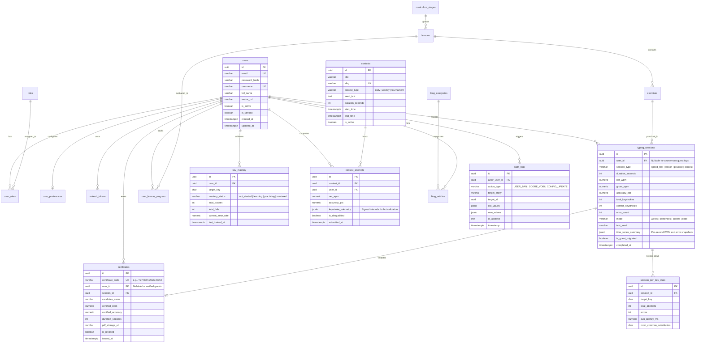

# Typing Typhon — Database Architecture & Entity Relationship Design

**Document Version:** 1.0.0  
**Status:** Approved Architectural Baseline  
**RDBMS:** PostgreSQL 16+  
**ORM / Migration Tool:** TypeORM or Prisma (Evaluated below)  
**Date:** October 2026  

---

## 1. Database Engine Rationale & Strategy

PostgreSQL 16+ is selected as the primary relational database for **Typing Typhon** based on:
1. **ACID Guarantees:** Essential for contest integrity, audit logging, and certification uniqueness.
2. **First-Class JSONB Support:** Allows hybrid relational data with flexible key diagnostic matrices and time-series keystroke interval logs without schema thrashing.
3. **Advanced Indexing:** Efficient indexing (B-Tree, Partial Indexes, GIN on JSONB) enabling fast leaderboard ranking and user history aggregations.
4. **Prisma / TypeORM Compatibility:** Native support for type-safe schema migrations and relational query building within NestJS.

---

## 2. Master Entity Relationship Diagram (ERD)



---

## 3. Data Domain Schemas & Specifications

### 3.1 Domain 1: Identity & Authorization
* **`users` Table:**
  * `id`: UUID (Primary Key, `gen_random_uuid()`).
  * `email`: VARCHAR(255), UNIQUE, indexed.
  * `password_hash`: VARCHAR(255), Nullable (for pure OAuth users).
  * `username`: VARCHAR(50), UNIQUE, indexed.
  * `created_at`, `updated_at`: TIMESTAMPTZ with default `CURRENT_TIMESTAMP`.
* **`roles` & `user_roles` Tables:**
  * Pre-seeded roles: `SuperAdmin`, `ContentEditor`, `ContestModerator`, `User`.
* **`user_preferences` Table:**
  * Stores theme, volume, caret style, auto-restart shortcuts, and notification preferences.

### 3.2 Domain 2: Typing Performance & History
* **`typing_sessions` Table:**
  * Captures every completed qualifying test.
  * `user_id`: UUID, foreign key referencing `users(id)`, `ON DELETE SET NULL`. If null, represents guest session record imported or temporarily logged.
  * `net_wpm`: NUMERIC(5,2) — e.g., `112.45`.
  * `gross_wpm`: NUMERIC(5,2).
  * `accuracy_pct`: NUMERIC(5,2) — e.g., `98.65`.
  * `time_series_summary`: JSONB — Compact array of `[{ s: 1, w: 65, e: 0 }, { s: 2, w: 72, e: 1 }, ...]`.
* **`session_per_key_stats` Table:**
  * Granular per-key breakdown of a session. Enables deep analytics without storing raw keystroke streams permanently.

### 3.3 Domain 3: Curriculum & Pedagogical Mastery
* **`curriculum_stages` Table:**
  * `id`: UUID, `order_index`: INT, `slug`: VARCHAR(100), `name`: VARCHAR(150), `description`: TEXT.
* **`lessons` Table:**
  * `stage_id`: UUID FK, `order_index`: INT, `title`: VARCHAR(150), `target_keys`: CHAR(1) ARRAY, `min_accuracy_threshold`: NUMERIC(4,2) DEFAULT 96.00.
* **`key_mastery` Table:**
  * Represents an aggregated view of a user's muscle memory across every individual keyboard key.
  * Unique constraint on `(user_id, target_key)`.

### 3.4 Domain 4: Certificates & Verification
* **`certificates` Table:**
  * `certificate_code`: VARCHAR(64) UNIQUE, indexed. Randomly generated, URL-safe cryptographic token (e.g., `TYPHON-2026-A8F9-BC31`).
  * `session_id`: UUID FK referencing the exact underlying `typing_sessions(id)`.
  * Public verification reads directly from this table without requiring user authentication.

### 3.5 Domain 5: Contests & Integrity
* **`contests` & `contest_attempts` Tables:**
  * Supports scheduled daily/weekly challenges with pre-determined text.
  * `keystroke_telemetry`: JSONB — Stores compressed inter-keystroke intervals (IKIs) for anti-cheat validation. Cleaned up after 30 days via background cron to conserve disk space.

---

## 4. Indexing & Optimization Strategy

```sql
-- Fast historical retrieval for user dashboards
CREATE INDEX idx_typing_sessions_user_completed 
ON typing_sessions (user_id, completed_at DESC);

-- Fast leaderboard querying for active contests
CREATE INDEX idx_contest_attempts_ranking 
ON contest_attempts (contest_id, net_wpm DESC, accuracy_pct DESC)
WHERE is_disqualified = FALSE;

-- Lightning-fast certificate code verification
CREATE UNIQUE INDEX idx_certificates_code 
ON certificates (certificate_code);

-- Rapid lookup for key mastery lookups
CREATE INDEX idx_key_mastery_user 
ON key_mastery (user_id, target_key);

-- GIN index for search within practice text tags
CREATE INDEX idx_practice_texts_tags 
ON practice_texts USING GIN (tags);
```

---

## 5. Guest Data vs. User Data Handling

| Characteristic | Guest User (Client-Side) | Registered User (Database) |
| :--- | :--- | :--- |
| **Primary Storage Engine** | Client IndexedDB (`typingtyphon_guest_db`) | PostgreSQL `typing_sessions` |
| **Max History Retained** | Last 50 completed sessions | Unlimited historical sessions |
| **Cross-Device Sync** | Not available (Device-local) | Seamless cloud sync |
| **Public Leaderboard Submission** | Excluded (Requires verified account) | Eligible with anti-cheat telemetry |
| **Certificate Persistence** | Local PDF download + Temporary UUID | Permanent URL + Dashboard Gallery |
| **Purge Trigger** | User clears browser storage / Cache reset | User executes GDPR account deletion |

---

## 6. Retention & GDPR Compliance Policies

1. **Right to be Forgotten (Account Deletion):**
   * Triggering account deletion triggers a transactional cascade:
     * User profile anonymized: `email = 'deleted_' || id || '@deleted.local'`, `username = 'deleted_user_' || id`.
     * `typing_sessions.user_id` set to `NULL` (preserving aggregate benchmark analytics while severing personal link).
     * `certificates` revoked or set to anonymized candidate name.
     * All refresh tokens revoked.
2. **Telemetry Log Pruning:**
   * Raw `keystroke_telemetry` JSONB records older than 30 days in `contest_attempts` are truncated via a nightly NestJS cron job to optimize storage footprints.
