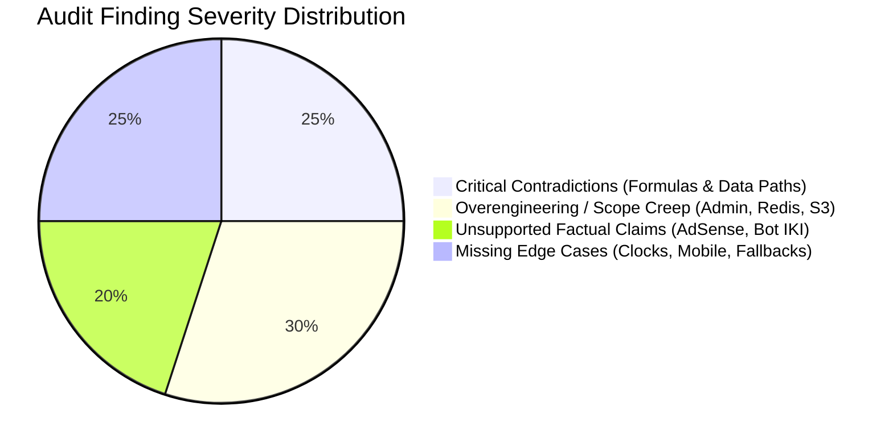

# Typing Typhon — Comprehensive Documentation Audit & Architectural Review

**Audit Version:** 1.0.0  
**Audit Date:** October 2026  
**Auditor:** Senior Product Architect, Systems Engineering & SEO Strategist  
**Scope:** Complete review of `/docs` (20 specifications) and repository landing indices.  

---

## 1. Executive Summary of Audit Findings

The initial documentation suite establishes an exceptionally detailed, well-structured, and forward-looking blueprint for **Typing Typhon**. The core values—**guest-first access, protected typing canvas, systematic alphabet curriculum, and an advertising-first monetization model**—are firmly embedded across the specifications.

However, a rigorous technical and business audit reveals **several critical contradictions, instances of premature overengineering, unsupported factual assertions, and ambiguous edge cases** that must be resolved prior to application scaffolding. 

---

## 2. Critical Contradictions & Behavioral Ambiguities

### 2.1 Contradiction 1: Typing Speed Metric Conventions & Real-Time Calculation
* **The Conflict:**
  * In [PROJECT_CONTEXT.md](file:///c:/Users/PC/Desktop/Karan%20Sir/typingtyphon/docs/PROJECT_CONTEXT.md#L143) (Section 6), WPM is described as:  
    $$\text{WPM} = \frac{\text{correct characters} / 5}{\text{elapsed minutes}}$$
  * In [TYPING_ENGINE_SPECIFICATION.md](file:///c:/Users/PC/Desktop/Karan%20Sir/typingtyphon/docs/TYPING_ENGINE_SPECIFICATION.md#L35) (Section 2), two different formulas are introduced:
    1. Standard Net WPM: $\frac{\text{Correct Keystrokes} / 5}{\text{Elapsed Minutes}}$
    2. Penalized Net WPM: $\frac{(\text{Correct Keystrokes} / 5) - \text{Uncorrected Errors}}{\text{Elapsed Minutes}}$
  * In [PRODUCT_REQUIREMENTS.md](file:///c:/Users/PC/Desktop/Karan%20Sir/typingtyphon/docs/PRODUCT_REQUIREMENTS.md#L30) (FR-1.5), the engine promises real-time rolling Gross WPM, Net WPM, and CPM.
* **The Architectural Issue:**
  * "Keystrokes" versus "Characters": If a user presses `Backspace` 10 times, did their *Keystrokes* increase? Under some typewriter rules, non-character keys do not count toward speed; under modern gaming engines (like Monkeytype), raw keystrokes include every physical keypress.
  * During an active test, what constitutes an "uncorrected error"? If a user is midway through typing a word, incomplete characters cannot be penalized as uncorrected errors until the word is submitted with a space or the timer terminates.
* **Audit Resolution & Correction:**
  * Adopt the definitive **Standardized Touch-Typing Convention**:
    * **1 Standard Word** $\equiv$ Exactly 5 characters.
    * **Gross WPM (Raw Velocity):** $\frac{\text{Total Input Characters Typed} / 5}{\text{Elapsed Minutes}}$ (Backspace keys are excluded from character count).
    * **Net WPM (Official Headline Metric):** $\max\left(0, \frac{\text{Correct Characters Typed} / 5}{\text{Elapsed Minutes}}\right)$.
    * **Post-Test Penalized WPM (Optional Competitive Metric):** Deducts 1 standard word per uncorrected error remaining in completed words at the instant the test expires.
    * **Real-time Live HUD Display:** Must display **Net WPM** calculated on completed characters to prevent disorienting score jumps mid-keystroke.

---

### 2.2 Contradiction 2: Certificate PDF Generation & Storage Architecture
* **The Conflict:**
  * [UI_UX_SPECIFICATION.md](file:///c:/Users/PC/Desktop/Karan%20Sir/typingtyphon/docs/UI_UX_SPECIFICATION.md#L187) and [USER_FLOWS.md](file:///c:/Users/PC/Desktop/Karan%20Sir/typingtyphon/docs/USER_FLOWS.md#L162) describe certificate generation as happening **client-side** via vector rendering / `@react-pdf/renderer` or direct print CSS, requiring zero server roundtrips.
  * Conversely, [TECHNICAL_ARCHITECTURE.md](file:///c:/Users/PC/Desktop/Karan%20Sir/typingtyphon/docs/TECHNICAL_ARCHITECTURE.md#L38), [DATABASE_DESIGN.md](file:///c:/Users/PC/Desktop/Karan%20Sir/typingtyphon/docs/DATABASE_DESIGN.md#L110), and [DEPLOYMENT_AND_DEVOPS.md](file:///c:/Users/PC/Desktop/Karan%20Sir/typingtyphon/docs/DEPLOYMENT_AND_DEVOPS.md#L30) introduce an external Object Storage tier (AWS S3 or Cloudflare R2), an asynchronous background job queue, and database column `pdf_storage_url`.
* **The Architectural Issue:**
  * Storing generated static PDF binary files in S3/R2 for free guest typing tests creates recurring cloud storage egress costs, requires background worker processes (BullMQ / Redis), and introduces cloud API failure points for an MVP.
* **Audit Resolution & Correction:**
  * **For MVP:** Certificates are generated **100% on the client** (using browser print stylesheets and vector HTML/Canvas export).
  * The backend stores **only the relational metadata and cryptographic verification record** in PostgreSQL (`candidate_name`, `wpm`, `accuracy`, `session_id`, `issued_at`, `verification_uuid`).
  * The public verification route `/verify/[certificateId]` dynamically renders the official credential card server-side (SSR) directly from PostgreSQL metadata, eliminating the need for S3/R2 object storage in Phase 1.

---

### 2.3 Contradiction 3: Redis Dependency in the MVP Tier
* **The Conflict:**
  * [TECHNICAL_ARCHITECTURE.md](file:///c:/Users/PC/Desktop/Karan%20Sir/typingtyphon/docs/TECHNICAL_ARCHITECTURE.md#L98) designates Redis 7 as a mandatory infrastructure component for caching, rate limiting, and contest tokens.
  * [PROJECT_ROADMAP.md](file:///c:/Users/PC/Desktop/Karan%20Sir/typingtyphon/docs/PROJECT_ROADMAP.md#L45) places Contests and Competitions in **Phase 3 (Weeks 10–12)**.
* **The Architectural Issue:**
  * Requiring Redis on Day 1 for Phase 1 MVP increases local Docker complexity, requires managed Redis provisioning on hosting platforms, and adds connection failure modes before any contest features exist.
  * In-memory caching and in-memory rate limiting (`@nestjs/throttler` in-memory storage) are more than sufficient for initial single-instance development and MVP launch.
* **Audit Resolution & Correction:**
  * **Defer Redis to Phase 3.** For Phase 1 and Phase 2, use NestJS native in-memory caching and standard in-memory rate limiting. Redis will be introduced strictly when distributed multi-node contest session synchronization is built.

---

## 3. Unsupported Factual Claims & Policy Realities

### 3.1 AdSense Policy Reality vs. "20–25 Mandatory Articles"
* **The Claim:** [ADSENSE_MONETIZATION.md](file:///c:/Users/PC/Desktop/Karan%20Sir/typingtyphon/docs/ADSENSE_MONETIZATION.md#L73) and [PROJECT_ROADMAP.md](file:///c:/Users/PC/Desktop/Karan%20Sir/typingtyphon/docs/PROJECT_ROADMAP.md#L83) assert that Google AdSense mandates a minimum of 20 to 25 published articles for approval.
* **Fact Check (Checked: October 2026; Google Publisher Policies & Search Essentials):**
  * Google **does not specify an arbitrary numerical article quota** (neither 20 nor 25).
  * Google’s actual requirement is that the site must possess **"sufficient unique, original content that provides substantial value to the user"**, with complete navigation, established user utility, and zero placeholder pages ("under construction" or scraped copy).
  * A utility-first platform with an interactive typing speed test, full alphabet curriculum, and 8–10 deeply researched, high-value educational guides can be approved, whereas a site with 30 thin, repetitive AI-generated articles will be summarily rejected for "Low-Value Content".
* **Audit Correction:**
  * Re-label the "25 articles" rule from a "Mandatory Policy Requirement" to an **"In-House Editorial Recommendation & Quality Baseline"**.
  * Focus on publishing 10–12 comprehensive, authoritative, human-edited cornerstone guides (ergonomics, home row mechanics, speed plateaus) rather than artificially racing to produce 25 low-density blog posts.

---

### 3.2 Anti-Cheat Telemetry: The Flaw in Fixed $\sigma_{\text{IKI}} < 5\text{ms}$ Rejections
* **The Claim:** [PRODUCT_REQUIREMENTS.md](file:///c:/Users/PC/Desktop/Karan%20Sir/typingtyphon/docs/PRODUCT_REQUIREMENTS.md#L78), [USER_FLOWS.md](file:///c:/Users/PC/Desktop/Karan%20Sir/typingtyphon/docs/USER_FLOWS.md#L143), and [TYPING_ENGINE_SPECIFICATION.md](file:///c:/Users/PC/Desktop/Karan%20Sir/typingtyphon/docs/TYPING_ENGINE_SPECIFICATION.md#L106) assert that any contest submission with an Inter-Keystroke Interval (IKI) standard deviation $< 5\text{ms}$ is an automated bot and must be rejected.
* **Scientific & Technical Flaw:**
  1. **False Positives:** Elite competitive typists typing familiar short common bigrams (e.g., `th`, `er`, `in`) frequently burst keypresses in mechanical intervals with very tight standard deviations. Rejecting real users based on a single arbitrary scalar metric causes catastrophic user trust loss.
  2. **Trivial Evasion:** Any junior script developer writing a typing bot can easily bypass this rule by adding random sleep intervals (e.g., `time.sleep(random.uniform(0.04, 0.12))`), which immediately yields a standard deviation $> 20\text{ms}$.
* **Audit Correction:**
  * Replace rigid rejection with a **Tiered Anomaly Flagging Model**:
    * **Plausibility Envelope:** Reject submissions with impossible physical human limits ($>280\text{ WPM}$ sustained over 60s, or duration anomalies where a 60s test is submitted in $<55\text{s}$).
    * **Suspicious Telemetry:** If standard deviation $< 5\text{ms}$ across the entire 60 seconds (statistically improbable across diverse finger reaches), do **not** publicly accuse or ban the user. Instead, flag the attempt as `needs_review` in the database and exclude it from the public top-10 leaderboard until confirmed.

---

## 4. Overengineering & Premature Complexity in the MVP

### 4.1 Granular 5-Role RBAC in the Admin Panel
* **The Bloat:** [ADMIN_PANEL_SPECIFICATION.md](file:///c:/Users/PC/Desktop/Karan%20Sir/typingtyphon/docs/ADMIN_PANEL_SPECIFICATION.md#L20) defines 5 distinct roles (`SuperAdmin`, `ContentEditor`, `SEOManager`, `ContestModerator`, `AnalyticsViewer`) with intricate permissions.
* **The Reality:** At launch, the team consists of the founder, a full-stack developer, and an SEO/content specialist. Engineering 5 separate permission guards, UI visibility filters, and permission-denied states slows down MVP velocity.
* **Audit Correction:**
  * Collapse MVP administration to **2 Roles**:
    1. `Admin` (Full access to metrics, curriculum, content, user moderation, and config).
    2. `User` (Standard typist account).
  * Additional roles (`Editor`, `Moderator`) can be introduced via database enum extension in Phase 3 when external staff or contractors are onboarded.

---

### 4.2 Custom Headless CMS for Blog & Content Management
* **The Bloat:** [ADMIN_PANEL_SPECIFICATION.md](file:///c:/Users/PC/Desktop/Karan%20Sir/typingtyphon/docs/ADMIN_PANEL_SPECIFICATION.md#L60) specifies a custom Markdown/MDX editor, live preview, word count tools, and blog publishing CMS inside the Admin Panel.
* **The Reality:** Building a custom web-based CMS in NestJS + Next.js requires weeks of engineering for rich text editing, asset uploads, revision histories, and schema validations.
* **Audit Correction:**
  * For MVP, adopt a **Git-Driven Content Workflow (Contentlayer or Next.js native MDX files in `/content/blog`)**.
  * Articles are authored in Markdown/MDX, stored in Git, previewed via standard Next.js local development, and published via Git commit.
  * The Admin Panel focuses strictly on runtime operational data: user status, contest moderation, and curriculum threshold tweaks.

---

## 5. Missing Acceptance Criteria & Edge Cases

The audit identified several operational edge cases that must be explicitly codified:

1. **Client Clock Skew in Guest Migration:**
   * *Problem:* A guest user’s device clock may be inaccurate or set to the past/future.
   * *Resolution:* When migrating guest sessions to the backend, the backend must assign `migrated_at = NOW()` and clamp `client_timestamp` to $\le \text{NOW}() + 60\text{ seconds}$.
2. **Mobile Viewport & Virtual Keyboard Shifting:**
   * *Problem:* On mobile devices, opening the on-screen keyboard shrinks the viewport height by 40–50%, frequently pushing the typing text out of view.
   * *Resolution:* The UI must implement CSS dynamic viewport units (`dvh`) and automatically scroll the typing canvas into the optical top third of the viewport whenever the input buffer is focused.
3. **Caps Lock & Non-Alphanumeric Key Handling:**
   * *Problem:* Pressing `CapsLock`, `Shift`, `Alt`, or function keys must not register as error keystrokes.
   * *Resolution:* The headless typing engine must explicitly ignore non-printable dead keys, while providing a clear visual badge: `"Caps Lock is ON"`.
4. **Test Pause Behavior:**
   * *Problem:* If a user presses `Esc` or leaves the browser tab, does the timer continue?
   * *Resolution:* For standardized speed benchmarks and competitive contests, **pausing is strictly prohibited** (switching tabs invalidates the test or lets the clock expire). For untimed beginner alphabet lessons, pausing is permitted.

---

## 6. Audit Verdict & Path Forward

The Typing Typhon specifications are fundamentally strong and pedagogically superior to competitors like Monkeytype (which lacks lessons) and Typing.com (which suffers from outdated UI and invasive ads).

By applying the corrections identified in this audit:
1. Mathematical conventions are unified across all documentation.
2. Unnecessary infrastructure (Redis, S3/R2) is removed from Phase 1.
3. The Admin Panel is simplified to focus on high-value operations.
4. Editorial and AdSense plans are aligned with verified Google policies.

The actionable revisions are codified in the companion deliverables:
* [`FOUNDER_DECISIONS.md`](file:///c:/Users/PC/Desktop/Karan%20Sir/typingtyphon/docs/FOUNDER_DECISIONS.md)
* [`MVP_SCOPE_FINAL.md`](file:///c:/Users/PC/Desktop/Karan%20Sir/typingtyphon/docs/MVP_SCOPE_FINAL.md)
* [`TEAM_DEPENDENCY_MATRIX.md`](file:///c:/Users/PC/Desktop/Karan%20Sir/typingtyphon/docs/TEAM_DEPENDENCY_MATRIX.md)
