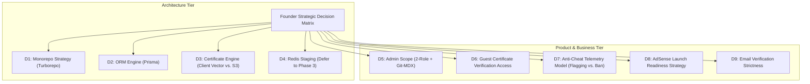

# Typing Typhon — Executive Decisions & Strategic Review

**Document Version:** 1.0.0  
**Status:** Prepared for Founder Sign-Off  
**Date:** October 2026  
**Target:** Technical Founder & Project Leadership  

---

## 1. Executive Summary & Purpose

Following the [DOCUMENTATION_AUDIT.md](file:///c:/Users/PC/Desktop/Karan%20Sir/typingtyphon/docs/DOCUMENTATION_AUDIT.md), this document formalizes the **9 strategic and architectural decisions** required before software development begins.

Each decision presents:
* **The Context & Trade-Off.**
* **The Competing Options.**
* **The Timeline & Financial Impact.**
* **The Recommended Default** (engineered for rapid time-to-market, low initial burn, and maximum product stability).

---

## 2. Decision Log & Recommendations

---

### Decision 1: Monorepo vs. Decoupled Dual Repositories
* **Context:** The frontend (Next.js) and backend (NestJS) share identical TypeScript DTOs, typing mathematical formulas, and validation rules.
* **Options:**
  * **Option A (Recommended): Turborepo Monorepo.**
    * Structure: `apps/web` (Next.js), `apps/api` (NestJS), `packages/shared-types` (DTOs, engine math, bigram dictionaries).
    * *Pros:* Zero API contract drift; atomic commits for full-stack features; single CI pipeline.
    * *Cons:* Requires initial Turborepo workspace configuration.
  * **Option B: Independent Dual Repositories.**
    * Structure: Separate Git repos `typingtyphon-web` and `typingtyphon-api`.
    * *Pros:* Isolated repository permissions.
    * *Cons:* Duplication of TypeScript interfaces; risk of frontend breaking when API DTOs change.
* **Timeline Impact:** Option A saves approximately 1.5 weeks of integration debugging.
* **Recommended Decision:** **Approve Option A (Turborepo Monorepo).**

---

### Decision 2: Relational Database ORM (Prisma vs. TypeORM vs. Drizzle)
* **Context:** The database is PostgreSQL 16. We need high developer velocity, type-safe migrations, and bulletproof relational querying.
* **Options:**
  * **Option A (Recommended): Prisma ORM.**
    * *Pros:* Declarative `schema.prisma`; auto-generated type-safe client; automated migration history; built-in Prisma Studio for easy database inspection.
    * *Cons:* Minor query engine memory overhead compared to raw SQL.
  * **Option B: TypeORM.**
    * *Pros:* Native NestJS decorator patterns.
    * *Cons:* Historical migration quirks; verbose repository boilerplate.
  * **Option C: Drizzle ORM.**
    * *Pros:* Lightweight, maximum raw execution speed.
    * *Cons:* Requires writing manual SQL-like joins; smaller ecosystem support in NestJS.
* **Recommended Decision:** **Approve Option A (Prisma ORM).**

---

### Decision 3: Certificate PDF Storage & Generation Architecture
* **Context:** Qualifying users can claim certificates. We must balance instant delivery with infrastructure costs.
* **Options:**
  * **Option A (Recommended): Client-Side Vector PDF + Cloud Relational Verification.**
    * PDF generated instantly in the user's browser using `@react-pdf/renderer` or high-resolution vector print stylesheets.
    * PostgreSQL stores only the metadata record and verification UUID.
    * Public URL `/verify/[code]` queries PostgreSQL and renders an official SSR verification card.
    * *Pros:* **$0 cloud storage egress cost**; zero server CPU load; instant client download; zero S3/R2 failure dependencies.
    * *Cons:* Requires solid browser print/canvas styling.
  * **Option B: Server-Side PDF Rendering + Cloudflare R2 / AWS S3 Storage.**
    * NestJS renders PDF via headless Puppeteer/Chromium, uploads binary to S3/R2, and saves public URL in the database.
    * *Pros:* Exact pixel-perfect server control.
    * *Cons:* High server memory footprint (Puppeteer); recurring cloud storage costs; background job queue required.
* **Recommended Decision:** **Approve Option A (Client-Side Vector + Relational Verification).**

---

### Decision 4: Caching & Rate Limiting Infrastructure (In-Memory vs. Redis)
* **Context:** The technical architecture proposed Redis 7 for caching and rate limiting.
* **Options:**
  * **Option A (Recommended): In-Memory for Phase 1 & 2; Introduce Redis in Phase 3.**
    * Use NestJS built-in cache manager and `@nestjs/throttler` in-memory storage for the MVP.
    * Introduce Redis only when daily scheduled contests and distributed multiplayer leaderboards are launched in Phase 3.
    * *Pros:* Simplifies local Docker development; eliminates $15–$30/mo managed Redis hosting costs in Phase 1; zero external network latency for cache hits.
    * *Cons:* Cache is instance-local during Phase 1.
  * **Option B: Provision Redis from Day 1.**
    * Deploy Redis container and managed cloud cluster immediately.
    * *Pros:* Ready for horizontal multi-instance scaling from launch.
    * *Cons:* Premature operational complexity for pre-traffic MVP.
* **Recommended Decision:** **Approve Option A (Stage Redis for Phase 3).**

---

### Decision 5: Admin Panel Scope & Content Publishing Workflow
* **Context:** We need administrative control over curriculum, users, and content without burning weeks building an oversized custom CMS.
* **Options:**
  * **Option A (Recommended): 2 RBAC Roles (`Admin`, `User`) + Git-Driven MDX for Blog.**
    * Blog articles and guides authored in MDX inside the repository (`/content/blog`).
    * Admin Panel focuses strictly on runtime data: User inspection/suspension, curriculum difficulty overrides, and contest moderation.
    * *Pros:* Cuts 3 weeks of custom CMS development; version-controlled content with full Git history and branch previews; zero database storage for articles.
    * *Cons:* Publishing a blog post requires a Git commit or merge.
  * **Option B: Full 5-Role RBAC + Custom In-Browser CMS Editor.**
    * Build web-based rich text editor, image upload manager, and 5 granular administrative permission tiers.
    * *Pros:* Non-technical staff can edit blog posts from a browser without Git.
    * *Cons:* High engineering cost; creates duplicate database tables for drafts, revisions, and assets.
* **Recommended Decision:** **Approve Option A (Pragmatic Admin + Git MDX).**

---

### Decision 6: Guest Certificate Access & Public Verification Rights
* **Context:** Certificates are viral growth drivers. How should guest access be treated?
* **Options:**
  * **Option A (Recommended): Dual-Tier Generosity.**
    * Unregistered guests can immediately download their printable PDF certificate with an active verification UUID.
    * The verification page `/verify/[code]` displays: *"Officially Verified Benchmark (Guest Session)"*.
    * To lock their permanent legal name, prevent UUID expiration, and add the credential to a permanent profile, they are invited to create a free account.
    * *Pros:* Maximum word-of-mouth virality; frictionless sharing on LinkedIn/resumes; natural incentive to register.
    * *Cons:* More guest records created in the database.
  * **Option B: Account-Gated Certificates.**
    * Tests are free, but claiming or viewing a certificate requires creating an account.
    * *Pros:* Higher forced conversion rate.
    * *Cons:* Adds friction and violates the guest-first product ethos.
* **Recommended Decision:** **Approve Option A (Dual-Tier Generosity).**

---

### Decision 7: Anti-Cheat & Contest Telemetry Architecture
* **Context:** Preventing script automation on daily challenges without falsely penalizing legitimate fast typists.
* **Options:**
  * **Option A (Recommended): Multi-Signal Anomaly Flagging (No Instant Bans).**
    * Submissions record inter-keystroke intervals (IKIs).
    * If physical impossibility thresholds are exceeded ($> 280\text{ WPM}$ or zero IKI variance across 60 seconds), the score is marked `flagged_for_review`.
    * Flagged scores are temporarily excluded from the public top 10 but the user is **not** banned or accused publicly.
    * *Pros:* Zero risk of public false accusations against elite typists; maintains competitive integrity.
    * *Cons:* Requires occasional moderator review for the top 3 leaderboard slots.
  * **Option B: Hard Rejection on Fixed Scalar Metric ($\sigma_{\text{IKI}} < 5\text{ms}$).**
    * Instantly return HTTP 422 and reject submission.
    * *Pros:* Fully automated.
    * *Cons:* High false-positive rate on rhythmic burst typists; easily bypassed by bots with basic jitter scripts.
* **Recommended Decision:** **Approve Option A (Multi-Signal Flagging).**

---

### Decision 8: Google AdSense Submission Strategy & Article Baseline
* **Context:** Maximizing the likelihood of AdSense approval on first submission while avoiding "Low-Value Content" rejections.
* **Options:**
  * **Option A (Recommended): Quality-First Milestone (10–12 High-Value Guides + Working Tools).**
    * Submit AdSense application after launching the interactive typing test, complete curriculum, and **10–12 deeply researched, authoritative educational guides** (covering ergonomics, home-row biomechanics, keyboard switches, and speed plateaus).
    * Ensure privacy policy, terms, contact page, and Google-certified CMP are fully operational.
    * *Pros:* High probability of first-pass approval; provides genuine value to readers; avoids spammy filler content.
    * *Cons:* Requires 2–3 weeks of focused editorial writing.
  * **Option B: Rush to 25 Articles via Generic Copy.**
    * Rapidly publish 25 short blog posts targeting keyword variations.
    * *Pros:* Hits the arbitrary 25-article threshold sooner.
    * *Cons:* High risk of Google rejecting the site for "Thin / Scraped Content".
* **Recommended Decision:** **Approve Option A (Quality-First Milestone).**

---

### Decision 9: Email Verification Policy for Registered Accounts
* **Context:** Onboarding user accounts while preventing spam registrations.
* **Options:**
  * **Option A (Recommended): Soft / Non-Blocking Email Verification.**
    * Users can immediately log in, sync local guest data, and practice.
    * An informational banner prompts them to verify their email. Only high-security actions (password change, account deletion) are blocked until verified.
    * *Pros:* Near-zero friction; preserves high guest-to-account conversion rates.
    * *Cons:* Requires periodic cleanup of unverified abandoned accounts after 90 days.
  * **Option B: Hard Email Verification Gate.**
    * User must click the email link before accessing their account.
    * *Pros:* Guarantees 100% verified email list.
    * *Cons:* Causes a 25–35% drop-off in user onboarding.
* **Recommended Decision:** **Approve Option A (Soft Verification).**

---

## 3. Summary of Recommended Decisions for Approval

| # | Strategic Area | Recommended Default | Estimated Impact |
| :-: | :--- | :--- | :--- |
| **D1** | **Repository Structure** | **Turborepo Monorepo** | Zero contract drift; unified CI pipeline. |
| **D2** | **Backend ORM** | **Prisma ORM** | Maximum developer velocity & type-safety. |
| **D3** | **Certificate Engine** | **Client Vector + Relational DB** | $0 cloud storage costs; sub-second exports. |
| **D4** | **Caching Tier** | **In-Memory MVP (Redis in Phase 3)** | Eliminates premature hosting costs & complexity. |
| **D5** | **Admin Scope** | **2 Roles (`Admin`, `User`) + Git MDX** | Cuts 3 weeks of custom CMS development. |
| **D6** | **Guest Certificates**| **Dual-Tier Access** | High virality & respectful conversion loop. |
| **D7** | **Anti-Cheat Model** | **Proportionate Multi-Signal Flagging**| Zero false-accusation public bans. |
| **D8** | **AdSense Strategy** | **10–12 Authoritative Cornerstone Guides**| Maximizes first-pass AdSense approval. |
| **D9** | **Email Verification** | **Soft / Non-Blocking Onboarding** | Minimizes drop-off; preserves guest momentum. |
