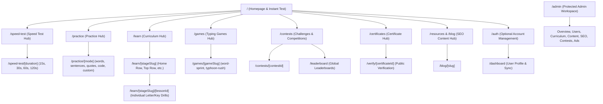
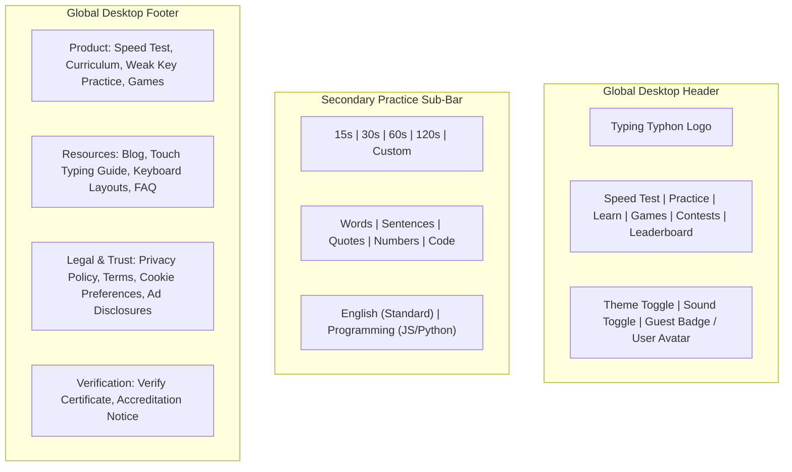

# Typing Typhon — Information Architecture & Route Inventory

**Document Version:** 1.0.0  
**Status:** Approved Architectural Baseline  
**Framework:** Next.js 15+ (App Router)  
**Date:** October 2026  

---

## 1. Information Architecture Overview

The information architecture of **Typing Typhon** is engineered to optimize two concurrent objectives:
1. **Frictionless Discovery for Users:** Instantaneous access to typing canvases, lessons, and diagnostics without navigational friction or authentication walls.
2. **Search Engine Indexability (SEO):** Clean, semantic URL hierarchies designed for crawl budget efficiency, programmatic keyword targeting, and rich snippet indexing.

---

## 2. Route Categorization & Taxonomy

To avoid architectural ambiguity, routes are classified into three distinct tiers:
* **Unique Page Template (UPT):** A distinct visual layout and component hierarchy requiring dedicated UI engineering.
* **Dynamic Route Instance (DRI):** Dynamic Next.js file routes (`[param]`) that hydrate the same underlying UPT using route parameters and server-rendered data.
* **Content Record (CR):** Database- or MDX-driven entries (e.g., individual blog articles, specific letter lessons) rendered through a single DRI.

| Metric | Count | Architectural Rationale |
| :--- | :--- | :--- |
| **Unique Page Templates (Frontend User)** | **18** | Reusable design templates covering all public, practice, and user flows. |
| **Unique Page Templates (Admin Panel)** | **6** | Distinct admin layouts (Dashboard, User Mgmt, Curriculum Editor, Content CMS, SEO Manager, Ad Settings). |
| **Public / Guest Static Routes** | **14** | Core discovery, legal, informational, and high-level hubs. |
| **Dynamic Routes (`[slug]` / `[id]`)** | **9** | Templated routes handling lessons, test presets, games, contests, certificates, and blog. |
| **Database Content Records (Initial)** | **100+** | 30+ alphabet lessons, 10 practice presets, 50+ blog/guide entries (sharing dynamic templates). |

---

## 3. Comprehensive Master Route Inventory

### Group A: Public & Educational Routes (Guest-First)

| Route Path | Template Type | Access Level | Primary SEO Intent / Query Target | Implementation Priority |
| :--- | :--- | :--- | :--- | :--- |
| `/` | UPT-1: Home / Fast Engine | Public (Guest) | "typing test", "typing speed test", "typing practice" | P0 (MVP Launch) |
| `/speed-test` | UPT-1: Fast Engine Preset | Public (Guest) | "wpm test", "online typing test" | P0 |
| `/speed-test/[duration]` | UPT-1 (e.g., `15s`, `60s`, `120s`) | Public (Guest) | "1 minute typing test", "30 second typing test" | P0 |
| `/results` (Client or `/results/[id]`) | UPT-2: Results & Analytics | Public (Guest) | Non-indexed for private runs; canonicalized | P0 |
| `/practice` | UPT-3: Practice Hub | Public (Guest) | "typing practice online", "touch typing practice" | P0 |
| `/practice/[mode]` | UPT-3 (words, sentences, quotes) | Public (Guest) | "quote typing test", "paragraph typing practice" | P0 |
| `/practice/code` | UPT-4: Code Syntax Typist | Public (Guest) | "coding typing practice", "typing test for programmers" | P1 |
| `/practice/custom` | UPT-3: Custom Text Input | Public (Guest) | "custom typing test" (Noindex) | P1 |
| `/learn` | UPT-5: Curriculum Overview | Public (Guest) | "touch typing lessons", "learn to type", "typing course" | P0 |
| `/learn/[stageSlug]` | UPT-5: Stage Directory | Public (Guest) | "home row typing lessons", "top row keyboard practice" | P0 |
| `/learn/[stageSlug]/[lessonId]` | UPT-6: Interactive Lesson | Public (Guest) | "learn letter f and j", "touch typing lesson 1" | P0 |
| `/guide/keyboard-layout` | UPT-7: Ergonomic Guide | Public (Guest) | "proper finger placement keyboard", "touch typing chart" | P1 |
| `/games` | UPT-8: Games Hub | Public (Guest) | "typing games", "fun typing games for adults" | P1 |
| `/games/[gameSlug]` | UPT-9: Game Canvas | Public (Guest) | "falling words typing game", "word sprint typing" | P1 |
| `/contests` | UPT-10: Contests Hub | Public (Guest) | "typing competitions", "typing challenges" | P2 |
| `/contests/[contestId]` | UPT-10: Contest Canvas | Public (Guest) | "daily typing challenge" | P2 |
| `/leaderboard` | UPT-11: Leaderboard View | Public (Guest) | "fastest typists in the world", "wpm leaderboard" | P1 |
| `/certificates` | UPT-12: Certificate Maker | Public (Guest) | "typing certificate online", "free typing speed certificate" | P0 |
| `/verify/[certificateId]` | UPT-13: Verification Card | Public (Guest) | Structured Data: `EducationalOccupationalCredential` | P0 |
| `/blog` | UPT-14: Editorial Directory | Public (Guest) | "typing blog", "keyboard switch guides", "wpm improvement" | P0 |
| `/blog/[slug]` | UPT-15: Editorial Post | Public (Guest) | Long-tail educational keywords (Article Schema) | P0 |
| `/about` | UPT-16: Static Information | Public (Guest) | Brand authority, author credentials, E-E-A-T signals | P0 |
| `/faq` | UPT-16: FAQ Accordion | Public (Guest) | "typing test FAQ", FAQPage Schema | P0 |
| `/contact` | UPT-16: Contact Form | Public (Guest) | User feedback, partnership inquiries | P0 |
| `/privacy-policy` | UPT-17: Legal Document | Public (Guest) | Legal compliance, AdSense requirement | P0 |
| `/terms` | UPT-17: Legal Document | Public (Guest) | Legal protection, acceptable use | P0 |
| `/cookie-preferences` | Modal / Tab on UPT-17 | Public (Guest) | GDPR/ePrivacy/CCPA consent compliance | P0 |
| `/_not-found` (404) | UPT-18: Custom 404 | Public (Guest) | Helpful navigation redirection | P0 |

---

### Group B: Registered User Routes (Authenticated)

| Route Path | Template Type | Access Level | Primary Functionality | Implementation Priority |
| :--- | :--- | :--- | :--- | :--- |
| `/auth/signin` | Auth Card Template | Guest Only | Email/password login, Google/GitHub OAuth | P0 |
| `/auth/signup` | Auth Card Template | Guest Only | Instant registration, guest data merge notice | P0 |
| `/auth/forgot-password` | Auth Card Template | Guest Only | Password reset token request | P0 |
| `/auth/reset-password` | Auth Card Template | Guest Only | Secure token consumption and credential update | P0 |
| `/dashboard` | UPT-19: User Dashboard | Authenticated | Aggregate statistics, WPM progress chart, streak tracker | P0 |
| `/dashboard/history` | UPT-19 (Sub-tab) | Authenticated | Infinite scroll list of all completed tests with filters | P0 |
| `/dashboard/weak-keys` | UPT-19 (Sub-tab) | Authenticated | Heatmap, error-by-key breakdown, recommended drills | P1 |
| `/dashboard/certificates` | UPT-19 (Sub-tab) | Authenticated | Gallery of earned typing certificates with PDF downloads | P0 |
| `/dashboard/settings` | UPT-20: User Settings | Authenticated | Profile info, theme, sound toggles, data export/delete | P0 |

---

### Group C: Protected Administrative Routes

*Access restricted strictly to authenticated users holding roles `SuperAdmin`, `ContentEditor`, `ContestModerator`, or `Auditor` via NestJS Guard.*

| Route Path | Admin Template | Permitted Roles | Core Responsibilities | Priority |
| :--- | :--- | :--- | :--- | :--- |
| `/admin` | Admin-1: Overview | All Admin Roles | High-level metrics, active users, test volume, error logs | P1 |
| `/admin/users` | Admin-2: User Directory | SuperAdmin, Moderator | Search, inspect metadata, ban/suspend, process GDPR deletions | P1 |
| `/admin/curriculum` | Admin-3: Lesson Studio | SuperAdmin, ContentEditor | CRUD on stages, lessons, exercises, mastery thresholds | P1 |
| `/admin/practice-content` | Admin-4: Content Manager | SuperAdmin, ContentEditor | Word sets, sentence corpora, quotes attribution, code snippets | P1 |
| `/admin/blog` | Admin-4: Blog CMS | SuperAdmin, ContentEditor | Draft, publish, schedule blog articles and markdown assets | P1 |
| `/admin/contests` | Admin-5: Contest Studio | SuperAdmin, Moderator | Create daily/weekly challenges, inspect flagged suspicious scores | P2 |
| `/admin/ads` | Admin-6: Ad Placements | SuperAdmin | Toggle ad slot identifiers, audit protected viewport rules | P1 |
| `/admin/audit-logs` | Admin-1 (Sub-view) | SuperAdmin, Auditor | Read-only ledger of administrative actions and config updates | P1 |

---

## 4. Navigation & Viewport Hierarchy

### 4.1 Header Layout
* **Left:** SVG Monogram + Wordmark `Typing Typhon` (links to `/`).
* **Center Navigation:** Speed Test, Practice (Dropdown: Words, Sentences, Quotes, Code), Learn, Games, Leaderboard.
* **Right Control Cluster:**
  * Quick Settings (Sound volume, Caret style, Keyboard layout).
  * Theme switcher (Dark / Light / OLED / Cyberpunk).
  * State Badge:
    * *Guest:* Shows flame icon with local streak count + button `[Sign In]`.
    * *Authenticated:* Displays user avatar with dropdown (Dashboard, Saved Tests, Certificates, Settings, Logout).

### 4.2 Practice Sub-Navigation (Sticky under Header during Practice)
* Mode tabs: `Words`, `Sentences`, `Quotes`, `Numbers`, `Code`, `Custom`.
* Duration pills: `15`, `30`, `60`, `120`.
* Test action pills: Punctuation toggle `(!#)`, Numbers toggle `(123)`, Quick Restart icon.

### 4.3 Mobile Viewport Strategy (<768px)
* Mobile bottom bar navigation: `[Test]`, `[Learn]`, `[Practice]`, `[Menu]`.
* Dedicated mobile keyboard notice: If virtual keyboard opens, UI auto-scrolls typing canvas into primary view with minimum 50vh height buffer to preserve focus.
