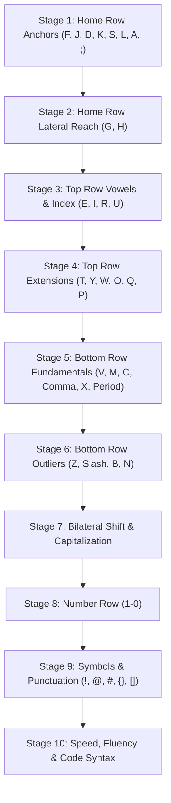
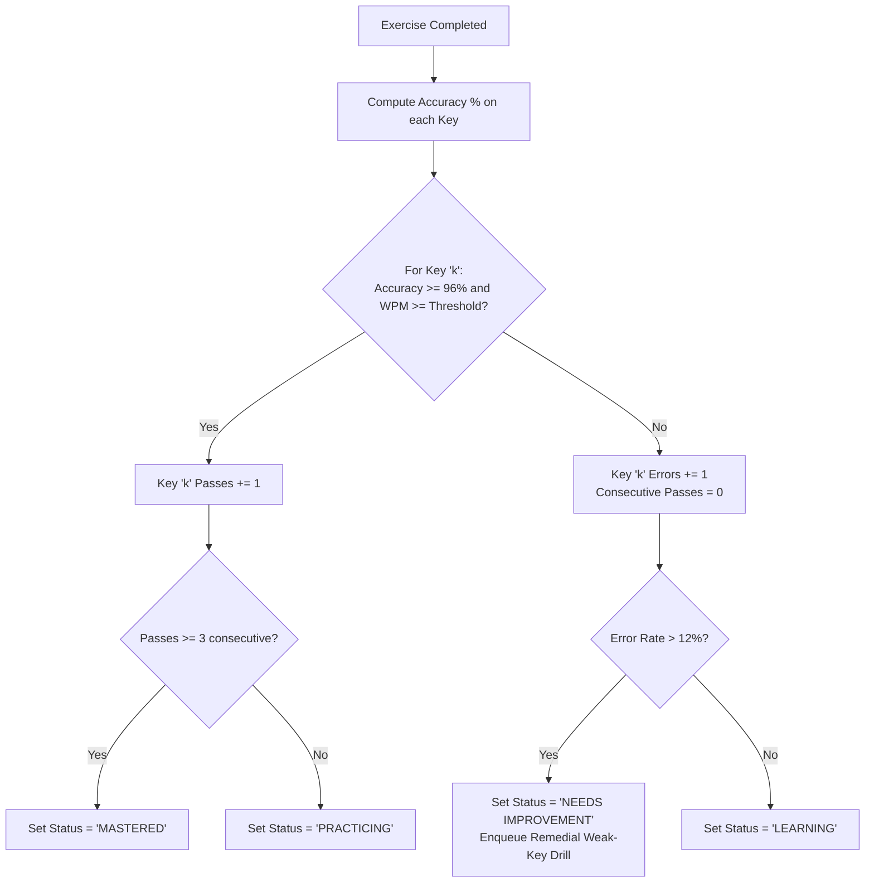

# Typing Typhon — Alphabet-by-Alphabet Touch-Typing Curriculum

**Document Version:** 1.0.0  
**Status:** Approved Pedagogical Baseline  
**Keyboard Standard:** ANSI QWERTY (Extendable to ISO, Dvorak, Colemak)  
**Date:** October 2026  

---

## 1. Pedagogical Philosophy & Motor Skill Acquisition

Touch typing is not an intellectual memorization task; it is **neuromuscular motor programming (muscle memory)**. 

Teaching letters in alphabetical order ($A, B, C \dots Z$) is pedagogically counterproductive because it forces awkward, cross-row finger leaps before hand stabilization has occurred. 

**Typing Typhon’s Curriculum Principles:**
1. **The Home Row Anchor:** The fingers must always return to the baseline resting position ($A, S, D, F$ for the left hand; $J, K, L, ;$ for the right hand).
2. **Radial Finger Reach:** Every key outside the home row is introduced as a specific directional reach (upward, downward, or lateral) from an established anchor finger.
3. **Dual-Key Bilateral Introduction:** Keys are introduced in symmetrical left/right finger pairs (e.g., $F$ and $J$ for index fingers, $D$ and $K$ for middle fingers).
4. **Immediate Word Synthesis:** The moment a new key is learned, it is integrated into authentic words composed exclusively of previously mastered letters.
5. **Opposite-Hand Shift Rule:** Capitalization of left-hand letters must use the Right Shift key; capitalization of right-hand letters must use the Left Shift key.

---

## 2. Progressive Curriculum Matrix (Stages 1–10)

### Stage 1: Home Row Anchors & Resting Position
* **Prerequisite:** Keyboard orientation & posture overview.
* **Finger Anchors:** Left Hand: Pinky ($A$), Ring ($S$), Middle ($D$), Index ($F$). Right Hand: Index ($J$), Middle ($K$), Ring ($L$), Pinky ($;$). Thumbs: Spacebar.

| Lesson ID | Keys Introduced | Hand / Finger Assignment | Sample Introductory Drill | Target Words Synthesized | Pass Threshold |
| :--- | :--- | :--- | :--- | :--- | :--- |
| **L1.1** | `F` & `J` | Left Index / Right Index (Tactile Bumps) | `fff jjj fjf jfj ff jj fff jjj` | (Foundational rhythm) | $\ge 96\%$ Acc, $\ge 15$ WPM |
| **L1.2** | `D` & `K` | Left Middle / Right Middle | `ddd kkk dkd kdk fdf jkj fdkj` | (Hand coordination) | $\ge 96\%$ Acc, $\ge 15$ WPM |
| **L1.3** | `S` & `L` | Left Ring / Right Ring | `sss lll sls lsl sld ldk skfl` | (Independent ring motor) | $\ge 96\%$ Acc, $\ge 15$ WPM |
| **L1.4** | `A` & `;` | Left Pinky / Right Pinky | `aaa ;;; a;a ;a; asdf jkl; a;` | `all`, `ask`, `alas` | $\ge 96\%$ Acc, $\ge 15$ WPM |
| **L1.5** | Home Row Review | Full 8 Fingers + Spacebar | `asdf jkl; a fad dad fall salad flask` | `fad`, `dad`, `fall`, `salad`, `flask` | $\ge 96\%$ Acc, $\ge 20$ WPM |

---

### Stage 2: Home Row Lateral Reach
* **Concept:** Index fingers reach horizontally inward to strike $G$ and $H$, then instantly snap back to $F$ and $J$.

| Lesson ID | Keys Introduced | Hand / Finger Assignment | Sample Introductory Drill | Target Words Synthesized | Pass Threshold |
| :--- | :--- | :--- | :--- | :--- | :--- |
| **L2.1** | `G` & `H` | Left Index reach / Right Index reach | `fgf jhj ghg hgh fgh jhg flag glad` | `glad`, `half`, `shall`, `glass`, `dash` | $\ge 96\%$ Acc, $\ge 20$ WPM |
| **L2.2** | Home Row Fluency | Complete 10 Home Row Keys | `a gala dad had a flash; glad lads fall`| Natural sentences from 10 keys | $\ge 96\%$ Acc, $\ge 25$ WPM |

---

### Stage 3: Top Row High-Frequency Keys
* **Concept:** Upward diagonal reaches to frequent vowels and consonants.

| Lesson ID | Keys Introduced | Hand / Finger Assignment | Sample Introductory Drill | Target Words Synthesized | Pass Threshold |
| :--- | :--- | :--- | :--- | :--- | :--- |
| **L3.1** | `E` & `I` | Left Middle (Up) / Right Middle (Up) | `ded kik ede iki die kid life side feed` | `feed`, `seed`, `hide`, `silk`, `file` | $\ge 96\%$ Acc, $\ge 22$ WPM |
| **L3.2** | `R` & `U` | Left Index (Up) / Right Index (Up) | `frf juj rur uru fur run red jar sure` | `fur`, `run`, `red`, `user`, `surf`, `fire` | $\ge 96\%$ Acc, $\ge 22$ WPM |
| **L3.3** | Top Row Vowel Words| Combined $E, I, R, U$ + Home Row | `the red fur is dry; a kid had a ruler` | Full contextual sentences | $\ge 96\%$ Acc, $\ge 25$ WPM |

---

### Stage 4: Top Row Extensions & Peripherals
* **Keys Introduced:** `T`, `Y` (Index reaches up-inward), `W`, `O` (Ring fingers up), `Q`, `P` (Pinky fingers up).

| Lesson ID | Keys Introduced | Hand / Finger Assignment | Sample Words | Pass Threshold |
| :--- | :--- | :--- | :--- | :--- |
| **L4.1** | `T` & `Y` | Left Index / Right Index | `try`, `that`, `they`, `year`, `city`, `stay` | $\ge 96\%$ Acc, $\ge 25$ WPM |
| **L4.2** | `W` & `O` | Left Ring / Right Ring | `who`, `word`, `flow`, `wood`, `slow`, `grow` | $\ge 96\%$ Acc, $\ge 25$ WPM |
| **L4.3** | `Q` & `P` | Left Pinky / Right Pinky | `quit`, `quick`, `play`, `drop`, `hope`, `keep` | $\ge 96\%$ Acc, $\ge 25$ WPM |

---

### Stage 5: Bottom Row Fundamentals
* **Keys Introduced:** `V`, `M` (Index downward), `C`, `,` (Middle downward), `X`, `.` (Ring downward).

| Lesson ID | Keys Introduced | Hand / Finger Assignment | Sample Words | Pass Threshold |
| :--- | :--- | :--- | :--- | :--- |
| **L5.1** | `V` & `M` | Left Index / Right Index | `view`, `move`, `more`, `make`, `save`, `time` | $\ge 96\%$ Acc, $\ge 25$ WPM |
| **L5.2** | `C` & `,` | Left Middle / Right Middle | `cat`, `face`, `come`, `call, calm, cold,` | $\ge 96\%$ Acc, $\ge 25$ WPM |
| **L5.3** | `X` & `.` | Left Ring / Right Ring | `six`, `next`, `text`, `box. fix. axe.` | $\ge 96\%$ Acc, $\ge 25$ WPM |

---

### Stage 6: Bottom Row Outliers
* **Keys Introduced:** `Z` (Left Pinky down), `/` (Right Pinky down), `B` (Left Index extended reach), `N` (Right Index reach).

| Lesson ID | Keys Introduced | Hand / Finger Assignment | Sample Words | Pass Threshold |
| :--- | :--- | :--- | :--- | :--- |
| **L6.1** | `B` & `N` | Left Index / Right Index | `book`, `best`, `nine`, `born`, `bank`, `band` | $\ge 96\%$ Acc, $\ge 28$ WPM |
| **L6.2** | `Z` & `? /` | Left Pinky / Right Pinky | `zone`, `zero`, `size`, `quiz`, `and/or`, `yes?`| $\ge 96\%$ Acc, $\ge 28$ WPM |
| **L6.3** | 26-Letter Alphabet Mastery | All 26 letters in pangrams | `The quick brown fox jumps over the lazy dog.` | $\ge 97\%$ Acc, $\ge 35$ WPM |

---

### Stage 7 to Stage 10: Advanced Mastery
* **Stage 7 (Capitalization & Shift):** Bilateral shift coordination drills (Left shift held for right-side characters; Right shift held for left-side characters).
* **Stage 8 (Numbers 0–9):** Upward reaches from home row to number row ($1 \dots 5$ left hand, $6 \dots 0$ right hand).
* **Stage 9 (Symbols & Punctuation):** Shift + Number keys (`!`, `@`, `#`, `$`, `%`, `^`, `&`, `*`, `(`, `)`), Braces (`{`, `}`, `[`, `]`), and Math symbols (`+`, `=`, `<>`).
* **Stage 10 (Specialized Code Typist):** Programming syntax drills (CamelCase, snake_case, indentation, markdown, SQL queries).

---

## 3. Dynamic Key Mastery & Remedial Algorithm

### 3.1 Key Mastery States
1. **`NOT_STARTED`:** User has not yet encountered this key in the curriculum.
2. **`LEARNING`:** Introduced in current lesson; has completed $< 3$ successful sessions.
3. **`PRACTICING`:** Passing accuracy achieved, but lacks speed or long-term consistency.
4. **`NEEDS_IMPROVEMENT`:** Accuracy on this specific key dropped below $88\%$ or latency exceeds $2.5\times$ user mean.
5. **`MASTERED`:** $\ge 3$ consecutive sessions with $\ge 96\%$ accuracy and target WPM met.

### 3.2 Deterministic Drill Synthesis (No AI Needed)
When a user requests a "Weak-Key Drill" or triggers remedial training for key $K$:
1. Query the bigram frequency dictionary for English words containing $K$ paired with home-row anchors (e.g., if $K = 'b'$, select bigrams `be`, `bl`, `br`, `ab`, `ob`).
2. Generate a 20-word exercise prioritizing words with high $K$-density: e.g., `"bubble table branch habit double rabbit blank sober balance robust"`.
3. Evaluate the drill and update key latency and accuracy metrics.
