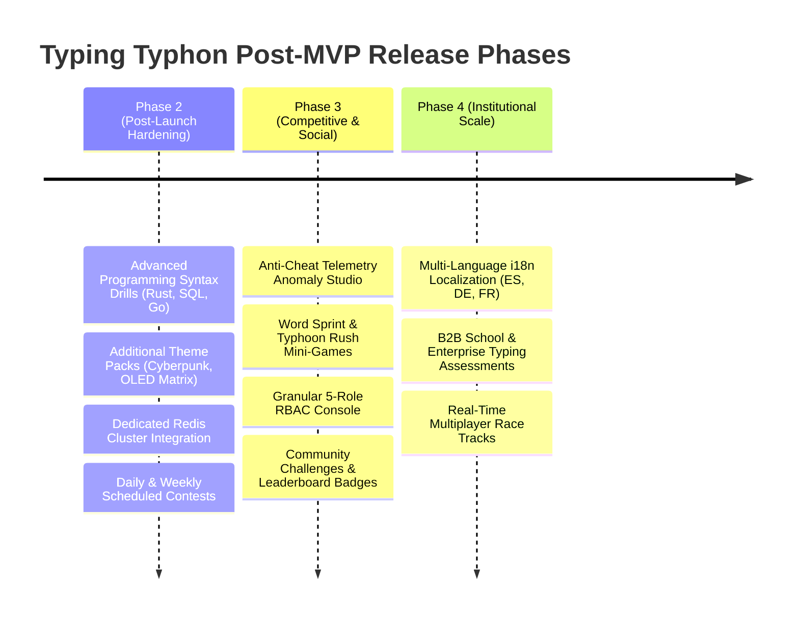

# Typing Typhon — Final Approved MVP Scope & Feature Boundary

**Document Version:** 1.0.0  
**Status:** Hardened Specification Baseline  
**Date:** October 2026  
**Target Release:** Phase 1 Launch Baseline  

---

## 1. Scope Boundary Philosophy

The objective of the **Typing Typhon MVP** is to launch a fast, beautiful, search-indexed, and pedagogically superior touch-typing platform that delivers immediate value to guests, provides seamless cloud upgrade paths, and fulfills all requirements for Google AdSense compliance.

Features that do not directly contribute to **user value, muscle-memory learning, search acquisition, or monetization readiness** are strictly deferred to post-launch milestones.

```mermaid
graph TD
    subgraph Core MVP (Launch Baseline)
        Canvas["High-Performance Typing Canvas (<16ms)"]
        Curriculum["26-Letter Curriculum (Stages 1-6) + Virtual Hands"]
        GuestIDB["Guest IndexedDB Storage (Last 50 Sessions)"]
        Auth["Optional Auth (Argon2id + Google OAuth)"]
        Migrate["Guest-to-Cloud Data Migration"]
        Certs["Verifiable Certificates (Client Vector + Public UUID)"]
        SEO["Technical SEO Hubs & 10-12 Pillar Guides (MDX)"]
        AdSense["Protected Viewport Ad Containers + CMP + ads.txt"]
        Admin["Pragmatic Admin Dashboard (User & Config)"]
    end

    subgraph Deferred to Post-MVP
        Multiplayer["Real-time WebSocket Racing"]
        S3PDF["Server-Side Puppeteer / S3 PDF Storage"]
        RedisCluster["Dedicated Redis Cluster (In-memory used for MVP)"]
        ComplexRBAC["5 Granular Admin Roles (Admin + User used for MVP)"]
        CMSBuilder["Custom In-Browser MDX Editor (Git MDX used for MVP)"]
        i18n["Multi-Language Localization"]
        Paywalls["Paid Subscriptions / Paywalls (Strictly Excluded)"]
    end

    Core MVP -.->|Post-Validation Expansion| Deferred to Post-MVP
```

---

## 2. In-Scope MVP Features & Deliverables

### 2.1 The Protected Typing Engine
* **Modes:**
  * Timed Speed Tests: `15s`, `30s`, `60s`, `120s`.
  * Text Variations: Words (English 200, 1k frequency sets), Sentences, Quotes, and Numbers/Punctuation.
* **Deterministic Calculations:**
  * Gross WPM, Net WPM (headline metric), Accuracy %, Error Count, and Character Breakdown.
  * Real-time rolling calculations updated on character submission.
  * 1-second interval time-series sampling for post-test velocity graphs.
* **Input Physics & Ergonomics:**
  * Sub-16ms keystroke feedback.
  * Standard backspace, word delete (`Ctrl+Backspace`), and strict confidence mode.
  * Hidden auto-focused input buffer; caps lock detection banner.
  * Visual caret with configurable smooth transitions.
  * Strict $120\text{px}$ zero-ad buffer zone around canvas.

### 2.2 Complete Alphabet Touch-Typing Curriculum (Stages 1–6)
* Complete 26-letter pedagogical sequence:
  * **Stage 1:** Home Row Anchors ($F, J, D, K, S, L, A, ;$).
  * **Stage 2:** Home Row Lateral Reaches ($G, H$).
  * **Stage 3:** Top Row Vowels & High-Frequency Consonants ($E, I, R, U$).
  * **Stage 4:** Top Row Extensions ($T, Y, W, O, Q, P$).
  * **Stage 5:** Bottom Row Fundamentals ($V, M, C, \text{comma}, X, \text{period}$).
  * **Stage 6:** Bottom Row Outliers ($Z, \text{slash}, B, N$).
* Interactive Virtual Keyboard:
  * Dynamic finger-to-key color coding (Index, Middle, Ring, Pinky).
  * Ergonomic hand silhouette overlay indicating which finger to strike.
* Mastery Engine:
  * 3 consecutive exercises with $\ge 96\%$ accuracy and target WPM to achieve `Mastered` status.
  * Deterministic weak-key drill synthesis targeting problem bigrams.

### 2.3 Guest Storage & Cloud Migration
* Client-Side IndexedDB (`typingtyphon_guest_db`):
  * Stores up to 50 historical sessions with full metrics.
  * Retains key mastery dictionary and UI theme/sound preferences.
  * Provides a one-click local storage wipe button.
* Contextual Registration Invitation:
  * Displayed on the results screen after 5 completed sessions; non-blocking with "Maybe Later".
* Cloud Migration Pipeline:
  * On registration/login, checks IndexedDB for un-migrated sessions.
  * Server-side plausibility validation (speed $\le 280\text{ WPM}$, duration integrity).
  * Deduplication via `SHA-256(timestamp + duration + textSeed)`.
  * Safe migration toast notification.

### 2.4 User Accounts & Cloud Dashboard
* Optional Registration:
  * Email/Password with Argon2id hashing.
  * Google OAuth2 authentication.
  * Soft/non-blocking email verification.
  * Secure HTTP-only JWT cookies (15-minute access, 30-day rotating refresh tokens).
* Authenticated Dashboard:
  * Lifetime tests completed, cumulative time practiced, average WPM, personal best.
  * Interactive progress chart showing WPM progression over time.
  * Weak-key diagnostic keyboard heatmap.
  * Saved certificates gallery.

### 2.5 Verifiable Certificates
* Qualifying Criteria: Completed standard 60-second or 120-second test with $\ge 40\text{ WPM}$ and $\ge 95\%$ accuracy.
* Generation: High-resolution client-side vector printable PDF export (using `@react-pdf/renderer` or print stylesheet).
* Verification: Unique UUID stored in PostgreSQL; public verification URL `/verify/[code]` rendering SSR candidate credential card.

### 2.6 Technical SEO & Content Engine
* Server-Side Rendering (SSR) & Static Site Generation (SSG) in Next.js 15+ App Router.
* Programmatic Landing Hubs:
  * `/speed-test/[duration]` (`15s`, `30s`, `60s`, `120s`).
  * `/practice/[mode]` (`words`, `sentences`, `quotes`, `numbers`).
  * `/learn/[stageSlug]` (Stages 1 through 6).
* 10–12 High-Value Educational Cornerstone Guides authored in Git-driven MDX (`/content/blog`).
* Automated XML Sitemaps (`sitemap-core.xml`, `sitemap-speed-test.xml`, `sitemap-curriculum.xml`, `sitemap-blog.xml`).
* Full Schema.org JSON-LD Structured Data:
  * `WebSite`, `Course`, `EducationalOccupationalCredential`, `Article`, `FAQPage`, `BreadcrumbList`.

### 2.7 Advertising & Google AdSense Readiness
* Ad Container Layouts:
  * Post-Test Results Ad (728x90 desktop / 300x250 mobile) rendered *after* test completion.
  * Blog Article Sidebar (300x600) and in-article display units.
  * Curriculum Directory Header Banner (728x90) on `/learn` hub.
  * Zero ads within $120\text{px}$ of active typing canvas.
* Policy Compliance Suite:
  * `ads.txt` statically served at root.
  * Google-certified Consent Management Platform (CMP) integration.
  * Complete legal suite: Privacy Policy (with AdSense/DART disclosures), Terms of Service, About, Contact, FAQ.

### 2.8 Pragmatic Admin Console (`/admin`)
* Access restricted to `Admin` role via NestJS Guards.
* Core Operations:
  * Metrics Overview (Total users, tests completed today, guest/user ratio).
  * User Directory (Search, inspect account, suspend/unsuspend, process GDPR deletion).
  * Curriculum Configuration (Adjust pass accuracy thresholds and target WPM per stage).
  * Ad Placements Kill-Switch (Instantly suppress ad containers across the platform).

---

## 3. Explicitly Deferred Features (Post-MVP Roadmap)



1. **Paid Subscriptions / Paywalls:** Strictly excluded from the MVP. Core practice remains 100% free.
2. **Dedicated Redis Cluster:** In-memory caching and throttler handle Phase 1; Redis introduced in Phase 2/3 for contests.
3. **Cloud Object Storage (S3/R2) for PDFs:** Vector PDFs generated client-side; verification handled relationally via PostgreSQL.
4. **Custom In-Browser Headless CMS:** Content authored and version-controlled via Git-driven MDX files.
5. **Real-Time Multiplayer WebSockets:** Racing games deferred until single-player foundation and audience are established.
6. **Multi-Language Localization (i18n):** Architecture is locale-ready, but initial launch is English-only.

---

## 4. MVP Launch Acceptance Gates (Definition of Done)

The MVP is ready for public deployment and Google AdSense application only when:

1. **Performance Gate:** Lighthouse Performance Score $\ge 95/100$, Largest Contentful Paint (LCP) $\le 1.8\text{s}$, Cumulative Layout Shift (CLS) $\le 0.01$, and Interaction to Next Paint (INP) $\le 100\text{ms}$.
2. **Keystroke Gate:** Keystroke input-to-DOM render latency $\le 16\text{ms}$ sustained with zero perceptible stutter on low-end hardware.
3. **Guest Integrity Gate:** A visitor can complete 5 tests, review local analytics, navigate lessons, close the browser, return, and find all records intact in IndexedDB.
4. **Migration Gate:** A guest with 10 local sessions signs up via Google OAuth and seamlessly merges all records into their PostgreSQL cloud account without duplicates or data corruption.
5. **SEO & Crawlability Gate:** 100% of static landing pages, presets, and curriculum stages render semantic HTML with valid JSON-LD schemas and unique self-canonical URLs.
6. **Policy & AdSense Gate:** Complete Privacy Policy, Terms, Contact, About, and 10+ published cornerstone articles live with a verified `ads.txt` file and operational CMP consent banner.
