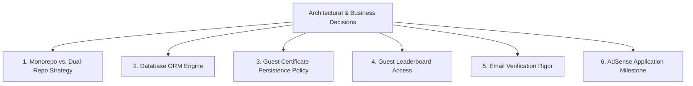
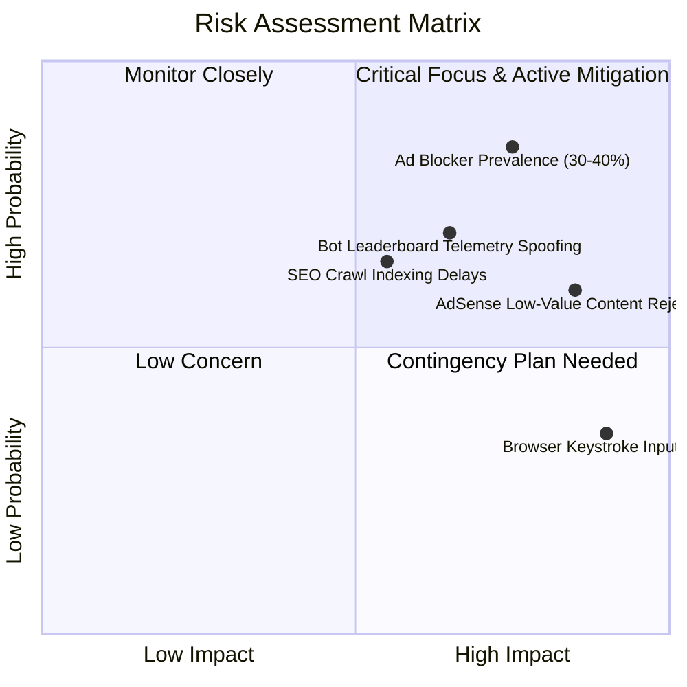

# Typing Typhon — Open Questions, Strategic Decisions & Risk Matrix

**Document Version:** 1.0.0  
**Status:** Awaiting Executive / Founder Sign-Off  
**Date:** October 2026  

---

## 1. Decisions Requiring Founder / Technical Lead Approval

---

### Decision 1: Monorepo (Turborepo) vs. Dual-Repository Structure
* **Context:** The frontend (Next.js) and backend (NestJS) share common TypeScript DTOs, typing mathematical formulas, and validation constraints.
* **Option A (Recommended): Turborepo Monorepo.**
  * *Structure:* Single Git repo with `apps/web` (Next.js), `apps/api` (NestJS), and `packages/contracts` (Shared DTOs & math).
  * *Pros:* Zero contract drift between frontend and backend; single CI pipeline; atomic commits for full-stack features.
  * *Cons:* Requires slightly more upfront monorepo tooling configuration.
* **Option B: Decoupled Dual Repositories.**
  * *Structure:* `typingtyphon-frontend` and `typingtyphon-backend`.
  * *Pros:* Complete isolation of deployment pipelines.
  * *Cons:* Risk of contract drift or redundant TypeScript interfaces.
* **Recommended Default:** **Option A (Turborepo Monorepo).**

---

### Decision 2: Backend ORM Framework (Prisma vs. TypeORM vs. Drizzle)
* **Option A (Recommended): Prisma ORM.**
  * *Pros:* Declarative schema file (`schema.prisma`), automated type generation, bulletproof migrations, intuitive query syntax.
  * *Cons:* Minor query engine memory overhead compared to raw SQL.
* **Option B: TypeORM.**
  * *Pros:* Deep native integration with NestJS decorators and repository pattern.
  * *Cons:* Complex migration management and past maintenance stability quirks.
* **Option C: Drizzle ORM.**
  * *Pros:* Ultra-lightweight, maximum performance.
  * *Cons:* Less standardized documentation within large NestJS enterprise patterns.
* **Recommended Default:** **Option A (Prisma ORM).**

---

### Decision 3: Guest Certificate Generation Policy
* **Option A (Recommended): Dual Tier Certificate Access.**
  * Guests can generate and download printable PDF certificates locally with a temporary verification UUID. However, permanent cloud verification indexing and public profile links explicitly highlight: *"Issued to Unregistered Guest Typist"*.
  * To obtain an "Officially Verified Candidate" certificate with a permanent URL and name protection, the user must create a free account.
* **Option B: Account-Gated Certificates.**
  * PDF generation requires a free sign-up.
* **Recommended Default:** **Option A (Dual Tier).** Preserves guest-first generosity while incentivizing registration for professional utility.

---

### Decision 4: Leaderboard & Contest Participation for Guests
* **Context:** Competitive integrity requires accountability. Unregistered guests could easily spam fake records.
* **Option A (Recommended): Practice Allowed, Official Ranking Requires Account.**
  * Guests can take daily challenges and view their hypothetical rank locally.
  * Appearing on the public Global Leaderboard requires a free verified account and server-side telemetry submission.
* **Option B: Open Guest Leaderboards.**
  * Guests appear on leaderboards with generated names (e.g., `Guest_4192`).
  * *Risk:* Severe spam and bot manipulation vulnerability.
* **Recommended Default:** **Option A.**

---

### Decision 5: Account Registration Email Verification Strictness
* **Option A (Recommended): Non-Blocking / Soft Verification.**
  * User can immediately use their registered account and sync data upon sign-up. A verification banner remains until they click the email confirmation link.
  * Only sensitive operations (changing password, deleting account) require confirmed email.
* **Option B: Hard Verification.**
  * User cannot log in until clicking email link.
  * *Risk:* Up to 35% drop-off in user onboarding.
* **Recommended Default:** **Option A (Soft Verification).**

---

### Decision 6: Timing of Google AdSense Submission
* **Option A (Recommended): Submit after Phase 3 (Content & Tool Maturity).**
  * Submit only after 25+ comprehensive articles, fully working curriculum, and 1,000+ test completions are active.
  * *Rationale:* Google AdSense routinely rejects new websites for "Thin Content" or "Site Under Construction" if submitted too early.
* **Option B: Submit Immediately at MVP Launch.**
  * *Risk:* High probability of rejection, initiating a 30-day review lockout.
* **Recommended Default:** **Option A.**

---

## 2. Technical & Business Risk Matrix

| Risk ID | Risk Description | Probability | Impact | Mitigation Strategy |
| :--- | :--- | :---: | :---: | :--- |
| **RSK-01** | **Keystroke Input Latency / Frame Drops** | Medium | Critical | Pure headless TypeScript engine with 0 React state updates during keydown; direct DOM canvas manipulation via CSS classes. |
| **RSK-02** | **AdSense "Low-Value Content" Rejection** | Medium | High | Enforce mandatory publishing of 25+ comprehensive, original educational articles prior to submission; zero placeholder pages. |
| **RSK-03** | **Ad Blocker Adoption Among Tech Users** | High | High | Display non-intrusive self-hosted patronage notice; explore future B2B educational/institutional assessment partnerships. |
| **RSK-04** | **Automated Bot Leaderboard Falsification** | High | Medium | Cryptographically signed session tokens; mandatory standard-deviation checks on inter-keystroke intervals ($\sigma \ge 5\text{ms}$). |
| **RSK-05** | **Search Engine Indexation Latency** | High | Medium | Comprehensive multi-sitemap architecture, instant Indexing API pings, and rich structured data schemas from Day 1. |
| **RSK-06** | **Guest Data Corruption on Storage Clear** | High | Medium | Transparent guest warnings in UI explaining that browser clearing wipes local history; gentle prompts to create a free account. |
