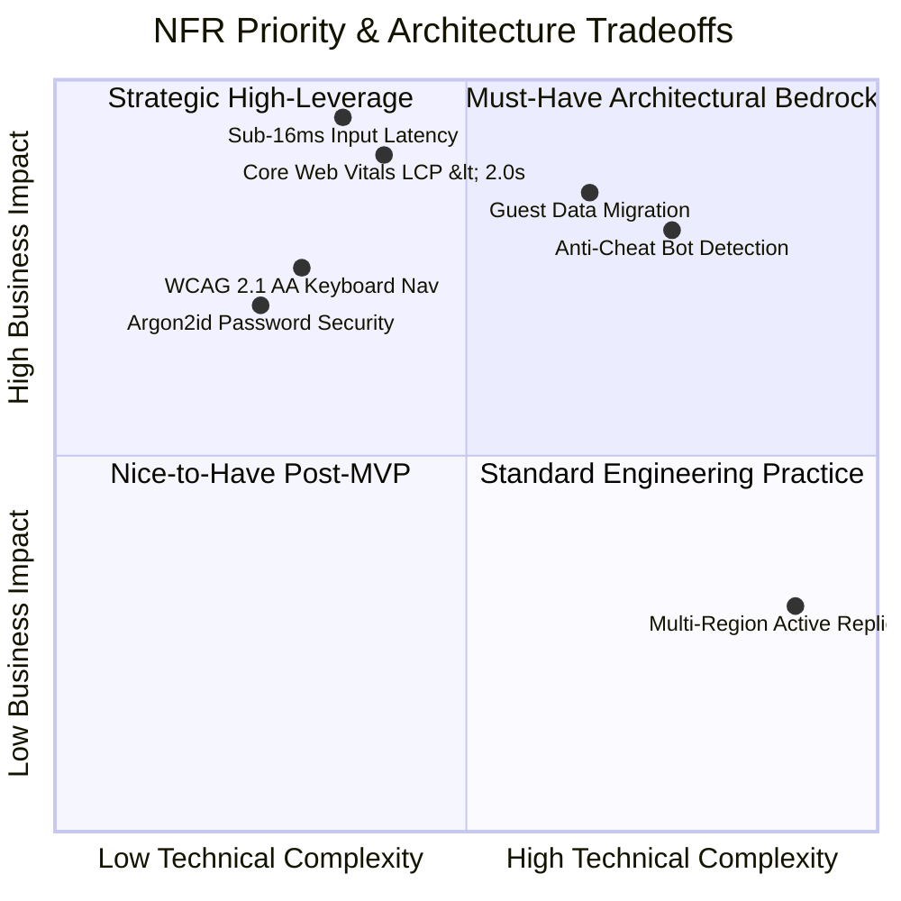

# Typing Typhon — Product Requirements Document (PRD)

**Document Version:** 1.0.0  
**Status:** Approved Specification Baseline  
**Date:** October 2026  
**Reference Architecture:** Next.js (App Router) + NestJS + PostgreSQL  

---

## 1. Introduction & Product Scope

This document specifies the complete functional requirements (FRs), non-functional requirements (NFRs), user stories, and acceptance criteria for **Typing Typhon**. It serves as the single source of truth for engineering, product, QA, and design teams.

---

## 2. Functional Requirements (FR)

### 2.1 Core Typing Engine & Speed Test (FR-1)
* **FR-1.1:** Instant Initialization: Typing test must be loaded and ready for input upon initial landing page load without user clicks.
* **FR-1.2:** Test Duration Modes: Must support pre-configured durations: 15 seconds, 30 seconds, 60 seconds, 120 seconds, and custom countdowns.
* **FR-1.3:** Text Modes: Must support:
  * Words (top 200, 1k, 10k frequency sets).
  * Sentences (syntactically coherent natural prose).
  * Paragraphs & Literature/Quotes (attributed public domain extracts).
  * Numbers & Mixed Punctuation.
  * Code Syntax (JavaScript, Python, HTML/CSS, SQL, C++).
  * Custom User-Pasted Text (sanitized client-side).
* **FR-1.4:** Real-time Keystroke Feedback:
  * Caret indicator following the active character.
  * Distinct visual states for unreached, active, correct, and incorrect characters.
  * Configurable backspace behavior: standard backspace (single char), Ctrl+Backspace (word delete), or strict mode (no backspace permitted).
* **FR-1.5:** Dynamic Metric Computation:
  * Real-time rolling Gross WPM, Net WPM, Raw CPM, Accuracy %, and Character Count (Correct, Incorrect, Extra, Missed).
  * Sub-second performance time-series capture (WPM/Error intervals per second).
* **FR-1.6:** Keyboard Shortcuts:
  * `Tab + Enter`: Instant test restart.
  * `Esc`: Pause / Quick settings toggle.

### 2.2 Alphabet-by-Alphabet Touch-Typing Curriculum (FR-2)
* **FR-2.1:** Structured Sequence: 30+ stages grouped into progressive tiers (Home Row $\to$ Top Row $\to$ Bottom Row $\to$ Capitalization/Shift $\to$ Numbers $\to$ Symbols).
* **FR-2.2:** Interactive Virtual Keyboard:
  * Real-time visual representation of standard QWERTY (with future extensibility to Dvorak/Colemak).
  * Dynamic finger guide highlighting which finger (Left/Right: Pinky, Ring, Middle, Index, Thumb) is assigned to the active key.
* **FR-2.3:** Mastery Threshold Engine:
  * An exercise must meet or exceed $\ge 96\%$ accuracy and a tier-specific target WPM (e.g., 20 WPM for beginner tiers) across at least 3 attempts to transition a key state to "Mastered".
  * If accuracy falls below $90\%$, automatically suggest remedial exercises for that key cluster.

### 2.3 Guest-First Architecture & Storage (FR-3)
* **FR-3.1:** Immediate Usability: Guests must be able to complete all tests, access beginner lessons, play games, and review analytics without an account.
* **FR-3.2:** Browser Storage (IndexedDB / LocalStorage):
  * Store the last 50 completed test records locally.
  * Store lesson completion states, key mastery matrix, and custom preferences (caret style, sound toggles, theme).
  * Implement an automatic versioning migration schema for client-side storage to prevent data corruption.
* **FR-3.3:** Clear Data Reset: Provide a dedicated "Clear Local History" button in guest preferences.

### 2.4 User Authentication & Account Management (FR-4)
* **FR-4.1:** Optional Registration: Clean registration flow via Email/Password (Argon2id hashing) and OAuth 2.0 (Google, GitHub).
* **FR-4.2:** Session Management: Secure HTTP-only cookies storing access JWT (short-lived: 15 min) and refresh token (long-lived: 30 days) with token rotation.
* **FR-4.3:** Profile & Settings: User customization for avatar, username, public profile visibility, theme (OLED Dark, Classic, Cyberpunk, Paper), sound effects, and keyboard layout.
* **FR-4.4:** GDPR Compliance: Self-service data export (JSON format) and permanent account deletion ("Right to be Forgotten").

### 2.5 Guest-to-Account Migration Pipeline (FR-5)
* **FR-5.1:** Migration Prompt: Upon first sign-up/login, if local guest records exist, prompt: *"Would you like to import your recent guest test history to your account?"*
* **FR-5.2:** Cryptographic & Plausibility Validation:
  * The backend must inspect submitted guest records for physical impossibility (e.g., WPM > 280, 100% accuracy with duration < 5s, corrupted timestamps).
  * Reject forged records while importing valid historical logs.
* **FR-5.3:** Deduplication: Deduplicate test sessions using SHA-256 hashes of `[timestamp + duration + textSeed + totalChars]`.

### 2.6 Weak-Key Diagnostics & Targeted Practice (FR-6)
* **FR-6.1:** Per-Key Statistics Aggregation: Track error rate, average latency (milliseconds between preceding key and target key), and common substitution pairs (e.g., typing 'e' instead of 'r').
* **FR-6.2:** Diagnostic Heatmap: Visual keyboard color-coded from Green (high accuracy/speed) to Red (high error rate/latency).
* **FR-6.3:** Dynamic Weak-Key Drill Generator: One-click generation of a personalized practice drill focusing specifically on the user's top 5 weakest keys and associated bigrams.

### 2.7 Typing Games & Gamification (FR-7)
* **FR-7.1:** Mini-Game Engine:
  * **Word Sprint:** Beat the clock before incoming words breach the screen threshold.
  * **Typhoon Rush:** Sustained speed keeps a vessel ahead of a storm; dropping below target WPM ends the run.
* **FR-7.2:** Local High Scores: Track high scores per difficulty for guests; sync to global leaderboard for authenticated accounts.

### 2.8 Contests & Competitive Integrity (FR-8)
* **FR-8.1:** Daily & Weekly Challenges: Pre-seeded identical text blocks available to all participants during a 24-hour / 7-day UTC window.
* **FR-8.2:** Anti-Cheat & Plausibility Telemetry:
  * Keystroke timing array: Submissions must include timestamped inter-keystroke intervals (IKIs).
  * Statistical variance check: Reject submissions with standard deviation of IKI $< 5\text{ms}$ (signature of automated macro/bot injections).
  * Signed session tokens: Contests require a server-generated session token before test begins; tests submitted after `[duration + 3000ms]` are flagged or rejected.

### 2.9 Verifiable Certification Engine (FR-9)
* **FR-9.1:** Qualification Criteria: Complete a standard 60-second or 120-second proctored paragraph test with $\ge 95\%$ accuracy.
* **FR-9.2:** Unique Public Verification: Each certificate generates a cryptographically random UUID v4, accessible at `/verify/[certificateId]`.
* **FR-9.3:** PDF & Print Ready Layout: Client-side rendering and vector-quality printable PDF export displaying Net WPM, Accuracy, Date, Duration, and Verification QR code.

### 2.10 Public Knowledge Base & SEO Blog (FR-10)
* **FR-10.1:** Content Publishing Engine: Server-rendered markdown/MDX articles, touch typing guides, ergonomic best practices, and keyboard switch comparisons.
* **FR-10.2:** Programmatic Landing Pages: Static routes for specific queries (e.g., `/practice/numbers`, `/speed-test/60-seconds`, `/learn/home-row`).

### 2.11 Administrative Control Panel (FR-11)
* **FR-11.1:** Role-Based Access Control (RBAC): SuperAdmin, ContentEditor, ContestModerator, and Auditor roles.
* **FR-11.2:** User & Contest Moderation: Ban abusive accounts, remove fraudulent leaderboard submissions, view audit logs.
* **FR-11.3:** Curriculum & Content Management: CRUD operations on lessons, word lists, practice quotes, and blog publications.

### 2.12 Advertising Management & Policy Safeguards (FR-12)
* **FR-12.1:** Placement Toggles: Admin ability to enable/disable specific ad zones (Header Leaderboard, Sidebar, Post-Test Results).
* **FR-12.2:** Protected Viewport Enforcement: Active typing sessions dynamically suppress ad updates, auto-refreshes, or layout shifts.

---

## 3. Non-Functional Requirements (NFR)



### 3.1 Performance & Latency (NFR-1)
* **NFR-1.1:** Keypress Response Latency: Keystroke DOM evaluation, highlighting update, and audio feedback must execute within $\le 16\text{ms}$ (60 fps frame budget; target: $< 8\text{ms}$).
* **NFR-1.2:** Zero Layout Shift: Cumulative Layout Shift (CLS) must remain $\le 0.02$ across all routes, particularly when dynamic ad units load.
* **NFR-1.3:** Backend API Response: 95th percentile latency ($p95$) for all non-reporting REST endpoints must be $\le 150\text{ms}$.

### 3.2 Security & Data Privacy (NFR-2)
* **NFR-2.1:** Encryption at Rest & In Transit: TLS 1.3 enforced for all traffic; database volumes and backups AES-256 encrypted.
* **NFR-2.2:** Password Hashing: Argon2id with memory cost 64MB, time cost 3 iterations, parallelism 1.
* **NFR-2.3:** Rate Limiting: API endpoints protected via sliding window rate limiter (e.g., auth endpoints: 5 req/min; general API: 120 req/min per IP).
* **NFR-2.4:** Content Security Policy (CSP): Strict CSP headers preventing unauthorized script execution while supporting Google AdSense tags and analytics.

### 3.3 Accessibility (NFR-3)
* **NFR-3.1:** Full Keyboard Operability: 100% of product functionality accessible without a mouse.
* **NFR-3.2:** Contrast & Legibility: Minimum contrast ratio of 4.5:1 for standard text and 3:1 for active UI components (WCAG 2.1 AA compliant).
* **NFR-3.3:** Screen Reader Announcements: ARIA live regions for completed test results and lesson progression indicators.

### 3.4 Reliability & Availability (NFR-4)
* **NFR-4.1:** Target Uptime: $99.9\%$ uptime excluding planned maintenance windows.
* **NFR-4.2:** Stateless API Architecture: NestJS backend must maintain zero in-memory session state, allowing seamless horizontal scaling behind a reverse proxy.

---

## 4. User Stories & Acceptance Criteria

### US-1: Guest Instant Typing Test
* **As a** first-time visitor landing on the homepage,  
* **I want to** start typing immediately without signing up, clicking modals, or configuring settings,  
* **So that I can** test my typing speed instantly.

```gherkin
Scenario: Guest types test text on landing
  Given the visitor navigates to the Typing Typhon homepage
  When the page finishes loading within 1.5 seconds
  Then the typing input canvas is automatically focused
  And the first character is highlighted with an active caret
  When the user strikes the first correct alphanumeric key
  Then the countdown timer begins decrementing immediately
  And the character turns green with zero perceivable delay (<16ms)
```

### US-2: Post-Test Results & Guest Local History
* **As a** guest user completing a 60-second test,  
* **I want to** see an in-depth breakdown of my speed, accuracy, and weak keys,  
* **So that I can** identify areas for improvement and compare subsequent runs.

```gherkin
Scenario: 60-second test completion
  Given a guest user is on the 59th second of a 60-second test
  When the countdown timer reaches 0
  Then the typing input canvas is instantly disabled
  And the user is transitioned to the Results View within 100ms
  And the Net WPM, Gross WPM, Accuracy %, and Weak Keys are displayed
  And the completed test is written to the browser's IndexedDB storage
  And the user can click "Restart Test" or press "Tab + Enter" to retry immediately
```

### US-3: Respectful Registration Prompt
* **As an** engaged guest who has completed 5 typing sessions,  
* **I want to** receive a polite option to save my data to the cloud,  
* **So that I do not** lose my accumulated progress when switching devices or clearing browser cache.

```gherkin
Scenario: Configurable threshold trigger for account invitation
  Given a guest has accumulated 5 completed tests in local storage
  When the results screen of the 5th test is rendered
  Then a non-blocking toast/card appears below the results: "Save your progress across devices? Create a free account."
  And the card provides two actions: [Create Free Account] and [Maybe Later]
  When the user clicks [Maybe Later]
  Then the card dismisses and does not prompt again for at least 5 additional sessions
```

### US-4: Guest-to-Account History Migration
* **As a** guest who decides to sign up for an account,  
* **I want my** past guest test results imported into my new user profile,  
* **So that my** historical statistics and charts reflect my complete practice history.

```gherkin
Scenario: Migrating local IndexedDB records upon registration
  Given a guest with 8 local test records completes registration via Google OAuth
  When authentication succeeds and the user is redirected to the Dashboard
  Then the client checks IndexedDB for un-migrated records
  And submits a batch payload to POST /api/v1/progress/migrate
  And the backend validates all 8 records for timestamp integrity and speed plausibility
  And writes the valid records to the database associated with the new userId
  And the local IndexedDB marks the records as migrated
  And the user is shown a confirmation: "8 historical sessions successfully synchronized!"
```
