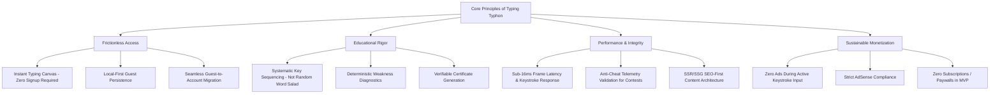
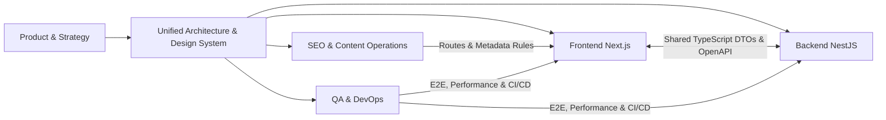

# Typing Typhon — Project Context & Master Vision

**Document Version:** 1.0.0  
**Status:** Approved Architectural Baseline  
**Date:** October 2026  
**Author:** Senior Product Architect & Strategic Systems Engineering  

---

## 1. Executive Summary & Product Vision

**Typing Typhon** is an open, high-performance, web-based typing ecosystem designed to transform how individuals worldwide acquire, refine, and validate touch-typing proficiency.

While contemporary platforms often collapse into either superficial 60-second speed-testing widgets (e.g., Monkeytype) or locked-down, antiquated enterprise training software (e.g., Typing.com, Mavis Beacon), **Typing Typhon** combines:
1. **Frictionless, instantaneous typing speed testing** (zero sign-up barriers, sub-millisecond input response).
2. **Pedagogically rigorous alphabet-by-alphabet and key-combination curriculum** designed for progressive muscle memory formation.
3. **Deterministic weakness diagnostics** pinpointing finger fatigue, letter confusion, and latency outliers.
4. **Interactive gamification, daily challenges, and verifiable certifications** that incentivize sustained practice.
5. **A search-engine-optimized, educational knowledge repository** generating steady, organic inbound acquisition.

The ultimate vision is to establish **Typing Typhon** as the definitive, globally trusted authority for keyboard literacy, typing assessments, and ergonomic touch-typing education.

---

## 2. Business Objectives & Monetization Strategy

### 2.1 Strategic Stage
- **Current Phase:** Product Genesis & Foundation Phase.
- **Baseline Metrics:** 0 Monthly Active Users (MAU), $0 Revenue.
- **Immediate Goal:** Build an authoritative, search-indexed, guest-accessible MVP platform capable of capturing early organic traffic and achieving Google AdSense compliance.

### 2.2 Monetization Model: Advertising-First
- **Primary Channel:** Non-intrusive, privacy-compliant Google AdSense display advertisements and direct educational sponsorships.
- **Core Principle:** **Zero Paywalls or Paid Subscriptions in the MVP.**
- **Protection of the Core Experience:** The typing canvas is a sacred user workspace. **Under no circumstances will advertisements interrupt an active typing test, obscure exercise prompts, or introduce input latency.** Advertisements are strictly confined to dedicated, high-viewability containers on content-rich informational pages, the Practice Hub, and post-test Result summaries.

### 2.3 Future Business Horizons (Post-MVP Evaluation)
- B2B Institutional Typing Assessments (School boards, civil service examination preparation, call-center recruiting validation).
- Proctored / Cryptographically Verified Certification Badges.
- Specialized Technical Modules (Medical transcription, legal stenography, advanced polyglot programming syntax).
*Note: These are documented future expansion pathways and are strictly excluded from the MVP.*

---

## 3. Target Audience & User Personas

| Persona | Core Motivation | Primary Feature Focus | Pain Points with Existing Tools |
| :--- | :--- | :--- | :--- |
| **Beginner / Student ("The Foundational Learner")** | Learn touch typing from scratch without looking at the keyboard. | Home-row drills, alphabet-by-alphabet visual guides, error remediation. | Existing tools jump straight into random word salad without muscle memory staging. |
| **Speed Enthusiast / Gamer ("The Velocity Seeker")** | Break 100+ WPM benchmarks, compete on global leaderboards. | 15s/30s/60s sprints, raw vs. adjusted WPM, latency graphs, burst speed. | Inconsistent timer calculations, input lag, ad popups mid-stroke. |
| **Job Seeker / Candidate ("The Certification Seeker")** | Validate minimum WPM (e.g., 40–60 WPM) for civil, administrative, or data entry roles. | Paragraph tests, printable/PDF certificates, public verification URLs. | Paywalled certificates or dubious unverified PDF generators. |
| **Programmer / Tech Worker ("The Syntax Typist")** | Improve accuracy on symbols, brackets (`{}`, `[]`, `=>`, `&&`), and camelCase/snake_case tokens. | Code-typing drills (JavaScript, Python, Rust, SQL, Markdown). | Normal typing sites lack code indentation, tab-handling, and programming character distributions. |

---

## 4. Fundamental Product Principles

Every architecture decision, schema migration, and component contract must satisfy these 13 governing laws:

1. **Zero Barrier Entry:** A user visiting `typingtyphon.com` must be able to press the first keystroke within 500 milliseconds of DOM load without clicking through popups, cookie consent walls that block input, or registration forms.
2. **Guest Dignity:** Unregistered visitors are first-class users. Their recent sessions, mastery progression, and preferences must be preserved locally (via client storage) with zero artificial degradation of features.
3. **Respectful Account Elevation:** Registration is an invitation to unlock multi-device cloud synchronization and public leaderboards, never a hostage negotiation for core functionality.
4. **Educational Integrity:** Touch typing relies on neuro-muscular adaptation. We teach spatial key relationships (home row outwards), finger ergonomics, and bigram frequency, rather than alphabetical order or unstructured paragraphs.
5. **Deterministic Diagnostics:** Weak key suggestions are computed via mathematical dispersion of error rates and inter-keystroke intervals (IKIs), not opaque, unpredictable AI tokens.
6. **Input Canvas Sanctuary:** Keystrokes have absolute priority on the browser thread. No background sync, garbage collection spike, or ad render may interrupt typing rhythm.
7. **Transparent Scoring Conventions:** Net WPM, Gross WPM, Accuracy, and Error Penalties are precisely calculated and explained with unambiguous formulas.
8. **Organic SEO as Core Growth Engine:** Static, search-indexable programmatic routes for every lesson, typing topic, key combination, and speed benchmark are built into the site hierarchy from Day 1.
9. **Zero Intrusive Advertising:** Ads must never cause layout shift (CLS), never play unmuted audio, and never sit adjacent to typing canvases where misclicks occur.
10. **Data Minimization & Privacy:** No keystroke telemetry of personal typed text is permanently harvested on servers without explicit consent. Passwords and sensitive input are never captured.
11. **Cryptographic Validation of Competitive Feats:** Public leaderboard submissions and verifiable certificates require server-side plausibility checks and timestamped stroke-interval validation to deter trivial DOM spoofing.
12. **Modular Decoupling:** Next.js frontend and NestJS backend remain independently deployable, communicating over typed REST APIs and contracts.
13. **Simplicity Over Hype:** Avoid microservices sprawl, unnecessary message brokers, or heavy AI frameworks until warranted by concrete business load.

---

## 5. Scope & Explicit Exclusions

### 5.1 In-Scope for Initial Platform
- Guest typing speed test engine with dynamic durations (15s, 30s, 60s, 120s) and custom text modes.
- Complete alphabet and key training curriculum (30+ modular stages from Home Row to Numeric/Symbolic mastery).
- Local storage persistence for guests with migration utility on registration.
- Optional user authentication (Email/Password + OAuth via Google/GitHub).
- Cloud performance history, weak-key heatmaps, and progress dashboards for registered accounts.
- Printable and digitally verifiable typing speed certificates with unique UUIDs.
- Standalone typing mini-games (e.g., Falling Words, Typhoon Rush).
- AdSense-compliant informational pages, blog engine, keyboard guides, and programmatic SEO hubs.
- Dedicated, role-secured Admin Panel for curriculum editing, content management, user moderation, and SEO operations.

### 5.2 Explicit MVP Exclusions
- **Paid Subscriptions / Paywalls:** No Stripe/LemonSqueezy billing, no tiered "Pro" subscriptions.
- **Real-Time Multiplayer WebSockets:** Contests are initially asynchronous or time-windowed leaderboards rather than synchronized peer-to-peer race tracks.
- **Mobile Native Applications:** The platform is a mobile-responsive Progressive Web Application (PWA), not native iOS/Android builds.
- **LLM/AI Dynamic Content Generation in the Loop:** Practice texts, lessons, and diagnostic reports use vetted, high-quality, static or deterministic algorithmic datasets.

---

## 6. High-Level Stakeholder & Workstream Matrix

The subsequent documentation files detail the technical implementation, operational standards, and development deliverables for each workstream.
