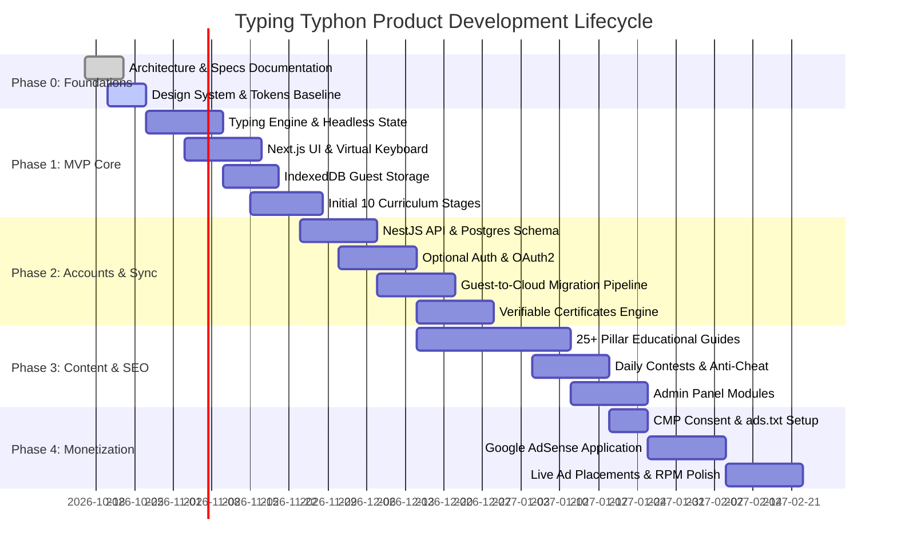
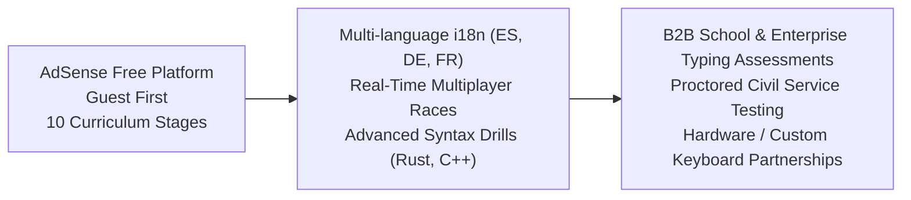

# Typing Typhon — Master Project Roadmap & Milestone Exit Criteria

**Document Version:** 1.0.0  
**Status:** Approved Strategic Baseline  
**Target Release Schedule:** 14-Week Guided Rollout to Monetization  
**Date:** October 2026  

---

## 1. Master Phase Roadmap

---

## 2. Phase-by-Phase Deliverables & Exit Criteria

### Phase 0: Architecture, Documentation & Engineering Foundations (Weeks 1–2)
* **Deliverables:** Complete 20-document architecture suite, project context, database schemas, API specs, and UI design tokens.
* **Exit Criteria (Definition of Done):**
  * Founder and lead architects approve documentation suite.
  * Shared TypeScript DTO contracts defined.
  * Empty workspace prepared for Next.js & NestJS monorepo or dual-repo initialization.

---

### Phase 1: MVP Core Build & Guest Experience (Weeks 3–6)
* **Deliverables:**
  * Headless Typing Engine state machine (100% test coverage).
  * Next.js App Router shell with protected canvas, sub-16ms keystroke feedback.
  * IndexedDB local persistence storing up to 50 sessions for guests.
  * Speed test durations (15s, 30s, 60s, 120s) across Words and Sentences.
  * Post-test results screen with interactive WPM time-series graph.
  * First 10 curriculum stages (Home row, top row, basic capitalizations) with virtual keyboard and finger guidance.
  * Technical SEO: SSR metadata, canonicals, sitemap, robots.txt, and basic legal pages.
* **Exit Criteria (Definition of Done):**
  * Guest can land on `/`, type a 60-second test, view results, and review local history without an account.
  * Lighthouse Performance $\ge 95$, LCP $< 1.8\text{s}$, CLS $\le 0.01$.

---

### Phase 2: User Accounts, Migration & Verifiable Credentials (Weeks 7–9)
* **Deliverables:**
  * NestJS backend API connected to PostgreSQL 16.
  * Optional user authentication (Email/Password with Argon2id + Google/GitHub OAuth).
  * Secure HTTP-only JWT cookie architecture with token refresh rotation.
  * Guest-to-account history migration pipeline with server-side plausibility checks.
  * Cloud user dashboard with cumulative stats, streak tracking, and weak-key heatmap.
  * Digital typing certificate generation (PDF export + public verification URL `/verify/[code]`).
  * Admin Panel baseline (User directory, curriculum editor).
* **Exit Criteria (Definition of Done):**
  * A guest with 5 local sessions registers and successfully migrates records to the database.
  * Public verification of a certificate UUID renders accurate candidate metadata.

---

### Phase 3: Content Expansion, Daily Contests & SEO Authority (Weeks 10–12)
* **Deliverables:**
  * 25+ comprehensive educational articles, keyboard switch comparisons, and touch typing tutorials published to `/blog`.
  * Daily and Weekly Contest engine with IKI telemetry anti-cheat validation.
  * Mini-game canvas (Word Sprint).
  * Comprehensive Admin Panel (Contest moderation, content CMS, audit logs).
* **Exit Criteria (Definition of Done):**
  * 100% of public routes submitted to Google Search Console.
  * Anti-cheat test suite reliably catches automated macro injections.

---

### Phase 4: Monetization Launch, Growth & AdSense Integration (Weeks 13–14+)
* **Deliverables:**
  * Google AdSense application submitted following approval checklist.
  * Google-certified Consent Management Platform (CMP) deployed.
  * `ads.txt` verified at root domain.
  * Non-intrusive ad containers populated on results and blog pages.
  * Ongoing performance and RPM monitoring.
* **Exit Criteria (Definition of Done):**
  * AdSense account formally approved.
  * Ads rendering strictly in designated containers with zero input latency impact.

---

## 3. Post-MVP Growth Horizons (Future Roadmap)

