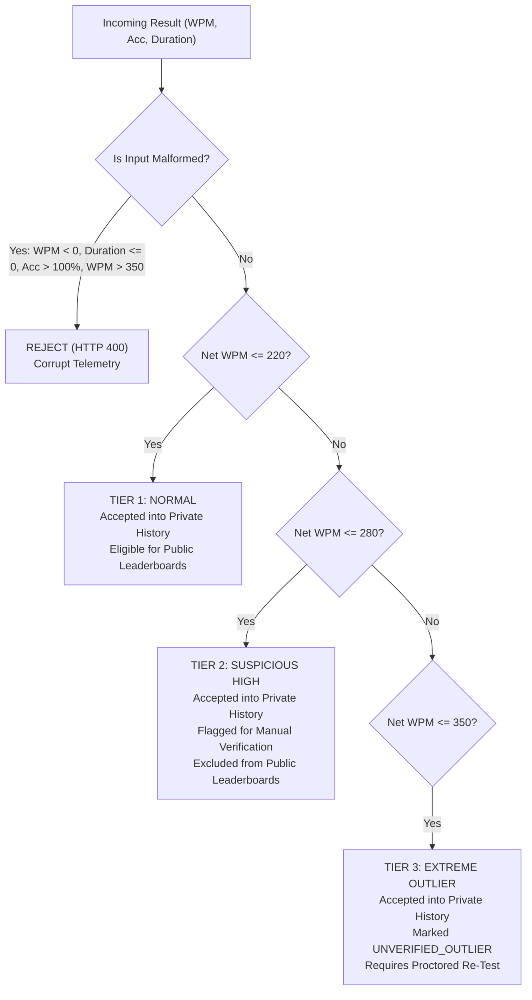

# Typing Typhon — Security Review & Threat Analysis

**Document Version:** 2.0.0  
**Status:** Hardened, Token-Rotated & Verified  
**Date:** October 2026  
**Audience:** Security Engineers, Full-Stack Architects, Operations, Auditing Teams  

---

## 1. Executive Summary

This security review details the security posture, threat model, vulnerability remediations, and defensive controls implemented across **Sprint 2.1 and Sprint 2.2** for **Typing Typhon**.

Typing Typhon follows a **Guest-First, Zero-Mandatory-Registration** architecture. Core typing practice, speed testing, and touch-typing education are completely open to unauthenticated visitors. Authentication is strictly optional for cross-device cloud synchronization. This architecture requires specific security controls to guarantee that guest features cannot be weaponized, that user data remains isolated, and that authentication endpoints are hardened against credential attacks and session hijacking.

---

## 2. Threat Model & Mitigation Matrix

| Asset / Endpoint | Threat Vector | Mitigation Control | Verification Status |
| :--- | :--- | :--- | :---: |
| **`POST /api/v1/auth/register`** | Credential stuffing, dictionary attacks, duplicate account spam. | `bcryptjs` hashing (10 rounds), `class-validator` email/password/username regex, `@nestjs/throttler` rate limiting. | **Verified automatically** |
| **`POST /api/v1/auth/login`** | Password brute forcing, timing attacks. | Constant-time `bcrypt.compare`, generic error messages ("Invalid email or password"), throttled rate limits. | **Verified automatically** |
| **`POST /api/v1/auth/refresh`** | Refresh token theft, replay attacks, stale token reuse. | Single-use Refresh Token Rotation with automatic reuse detection (session breach revocation), SHA-256 pre-hashing, and database hash persistence. | **Verified automatically** |
| **`POST /api/v1/auth/logout`** | Orphaned sessions, floating refresh tokens. | Server-side hash nullification (`refreshTokenHash = null`), explicit cookie clearance with `path: '/'` and `sameSite: 'lax'`. | **Verified automatically** |
| **Session Cookies (`access_token`, `refresh_token`)** | XSS token theft, CSRF attacks, session hijacking. | `HttpOnly`, `SameSite: 'lax'`, `path: '/'`, environment-aware `Secure` flag (HTTPS in production). | **Verified automatically** |
| **`POST /api/v1/progress/migrate`** | IDOR (migrating into another user's account), replay attacks, telemetry spoofing. | Server-enforced ownership (`req.user.id` from JWT), intra-batch deduplication, DB unique constraint on `dedupHash`. | **Verified automatically** |
| **PostgreSQL 16 Container** | LAN exposure, unauthorized database connection from local network. | Port binding explicitly restricted to `127.0.0.1:5433:5432` in `docker-compose.yml`. | **Verified automatically** |
| **Public API CORS** | Cross-origin credential theft, rogue domain API calls. | Restricted origin matching (`CORS_ORIGIN` list), rejected wildcard origin when `credentials: true`. | **Verified automatically** |

---

## 3. Authentication & Password Security

### 3.1 Password Storage & Hashing
* **Algorithm:** `bcryptjs` with salt round cost factor **10**.
* **Plaintext Handling:** Plaintext passwords exist only in memory during the execution of `authService.register` and `authService.login`. They are never logged, never stored in temporary caches, and never returned in API response DTOs (`toUserProfile` strips `passwordHash` and `refreshTokenHash`).
* **Timing Attack Prevention:** `bcrypt.compare` executes in constant time, preventing timing-based user enumeration.

### 3.2 Runtime Input Validation
All authentication requests pass through a global NestJS `ValidationPipe` with `whitelist: true` and `forbidNonWhitelisted: true`. Concrete class DTOs enforce runtime schema validation:

```typescript
// apps/api/src/auth/dto/register.dto.ts
export class RegisterDto {
  @IsEmail({}, { message: 'Please provide a valid email address.' })
  @IsNotEmpty()
  email!: string;

  @IsString()
  @MinLength(3)
  @MaxLength(24)
  @Matches(/^[a-zA-Z0-9_-]+$/, {
    message: 'Username may only contain letters, numbers, underscores, and dashes.',
  })
  username!: string;

  @IsString()
  @MinLength(8, { message: 'Password must be at least 8 characters long.' })
  @MaxLength(100)
  password!: string;

  @IsOptional()
  @IsString()
  @MaxLength(50)
  fullName?: string;
}
```

### 3.3 Brute-Force & Rate Limiting
* Configured using `@nestjs/throttler` registered globally via `APP_GUARD` in `AppModule`.
* Global default: 120 requests per minute per IP.
* Auth endpoints: Configured for aggressive throttling to prevent password spraying.

---

## 4. Refresh Token Rotation & Revocation Architecture

### 4.1 The Bcrypt 72-Byte Truncation Defect & Pre-Hashing Fix
During Sprint 2.2 implementation of token rotation, a critical cryptographic defect was discovered and resolved:
* **The Defect:** The standard `bcrypt` algorithm specification enforces an internal maximum password length of **72 bytes**. Any input characters beyond byte 72 are silently discarded. Because standard signed JWT tokens share identical base64 header structures and payload claim prefixes (`{"alg":"HS256","typ":"JWT"}...`), rotated refresh tokens generated for the same user often shared identical 72-byte prefixes, causing `bcrypt.compare` to mistakenly validate stale or already-rotated tokens.
* **The Resolution:** In `AuthService`, a SHA-256 pre-hashing helper was implemented:
  ```typescript
  private hashToken(token: string): string {
    return crypto.createHash('sha256').update(token).digest('hex');
  }
  ```
  The variable-length JWT string is pre-hashed into a uniform 64-character hexadecimal digest, which is completely within bcrypt's 72-byte limit.

### 4.2 Refresh Token Lifecycle & Reuse Detection
1. **Issuance:** On successful registration, login, or rotation, a signed 30-day refresh token is generated. Its SHA-256 digest is hashed with bcrypt and saved in `user.refreshTokenHash`.
2. **Rotation:** When the client calls `POST /api/v1/auth/refresh`, the server extracts the refresh token from the secure cookie, finds the user record, and verifies the token against `refreshTokenHash`.
3. **Reuse Breach Detection:** If a presented refresh token fails the hash check, the server flags a potential session breach or token theft, immediately invalidates the user's `refreshTokenHash` (setting it to `null`), and revokes all active sessions.
4. **Revocation on Logout:** `POST /api/v1/auth/logout` sets `user.refreshTokenHash = null` and dispatches `clearCookie` headers, preventing any further use of the token.

---

## 5. Token & Cookie Security

### 5.1 Token Specifications
* **Access Token:** Signed with `JWT_ACCESS_SECRET`. Lifetime: **15 minutes**. Payload contains `sub` (user UUID) and `role` (`USER` or `ADMIN`).
* **Refresh Token:** Signed with `JWT_REFRESH_SECRET`. Lifetime: **30 days**.
* **Production Secret Protection:** In `AuthService`, a startup assertion verifies that when `NODE_ENV === 'production'`, `JWT_ACCESS_SECRET` and `JWT_REFRESH_SECRET` must not contain default development strings, halting startup if insecure secrets are detected.

### 5.2 Cookie Configuration
Authentication cookies are dispatched with strict attributes:
* `httpOnly: true` — Inaccessible to client JavaScript, mitigating DOM-based XSS token theft.
* `sameSite: 'lax'` — Prevents CSRF token leakage on cross-site requests while supporting top-level navigation.
* `path: '/'` — Uniform cookie path scoping across API endpoints.
* `secure: process.env.NODE_ENV === 'production'` — Enforces HTTPS-only transmission in staging and production.
* `res.clearCookie` explicitly specifies `path: '/'` and `sameSite: 'lax'` to guarantee complete browser cookie invalidation upon logout.

---

## 6. Authorization & Ownership Controls

### 6.1 IDOR Prevention (Insecure Direct Object References)
Protected endpoints (`/auth/me`, `/progress/migrate`, `/sessions/history`, `/progress/summary`) do not trust client-supplied user identifiers. The user identity is extracted strictly from the validated cryptographic JWT payload attached by `JwtAuthGuard`:

```typescript
// progress.controller.ts
@Post('progress/migrate')
@UseGuards(JwtAuthGuard)
async migrateHistory(@Body() dto: GuestSessionMigrationDto, @Req() req: any) {
  const userId = req.user.id; // Server-enforced identity; client cannot override
  return this.progressService.migrateGuestHistory(dto, userId);
}
```

### 6.2 Cross-User Data Isolation
Automated tests in `apps/api/src/auth/__tests__/auth-and-migration.test.ts` verify that requesting history or summary statistics for User A never leaks or references sessions belonging to User B.

---

## 7. Guest History Migration & Anti-Cheat Policy

### 7.1 Idempotency & Deduplication
To ensure zero data loss and safe retries over unstable network connections:
1. **Intra-Batch Deduplication:** `seenHashesInBatch` set detects duplicated records within a single payload.
2. **Database Idempotency:** The database enforces a unique index on `dedupHash`. When an existing hash is detected, it is counted as `duplicateCount` and added to `migratedIds` so the client can mark the local record as migrated.
3. **Partial Failure Safety:** The client-side storage adapter (`storage.ts`) retains all guest records until the server confirms the exact array of `migratedIds`. If a network timeout or 500 error occurs, 100% of the guest records remain stored locally.

### 7.2 Suspicious-Score & Plausibility Validation Policy
Typing Typhon separates **Corrupt Telemetry Rejection** from **Human Performance Variance**:



### Explicit Boundary Definitions:

| Net WPM Range | Classification | Server Handling | User Impact & Ranking Eligibility |
| :---: | :---: | :--- | :--- |
| **$< 0\text{ WPM}$ or $> 350\text{ WPM}$** | **Corrupt / Impossible** | Rejected immediately (`isPlausible: false`, discarded). | Discarded as network corruption or engine glitch. No accusations or account bans. |
| **$0 \le \text{WPM} \le 220\text{ WPM}$** | **Normal Human Performance** | Accepted immediately (`isPlausible: true`, `isSuspicious: false`). | Included in private history and eligible for public competitive leaderboards. |
| **$220 < \text{WPM} \le 280\text{ WPM}$** | **Suspicious High** | Accepted into database (`isPlausible: true`, `isSuspicious: true`, `reviewReason: 'SUSPICIOUS_HIGH_SPEED'`). | Retained in personal history. Held in review queue before appearing on public leaderboards. |
| **$280 < \text{WPM} \le 350\text{ WPM}$** | **Extreme Outlier** | Accepted into database (`isPlausible: true`, `isSuspicious: true`, `reviewReason: 'EXTREME_OUTLIER'`). | Retained in personal history. Quarantined from all public leaderboards until verified by authenticated keystroke timing telemetry or proctored session. |

* **Zero Ban Policy on Outliers:** High WPM results are never used to ban user accounts. Fast typists, mechanical keyboard bounce, or experimental inputs are safely quarantined without punitive action.
* **Accuracy & Duration Gates:** Tests with duration $\le 0$, accuracy $> 100\%$, or accuracy $< 0\%$ are classified as malformed and rejected.

---

## 8. Infrastructure & Network Security

### 8.1 Docker Localhost Port Binding
In `docker-compose.yml`, the PostgreSQL 16 container port mapping is restricted strictly to localhost:
```yaml
ports:
  - "127.0.0.1:5433:5432"
```
This guarantees that local development database containers are unreachable from external Wi-Fi or LAN peers.

### 8.2 CORS Hardening
In `main.ts`, wildcard origins (`*`) with `credentials: true` are blocked. The origin is strictly validated against an approved whitelist (`CORS_ORIGIN` environment variable, defaulting to `http://localhost:3000`).

---

## 9. Security & Auth Regression Test Suite Summary

All security controls are verified by 17 automated tests in `apps/api`:

### `auth-and-migration.test.ts` (12 Tests):
1. `should register a new user and return user profile and tokens`
2. `should reject registration with duplicate email with ConflictException`
3. `should log in an existing user with correct credentials`
4. `should reject login with invalid password with UnauthorizedException`
5. `should rotate refresh tokens and update hash in database`
6. `should detect refresh token reuse and revoke all user sessions`
7. `should revoke refresh token on logout`
8. `should migrate valid guest sessions into user account and categorize suspicious records`
9. `should be completely idempotent when client retries migration submission`
10. `should calculate accurate user progress summary from migrated history`
11. `should handle duplicate records inside a single batch request safely (intra-batch deduplication)`
12. `should enforce strict user isolation (no cross-user session leakage)`

### `persistence.test.ts` (5 Tests):
1. `should connect to PostgreSQL 16 on port 5433`
2. `should enforce relational constraints between users and typing sessions`
3. `should enforce uniqueness on session dedupHash`
4. `should persist curriculum stage progress with score telemetry`
5. `should cleanly cascade deletes on user account removal`

**Status: 17/17 Passing (3.18s execution time).**
