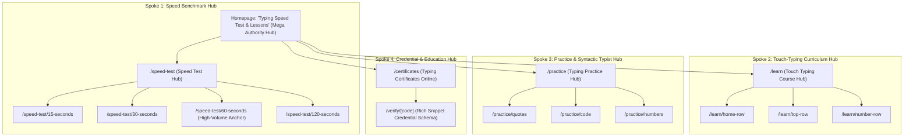
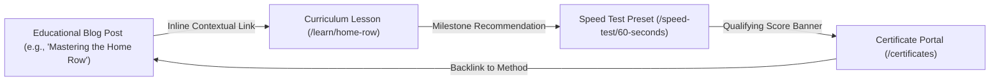

# Typing Typhon — Comprehensive Technical & Content SEO Strategy

**Document Version:** 1.0.0  
**Status:** Approved Growth Baseline  
**Target Search Engine:** Google (Global English), Bing, DuckDuckGo  
**Target Core Web Vitals:** LCP $< 2.0\text{s}$, CLS $\le 0.02$, INP $< 100\text{ms}$  
**Date:** October 2026  

---

## 1. Search Strategy Philosophy & Objectives

In the online typing tools vertical, organic search is the primary acquisition flywheel. Rather than relying on low-quality programmatic page spam (e.g., hundreds of thin variations of "typing test 12 seconds"), **Typing Typhon** executes an **Authoritative Hub-and-Spoke Architecture**.



---

## 2. Technical SEO Engineering Specifications

### 2.1 Server-Side Rendering (SSR) & Static Site Generation (SSG)
* All informational pages, curriculum directories, speed presets, and blog articles are statically generated at build time (`output: 'export'` or standard SSG with Incremental Static Regeneration `revalidate = 86400`).
* Dynamic typing canvases are rendered as fast-loading client islands within SSR HTML shells containing complete headings, explanatory body text, and semantic metadata.

### 2.2 Metadata Automation in Next.js 15+
Every indexable route implements `generateMetadata()` exporting:
* Semantic `title`: Maximum 60 characters; e.g., `"60-Second Typing Speed Test (Free WPM Test) | Typing Typhon"`.
* Compelling `description`: Maximum 155 characters with clear call-to-action; e.g., `"Test your typing speed in 60 seconds with our free, instant WPM test. Accurate keystroke analysis, real-time error tracking, and no signup required."`
* `canonical`: Strict self-referential canonical URL matching `https://typingtyphon.com/[route]`.
* Open Graph & Twitter Cards with dynamically generated 1200x630px social previews (`@vercel/og`).

### 2.3 Structured Data Architecture (Schema.org JSON-LD)
Structured data is injected server-side to secure rich snippets:

| Route Pattern | Schema Type | Intended Google Rich Snippet |
| :--- | :--- | :--- |
| `/` | `WebSite` + `SearchAction` | Sitelinks Search Box |
| `/learn`, `/learn/[stageSlug]` | `Course` + `EducationalOccupationalProgram` | Course Carousels & Learning Rich Cards |
| `/verify/[certificateId]` | `EducationalOccupationalCredential` | Credential / Badge Preview |
| `/faq` | `FAQPage` | Expandable SERP Accordions |
| `/blog/[slug]` | `Article` + `Author` (E-E-A-T verified) | Top Stories / Article Carousels |
| Breadcrumbs (All Hubs) | `BreadcrumbList` | Hierarchical Breadcrumb Navigation in SERP |

### 2.4 Robots.txt & Crawl Budget Safeguards
```ini
User-agent: *
Allow: /
Allow: /speed-test/
Allow: /practice/
Allow: /learn/
Allow: /certificates
Allow: /verify/
Allow: /blog/
Allow: /about
Allow: /faq

# Block non-indexable private views and high-frequency dynamic routes
Disallow: /admin/
Disallow: /dashboard/
Disallow: /auth/
Disallow: /api/
Disallow: /practice/custom
Disallow: /results?*

Sitemap: https://typingtyphon.com/sitemap.xml
```

### 2.5 Multi-Sitemap Architecture (`/sitemap.xml`)
The main sitemap index points to 4 modular sitemaps updated automatically on build:
1. `sitemap-core.xml`: Homepage, About, FAQ, Contact, Legal.
2. `sitemap-speed-test.xml`: Dedicated presets (`/speed-test/15-seconds`, `30-seconds`, `60-seconds`, etc.).
3. `sitemap-curriculum.xml`: All curriculum stages and public letter modules.
4. `sitemap-blog.xml`: All published editorial and educational guides.

---

## 3. High-Value Keyword Research & Intent Mapping

*Note: Keyword difficulty and intent are categorized based on industry search patterns in typing education.*

| Target Keyword Cluster | Primary Search Intent | Target Landing Route | Content Strategy & Angle |
| :--- | :--- | :--- | :--- |
| `typing speed test`, `wpm test` | Transactional / Tool | `/` & `/speed-test` | Instant zero-click canvas, sub-millisecond response, zero ads mid-screen. |
| `1 minute typing test`, `60 second typing test` | Specific Tool | `/speed-test/60-seconds` | Pre-configured 60s countdown, standard words metric explanation. |
| `learn to type`, `touch typing lessons` | Informational / Educational | `/learn` | 10-stage curriculum overview, home-row visual guide, muscle memory focus. |
| `typing test for jobs`, `typing certificate free` | Commercial / Informational | `/certificates` | Professional printable PDF, tamper-proof UUID verification, accuracy standards. |
| `programming typing test`, `code typing practice` | Specialized Niche | `/practice/code` | JavaScript/Python syntax, curly braces, camelCase indentation. |
| `how to increase typing speed from 40 to 80` | High-Intent Informational | `/blog/how-to-increase-wpm` | Comprehensive long-form guide on error elimination, ergonomics, and rhythm. |

---

## 4. Internal Linking Architecture (Hub-and-Spoke)



1. **Top-Down Hub Links:** Hub pages (`/learn`, `/practice`) link down to every individual sub-module.
2. **Bottom-Up Breadcrumbs:** Every child route includes microdata-tagged breadcrumbs back to the parent hub.
3. **Cross-Intent Contextual Bridges:** When a user completes a 60-second test with high errors, the results screen contextually links to `/learn/home-row` to remediate weak habits.

---

## 5. Content Publishing Roadmap (First 90 Days)

| Month | Content Pillar | Target URLs & Topics | Target Output |
| :--- | :--- | :--- | :--- |
| **Month 1 (Launch)** | Foundation & Core Hubs | Core speed presets (`15s`, `30s`, `60s`, `120s`), Home Row and Top Row curriculum guides, FAQ. | 15 Indexable URLs |
| **Month 2** | In-Depth Ergonomics & Guides | "How to Touch Type: Complete Guide", "Mechanical Switches vs. Membrane for Typing Speed", "Proper Typing Ergonomics". | 10 Long-Form Pillar Articles |
| **Month 3** | Professional & Job Assessments | "Civil Service & Legal Typing Test Standards", "Coding Typing Practice for Software Engineers", "Average Typing Speed by Profession". | 12 Deep Comparative Articles |

---

## 6. Internationalization (i18n) Readiness Strategy

* **MVP Architecture:** Single-language English (`en-US` default) with strict `lang="en"` tags.
* **Routing Design for Post-MVP:** The routing structure is built to support Next.js locale prefixes without breaking existing URLs:
  * e.g., `/es/speed-test`, `/de/learn`, `/fr/certificates`.
* **Hreflang Architecture:** When additional languages are added post-validation, automated `hreflang` alternates will be injected into `<head>`, pointing each locale to its regional equivalent.
