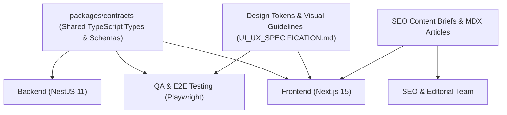
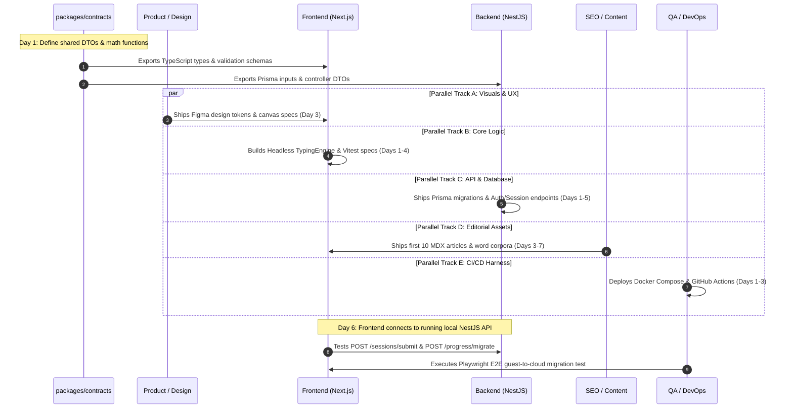

# Typing Typhon — Cross-Functional Team Dependency Matrix & Parallel Workstreams

**Document Version:** 1.0.0  
**Status:** Approved Operational Baseline  
**Workspace Model:** Monorepo (`apps/web`, `apps/api`, `packages/contracts`)  
**Target Sprint:** Sprint 1 Kickoff (Weeks 1–2)  
**Date:** October 2026  

---

## 1. Cross-Functional Workstream Overview

To maximize velocity without creating merge conflicts or waiting on blocking dependencies, the engineering, design, SEO, and QA teams operate under a **Contract-First Development Model**.

Shared TypeScript DTOs, schemas, and design tokens form the binding contracts across disciplines:



---

## 2. Team Workstream Breakdown & Parallel Deliverables

### 2.1 Product & UX/UI Design Workstream
* **Immediate Unblocked Tasks (Can Start Day 1):**
  1. Build Figma component library based on [UI_UX_SPECIFICATION.md](file:///c:/Users/PC/Desktop/Karan%20Sir/typingtyphon/docs/UI_UX_SPECIFICATION.md) design tokens (Slate dark theme, high-contrast states, and typography scale).
  2. Design the **Protected Typing Canvas** component with smooth caret animations and error character styling.
  3. Design the **Interactive Virtual Keyboard** with finger color-coding and hand silhouette overlays.
  4. Design the **Results & Performance Graph** view (WPM line chart, weak-key cards, and account upgrade invitation banner).
  5. Design the **Printable Certificate Layout** (high-resolution, vector-compatible A4/Letter format).
* **Hand-Off Deliverable:** Figma file with exported SVG icons, color tokens, and layout specs for frontend developers.

---

### 2.2 Frontend Engineering Workstream (Next.js 15+)
* **Immediate Unblocked Tasks (Can Start Day 1):**
  1. Scaffold the monorepo workspace (`apps/web`) using Next.js 15 App Router and Tailwind/Vanilla CSS variables.
  2. Implement the **Headless Typing Engine State Machine** in pure TypeScript (zero DOM dependencies, using formulas from [TYPING_ENGINE_SPECIFICATION.md](file:///c:/Users/PC/Desktop/Karan%20Sir/typingtyphon/docs/TYPING_ENGINE_SPECIFICATION.md)).
  3. Build the **IndexedDB Storage Adapter** (`typingtyphon_guest_db`) using `idb-keyval` to handle guest session persistence, mastery tracking, and local preference storage.
  4. Implement the **Virtual Keyboard & Hand Overlay Component** using pure CSS/SVG.
  5. Scaffold static public routes, sitemap generators, and Schema.org JSON-LD structured data injection shells.
* **Hand-Off Deliverable:** Functional client-side typing test canvas that runs 100% in-browser with local persistence, ready to consume backend REST endpoints.

---

### 2.3 Backend Engineering Workstream (NestJS 11+ & Prisma)
* **Immediate Unblocked Tasks (Can Start Day 1):**
  1. Scaffold NestJS 11 application (`apps/api`) with Fastify/Express adapter, centralized error handling, and RFC 7807 problem details.
  2. Implement PostgreSQL 16 schema migrations via **Prisma ORM** based on [DATABASE_DESIGN.md](file:///c:/Users/PC/Desktop/Karan%20Sir/typingtyphon/docs/DATABASE_DESIGN.md).
  3. Implement **`AuthModule`**:
     * Email/Password registration with Argon2id hashing.
     * Google OAuth2 verification.
     * HTTP-only JWT access (15m) and rotating refresh token (30d) cookies.
  4. Implement **`ProgressModule`**:
     * Ingestion of completed sessions (`POST /sessions/submit`).
     * Guest-to-account history migration pipeline (`POST /progress/migrate`) with deduplication and plausibility checks.
  5. Implement **`CertificatesModule`**:
     * Cryptographic UUID v4 generation, database issuance, and public lookup (`GET /certificates/verify/:code`).
* **Hand-Off Deliverable:** OpenAPI / Swagger documentation (`/api/docs`) and running backend service accepting authenticated and guest traffic.

---

### 2.4 SEO & Content Operations Workstream
* **Immediate Unblocked Tasks (Can Start Day 1):**
  1. Author the first **10 Educational Cornerstone Articles** in Markdown/MDX following the brief in [CONTENT_OPERATIONS.md](file:///c:/Users/PC/Desktop/Karan%20Sir/typingtyphon/docs/CONTENT_OPERATIONS.md):
     * "How to Touch Type Without Looking: The Definitive Guide".
     * "Proper Typing Ergonomics & Posture: Preventing Hand Strain".
     * "Mechanical vs. Membrane Keyboards: Impact on Typing Speed".
     * "The Science of Muscle Memory in Touch Typing".
     * "Home Row Foundations: Why F and J Have Tactile Bumps".
  2. Curate and verify the initial **English Word Corpora** (Top 200, 1k, and 5k frequency dictionaries) and public domain quote collections.
  3. Structure the exact drill strings for Curriculum Stages 1–6 (Home Row through Bottom Row Outliers).
  4. Verify legal disclosures (Privacy Policy, Terms of Service, AdSense/DART compliance, and CMP cookie notices).
* **Hand-Off Deliverable:** Vetted MDX files in `/content/blog` and JSON drill datasets ready for import into the curriculum engine.

---

### 2.5 QA & DevOps Engineering Workstream
* **Immediate Unblocked Tasks (Can Start Day 1):**
  1. Create the `docker-compose.yml` environment containing PostgreSQL 16 and pgAdmin for local development.
  2. Configure GitHub Actions CI pipeline:
     * Automated linting (`eslint`), type-checking (`tsc --noEmit`), and Vitest unit test runner.
     * Automated container build and security scan.
  3. Scaffold the **Vitest Unit Test Suite** for the headless typing engine (verifying 100% of mathematical edge cases from [TYPING_ENGINE_SPECIFICATION.md](file:///c:/Users/PC/Desktop/Karan%20Sir/typingtyphon/docs/TYPING_ENGINE_SPECIFICATION.md)).
  4. Scaffold the **Playwright E2E Test Suite** to automate the critical guest test run and IndexedDB verification.
  5. Configure Lighthouse CI to enforce Core Web Vitals thresholds (LCP $< 1.8\text{s}$, CLS $\le 0.01$).
* **Hand-Off Deliverable:** Automated green CI pipeline and containerized development environment.

---

## 3. Sprint 1 Dependency & Integration Matrix



---

## 4. Contract Drift Prevention (The Shared Package Rule)

To prevent frontend and backend teams from writing conflicting interfaces:
* All DTOs, request/response bodies, session types, and math interfaces live exclusively in `packages/contracts`.
* **Zero Custom Types in Apps:** `apps/web` and `apps/api` import contracts directly:
  ```typescript
  import { SubmitSessionDto, TypingSessionResponse, CalculateNetWpm } from '@typingtyphon/contracts';
  ```
* Any change to a payload schema must be committed to `packages/contracts`, instantly triggering TypeScript compilation checks across both frontend and backend in CI.
