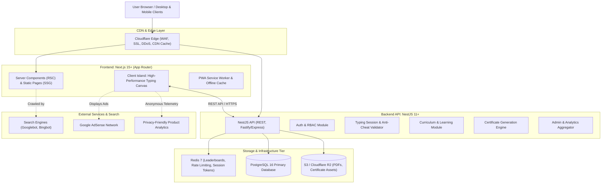
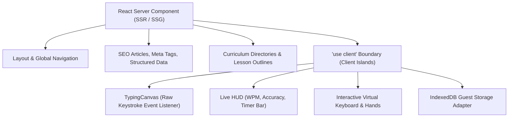
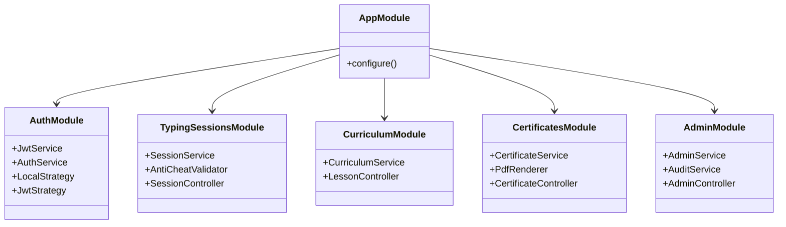
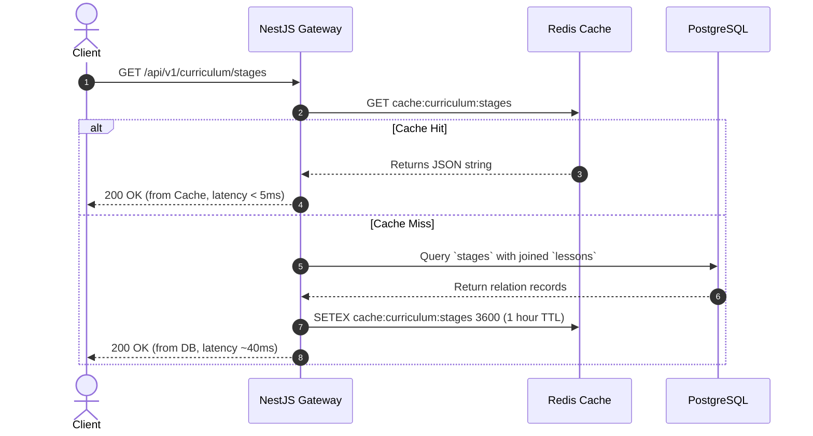
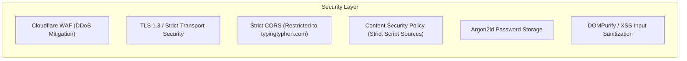

# Typing Typhon — Technical Architecture & Systems Engineering

**Document Version:** 1.0.0  
**Status:** Approved Architectural Baseline  
**Target Environment:** Production Distributed Cloud (Node.js 22 LTS, Next.js 15+, NestJS 11+, PostgreSQL 16+, Redis 7+)  
**Date:** October 2026  

---

## 1. Master System Architecture

The architecture of **Typing Typhon** follows an independently deployable, decoupled client-service topology. The frontend handles ultra-responsive client-side typing rendering and static/SSR search indexing, while the backend provides a stateless, horizontally scalable REST API.

---

## 2. Frontend Architecture (Next.js 15+ App Router)

### 2.1 Server Components vs. Client Components Strategy
To maximize performance and SEO while delivering sub-millisecond input response, the frontend enforces a strict separation:

1. **RSC & SSG (Server-Side):**
   * `/` (Hero, informational copy, footer).
   * `/learn`, `/learn/[stageSlug]` (Curriculum hierarchies, prerequisite trees).
   * `/blog`, `/blog/[slug]` (Educational articles, guides, keyboard specs).
   * `/verify/[certificateId]` (SSR verification page with direct search-engine schema injection).
2. **Client Islands (`'use client'`):**
   * `<TypingEngine />`: Mounts the hidden input buffer, listens to native `keydown` events, calculates delta timestamps via `performance.now()`.
   * `<VirtualKeyboard />`: Listens to keyup/keydown state transitions without triggering parent re-renders.
   * `<GuestStorageManager />`: Communicates asynchronously with IndexedDB to load/save guest history without blocking UI threads.

### 2.2 Client State Management (Zustand + Local IndexedDB)
* **Zustand Store (`useTypingStore`):** Manages ultra-fast ephemeral test state (active word index, character index, error count, timer countdown, pause state). Zero overhead, minimal re-renders.
* **IndexedDB Layer (`idb-keyval` or native wrapper):**
  * Database: `typingtyphon_guest_db`
  * Object Stores:
    * `sessions`: Stores last 50 completed test objects `{ id, wpm, acc, duration, mode, timestamp, is_migrated }`.
    * `mastery`: Key-by-key mastery dictionary `{ [key]: { attempts, passes, errorRate, lastTrained } }`.
    * `preferences`: UI settings `{ theme, soundEnabled, volume, caretStyle, keyboardLayout }`.

---

## 3. Backend Architecture (NestJS 11+)

The NestJS backend is architected in a modular, domain-driven structure, using standard Dependency Injection and strict DTO validation.

### 3.1 Modular Decomposition
* **`AuthModule`:** Argon2id password hashing, JWT creation/refresh rotation, OAuth2 verification (Google, GitHub), RBAC Guards.
* **`TypingSessionsModule`:** Ingestion of completed tests (both guest migration and authenticated runs), statistical plausibility validation, and time-series error calculation.
* **`CurriculumModule`:** Stages, lessons, exercises, key mastery evaluation logic, and prerequisite validation.
* **`CertificatesModule`:** Generation of immutable certificate entities, UUID mapping, PDF rendering pipeline, and public verification endpoints.
* **`ContestsModule`:** Daily/Weekly challenge seed management, signed session tokens, anti-cheat IKI analysis, and Redis sorted-set leaderboards.
* **`AdminModule`:** High-privilege moderation endpoints, content publishing, ad configuration toggles, and audit logging.

### 3.2 Request Lifecycle & Validation
Every incoming request passes through:
1. **`HelmetMiddleware`:** Sets secure HTTP headers (`X-Frame-Options`, `X-Content-Type-Options`, `Strict-Transport-Security`).
2. **`RateLimitGuard` (ThrottlerModule):** Enforces IP and user-based limits stored in Redis.
3. **`JwtAuthGuard`:** Validates HTTP-only cookie JWTs; injects `user` payload into request context.
4. **`RolesGuard`:** Evaluates RBAC permissions against endpoint metadata decorators (`@Roles('SuperAdmin')`).
5. **`ValidationPipe`:** Enforces strict DTO constraints with `whitelist: true` and `forbidNonWhitelisted: true`.
6. **`GlobalExceptionFilter`:** Transforms unhandled exceptions into RFC 7807 compliant Problem Details responses.

---

## 4. Caching & Data Flow Architecture (Redis 7)

### 4.1 Redis Utilization Matrix
* **Leaderboards:** Stored in Redis Sorted Sets (`ZADD leaderboard:daily:2026-10-16 [wpm] [userId]`), allowing $O(\log(N))$ rank lookups and range queries (`ZREVRANGE 0 49 WITHSCORES`).
* **Contest Session Tokens:** Stored as short-lived keys (`SETEX contest:session:[token] 300 [userId]`) ensuring single-use verification.
* **Rate Limiting:** Distributed sliding window counters across API instances.

---

## 5. Security & Privacy Architecture

1. **Content Security Policy (CSP):**
   * `default-src 'self';`
   * `script-src 'self' 'unsafe-inline' https://pagead2.googlesyndication.com https://www.google-analytics.com;`
   * `style-src 'self' 'unsafe-inline' https://fonts.googleapis.com;`
   * `font-src 'self' https://fonts.gstatic.com;`
   * `frame-src https://googleads.g.doubleclick.net;`
2. **Authentication Tokens:** Access tokens stored exclusively in `__Host-TypingTyphon-Token` HTTP-Only, Secure, SameSite=Lax cookies.
3. **Data Minimization:** Raw typing text from custom mode is evaluated purely in memory on the client and is **never** transmitted or persisted to backend servers.

---

## 6. Infrastructure & Deployment Topology

* **Frontend:** Hosted on Vercel or containerized on AWS ECS / DigitalOcean App Platform with Edge CDN caching.
* **Backend:** Dockerized Node.js application running behind an Nginx reverse proxy with zero-downtime rolling deploys.
* **Database:** Managed PostgreSQL (AWS RDS / Supabase / DigitalOcean Managed DB) with automated daily WAL snapshots and read replicas when read IOPS justify.
* **Storage:** Cloudflare R2 / AWS S3 for generated certificate PDFs and media assets.
