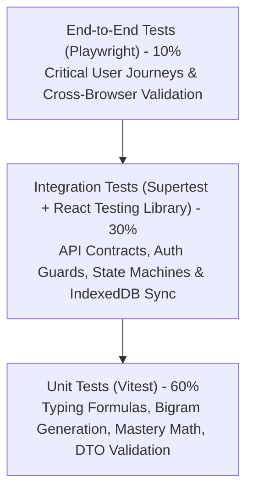
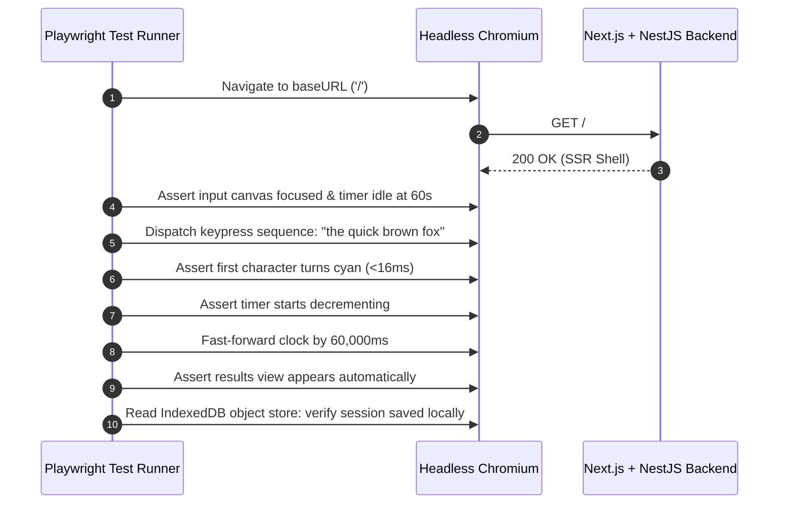

# Typing Typhon — Comprehensive Quality Assurance & Testing Strategy

**Document Version:** 1.0.0  
**Status:** Approved Engineering Baseline  
**Testing Frameworks:** Vitest / Jest (Unit & Integration), Playwright (E2E), k6 (Load), Axe-core (Accessibility)  
**Date:** October 2026  

---

## 1. Testing Pyramid & QA Philosophy

Because typing platforms are evaluated by users on **sub-millisecond responsiveness, calculation accuracy, and zero keyboard lag**, software quality cannot be an afterthought.

---

## 2. Test Execution Tiers

### 2.1 Tier 1: Unit Testing (Vitest)
* **Target Coverage:** $\ge 90\%$ code coverage on core domain logic.
* **Key Unit Test Suites:**
  1. `typing-engine.spec.ts`: Validates Gross WPM, Net WPM, accuracy, character penalties, backspace recovery, and zero division guards.
  2. `curriculum-mastery.spec.ts`: Tests the 3-consecutive-pass mastery state transitions and remedial threshold triggers.
  3. `weak-key-generator.spec.ts`: Validates deterministic synthesis of drill words targeting specific bigrams.
  4. `anti-cheat-telemetry.spec.ts`: Validates standard deviation of IKI and detects macro signatures.

### 2.2 Tier 2: Integration Testing (NestJS + Supertest)
* **Target:** All REST endpoints in NestJS.
* **Key Scenarios:**
  * Authentication flows: Registration, Argon2id validation, JWT cookie issuance, token rotation.
  * Guest migration: Batch upload of 50 local sessions, verification of duplicate rejection, database association.
  * Certificate issuance: Rejection of test sessions with duration $< 60\text{s}$ or accuracy $< 95\%$.
  * Rate limiting: Verifies 429 Too Many Requests response on brute-force attempts.

### 2.3 Tier 3: End-to-End Testing (Playwright)
Playwright executes automated browser sessions against headless Chromium, Firefox, and WebKit.

* **Automated E2E Scenarios:**
  * **E2E-1:** Guest instant test $\to$ 60s run $\to$ Results display $\to$ Local storage verification.
  * **E2E-2:** Account sign-up $\to$ Guest data migration modal $\to$ Cloud history verification.
  * **E2E-3:** Lesson exercise $\to$ Deliberate error injection $\to$ Verification of "Needs Improvement" status and remedial drill recommendation.
  * **E2E-4:** Public certificate generation $\to$ Public URL verification test (`/verify/[id]`).

---

## 3. Performance, Core Web Vitals & Load Testing

### 3.1 Core Web Vitals Automated Gate (Lighthouse CI)
Every pull request triggers Lighthouse CI. A build fails if:
* **Largest Contentful Paint (LCP):** $> 2.0\text{s}$.
* **Cumulative Layout Shift (CLS):** $> 0.02$.
* **Interaction to Next Paint (INP):** $> 100\text{ms}$.
* **SEO Score:** $< 95/100$.

### 3.2 Load & Stress Testing (k6)
Simulate peak contest traffic on NestJS endpoints:
* **Scenario:** 2,000 concurrent typists completing a 60-second test and posting results within a 10-second burst window.
* **Acceptance Criteria:** $p95$ API response time $< 200\text{ms}$; error rate $< 0.1\%$.

---

## 4. Accessibility & Security Automation

* **Automated a11y (Axe-core):** Integrated into Playwright runs. Asserts WCAG 2.1 AA compliance, focus rings, contrast ratios, and ARIA labels.
* **Security Audits:**
  * Automated `npm audit` and Snyk dependency vulnerability checks in CI.
  * OWASP ZAP baseline scan running against preview environments prior to production promotion.
