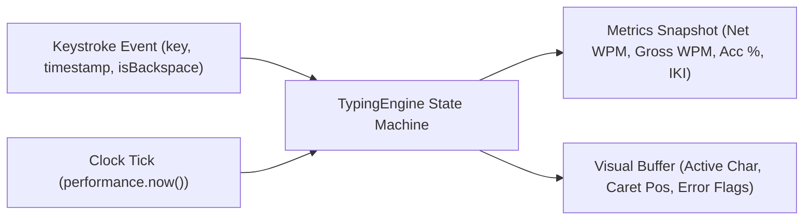
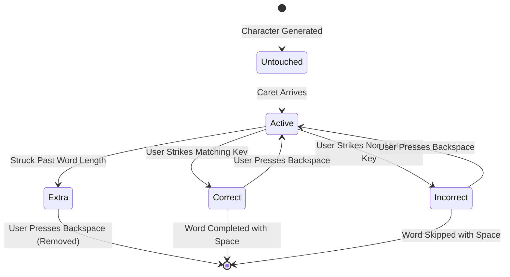
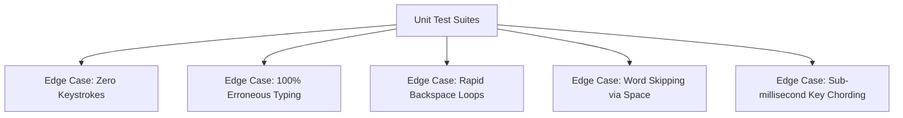

# Typing Typhon — Typing Engine Mathematical Specification

**Document Version:** 1.0.0  
**Status:** Approved Algorithmic Baseline  
**Language Compatibility:** TypeScript (Pure functions, zero DOM dependencies for unit testability)  
**Date:** October 2026  

---

## 1. Engine Core Philosophy

The Typing Typhon typing engine is designed as a **deterministic, headless state machine**. The state machine accepts discrete keyboard input events and elapsed time ticks, computing real-time metrics with zero side-effects. This decouples the engine completely from React DOM rendering, ensuring sub-millisecond execution and 100% test coverage.



---

## 2. Standardized Mathematical Formulas

To eliminate ambiguity across UI displays, certificates, and API validation, **Typing Typhon adopts the standardized 5-character standardized word convention** (recognized by international typewriting associations).

### 2.1 Standard Word Unit
A "standard word" is defined strictly as **5 keystrokes** (including letters, spaces, numbers, and punctuation).
$$\text{Standard Words} = \frac{\text{Keystrokes}}{5}$$

### 2.2 Gross Words Per Minute (Gross WPM / Raw WPM)
Gross WPM measures raw typing speed regardless of errors or subsequent corrections.
$$\text{Gross WPM} = \frac{\text{Total Keystrokes} / 5}{\text{Elapsed Seconds} / 60}$$

### 2.3 Net Words Per Minute (Net WPM / Standard WPM)
Net WPM reflects usable, productive typing velocity.
$$\text{Net WPM} = \max\left(0, \frac{\text{Correct Keystrokes} / 5}{\text{Elapsed Seconds} / 60}\right)$$
*Policy on Errors:* Uncorrected errors left in the completed text penalize the score by 1 standard word deduction per uncorrected error:
$$\text{Net WPM}_{\text{penalized}} = \max\left(0, \frac{(\text{Correct Keystrokes} / 5) - \text{Uncorrected Errors}}{\text{Elapsed Seconds} / 60}\right)$$
*Selected Convention:* On real-time HUD and speed-test result cards, **Net WPM** is prominently featured as the headline metric.

### 2.4 Accuracy Percentage
$$\text{Accuracy \%} = \begin{cases} 
100.00\% & \text{if Total Keystrokes} = 0 \\
\max\left(0, \frac{\text{Correct Keystrokes}}{\text{Total Keystrokes}} \times 100\right) & \text{if Total Keystrokes} > 0 
\end{cases}$$
*Note:* Every struck key that does not match the expected character at the caret position increments `Total Keystrokes` and `Errors`, permanently impacting the Accuracy percentage even if subsequently backspaced and corrected.

### 2.5 Consistency Metric (Coefficient of Variation)
Measures the rhythm and cadence of keystroke intervals. High consistency ($>85\%$) indicates rhythmic, relaxed touch typing.
$$\sigma_{\text{IKI}} = \sqrt{\frac{1}{N-1} \sum_{i=1}^{N} (\text{IKI}_i - \mu_{\text{IKI}})^2}$$
$$\text{Consistency \%} = \max\left(0, 100 - \left(\frac{\sigma_{\text{IKI}}}{\mu_{\text{IKI}}} \times 100\right)\right)$$
where $\text{IKI}_i$ is the Inter-Keystroke Interval ($t_i - t_{i-1}$) in milliseconds.

---

## 3. Character State Lifecycle & Backspace Handling



### 3.1 Character State Classifications
* **`Untouched`:** Character has not yet been reached by the typist. Rendered in `--char-untouched` (#64748B).
* **`Active`:** The character currently awaiting input. Caret is anchored to its left boundary.
* **`Correct`:** User typed the matching key. Rendered in `--char-correct` (#38BDF8).
* **`Incorrect`:** User pressed an incorrect key. Rendered in `--char-incorrect` (#F43F5E).
* **`Extra`:** If the user continues typing letters without pressing space, extra characters are appended to the word (up to a max buffer of 10 extra characters) and flagged in `--char-extra` (#BE123C).
* **`Missed`:** If the user strikes `Space` before completing all characters of a word, remaining untouched characters in that word are marked as missed errors.

### 3.2 Backspace Configurations
1. **Standard Mode (Default):** Typists can press `Backspace` to undo incorrect or correct characters within the current word. Backspacing into the previous word is permitted only if the previous word contained uncorrected errors.
2. **Confidence Mode:** Backspacing is completely disabled. Typists must maintain forward momentum.
3. **Word Delete (`Ctrl + Backspace` / `Alt + Backspace`):** Deletes the entire active word or all extra characters with a single keystroke.

---

## 4. Time-Series Sampling (Per-Second Metrics)

To generate the post-test velocity graph:
1. Every $1000\text{ms}$ while the test is active, the engine records a snapshot:
   ```typescript
   interface SecondSnapshot {
     second: number;             // Elapsed second (1, 2, ... N)
     rollingWpm: number;         // Net WPM in that 1-second interval
     cumulativeWpm: number;      // Net WPM from 0 to current second
     instantaneousErrors: number;// Errors made during that exact second
   }
   ```
2. When the test terminates (timer reaches 0), this array is finalized and passed to the charting library.

---

## 5. Comprehensive Edge Cases & Unit Test Matrix



| Test Case ID | Input Scenario | Expected State & Output |
| :--- | :--- | :--- |
| **TC-ENG-01** | Timer expires without a single keystroke pressed. | WPM = 0.00, Accuracy = 100.00%, Total Keystrokes = 0. No NaN or Division by Zero exceptions. |
| **TC-ENG-02** | User types 100 incorrect keys in 60 seconds. | Gross WPM = 20.00, Net WPM = 0.00, Accuracy = 0.00%, Total Errors = 100. |
| **TC-ENG-03** | User types "cat", backspaces 3 times, types "cat" again. | Correct Keystrokes = 3, Total Keystrokes = 6, Accuracy = 50.00% (3 correct / 6 total attempts). |
| **TC-ENG-04** | User presses Spacebar on word "elephant" after typing only "el". | Letters "e", "l" marked correct. Letters "ephant" marked as missed errors. Word advanced. |
| **TC-ENG-05** | User types 15 extra characters past a 4-letter word. | Extra characters clamped at 10 to prevent DOM overflow. Marked as extra errors. |
| **TC-ENG-06** | Test duration 15s; exact duration elapsed is 15.000s. | Elapsed minutes calculated as $15 / 60 = 0.25$. No fractional second drift. |
| **TC-ENG-07** | Automated bot submits 50 keys with 0ms delta intervals. | Engine flags `zero_variance_detected` in telemetry payload. |
