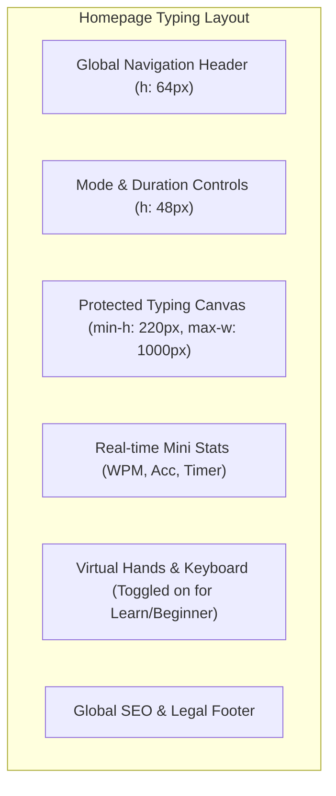
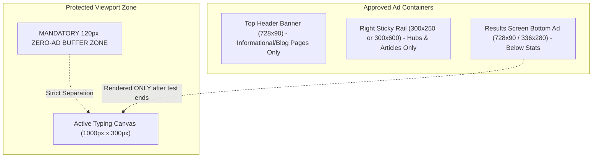

# Typing Typhon — UI/UX Design System & Specification

**Document Version:** 1.0.0  
**Status:** Approved Design Baseline  
**Typography:** Primary: `Inter`, Monospace/Typing Canvas: `JetBrains Mono`  
**Date:** October 2026  

---

## 1. Visual Identity & Design Principles

Typing Typhon’s design philosophy balances **zen-like focus** during typing with **data-dense, modern elegance** during performance review.

### 1.1 Core Design Pillars
1. **The Protected Canvas:** The typing area is stripped of visual noise, animations, banners, and layout shifts. Keystroke response is instant and tactile.
2. **Harmonious Dark-First Aesthetic:** Built primarily in sleek, low-strain dark palettes (with light and high-contrast modes) designed for prolonged typing sessions.
3. **Information Density without Clutter:** Clear visual hierarchies utilizing distinct color codings for correct characters, errors, skipped tokens, and caret states.

---

## 2. Color Palette & Design Tokens

### 2.1 Core Palette Tokens (CSS Variables)

```css
:root {
  /* Surface & Background */
  --bg-primary: #0F172A;       /* Slate 900 - Deep focused backdrop */
  --bg-surface: #1E293B;       /* Slate 800 - Cards, modals, containers */
  --bg-surface-elevated: #334155; /* Slate 700 - Hover states, dropdowns */
  --border-subtle: #334155;    /* Subtle card borders */
  --border-active: #38BDF8;    /* Active focus borders */

  /* Text & Typography */
  --text-primary: #F8FAFC;     /* Slate 50 - High contrast readable text */
  --text-secondary: #94A3B8;   /* Slate 400 - Subtitles, metadata, hints */
  --text-muted: #64748B;       /* Slate 500 - Inactive keys, footer links */

  /* Typing Canvas States */
  --char-untouched: #64748B;   /* Neutral slate for upcoming text */
  --char-correct: #38BDF8;     /* Cyan/Sky 400 - Vivid, crisp correct keystroke */
  --char-incorrect: #F43F5E;   /* Rose 500 - Instant, unambiguous error indicator */
  --char-extra: #BE123C;       /* Rose 700 - Characters typed beyond word boundary */
  --caret-color: #F59E0B;      /* Amber 500 - Smooth, visible tracking cursor */

  /* Brand & Accent Accents */
  --brand-primary: #0284C7;    /* Sky 600 - Primary actions, active tabs */
  --brand-gradient: linear-gradient(135deg, #0284C7 0%, #38BDF8 50%, #818CF8 100%);
  --success: #10B981;          /* Emerald 500 - Passed tests, high accuracy */
  --warning: #F59E0B;          /* Amber 500 - Mediocre accuracy / warnings */
  --error: #EF4444;            /* Red 500 - Critical errors / failed thresholds */

  /* Virtual Keyboard Finger Coding */
  --finger-left-pinky: #E0E7FF;   /* Indigo 100 on dark */
  --finger-left-ring: #C7D2FE;
  --finger-left-middle: #A5B4FC;
  --finger-left-index: #818CF8;
  --finger-thumb: #6366F1;
  --finger-right-index: #38BDF8;
  --finger-right-middle: #7DD3FC;
  --finger-right-ring: #BAE6FD;
  --finger-right-pinky: #E0F2FE;
}

/* Light Theme Variant */
[data-theme="light"] {
  --bg-primary: #F8FAFC;
  --bg-surface: #FFFFFF;
  --bg-surface-elevated: #F1F5F9;
  --border-subtle: #E2E8F0;
  --border-active: #0284C7;
  --text-primary: #0F172A;
  --text-secondary: #475569;
  --text-muted: #94A3B8;
  --char-untouched: #94A3B8;
  --char-correct: #0284C7;
  --char-incorrect: #E11D48;
  --caret-color: #D97706;
}
```

---

## 3. Typography & Hierarchy

* **Primary Body & UI Font:** `Inter`, -apple-system, BlinkMacSystemFont, "Segoe UI", sans-serif.
* **Typing Canvas & Code Font:** `JetBrains Mono`, "Fira Code", monospace. (Selected for distinct glyph shapes for `1`, `l`, `I`, `0`, `O`).

| Token | Size | Line Height | Weight | Usage |
| :--- | :--- | :--- | :--- | :--- |
| `text-display` | 48px (3.0rem) | 1.15 | 800 (Bold) | Hero headlines, primary speed benchmark results |
| `text-h1` | 32px (2.0rem) | 1.25 | 700 (Bold) | Major page titles, certificate headers |
| `text-h2` | 24px (1.5rem) | 1.30 | 600 (Semi-bold) | Section headers, card titles |
| `text-h3` | 18px (1.125rem)| 1.40 | 600 (Semi-bold) | Sub-sections, modal titles |
| `text-canvas` | 28px (1.75rem)| 1.60 | 400 (Regular) | Typing test characters (Desktop) |
| `text-canvas-mobile`| 20px (1.25rem)| 1.50 | 400 (Regular) | Typing test characters (Mobile) |
| `text-body` | 16px (1.0rem) | 1.50 | 400 (Regular) | Standard explanatory paragraphs, blog body |
| `text-caption` | 13px (0.8125rem)| 1.40 | 500 (Medium) | Timers, shortcuts, finger placement guides |

---

## 4. Component Layout Specifications



### 4.1 The Typing Canvas Component
* **Max Width:** `1000px`, centered with `auto` horizontal margins.
* **Line Limit:** Displays 3 lines of text at any moment. As the typist completes line 1 and begins line 2, line 1 smoothly scrolls upwards or shifts to keep active words in optical center.
* **Caret Animation:**
  * Active typing: Smooth linear transition (`transition: left 60ms linear`).
  * Idle (before test begins): Smooth blinking pulse (`animation: caretBlink 1.2s infinite`).
* **Hidden Input Buffer:** A hidden `<input>` or `<textarea>` element receives physical focus, preventing browser scrolling or accidental mobile keyboard dismissal while listening to `keydown` events.

### 4.2 Real-time Live Stats Bar
* Positioned directly above or below the canvas (user configurable).
* Minimalist presentation:
  * **Timer:** Large numeric countdown (e.g., `59`, `58`...). Changes to Amber at $\le 10$ seconds.
  * **WPM:** Real-time rolling gross WPM counter.
  * **Accuracy:** Percentage badge (e.g., `98%`).

### 4.3 Virtual Interactive Keyboard Component
* **Target Users:** All `/learn` curriculum routes and optional toggle on `/speed-test`.
* **Visual States:**
  * Inactive Key: Muted slate surface.
  * Target Key (to press next): High-contrast pulsing cyan border with finger indicator icon.
  * Pressed Key: Dynamic depression state (scale 0.96) with instant illumination.
  * Mis-pressed Key: Flashes red for 150ms.
* **Hand / Finger Orientation Overlay:** An ergonomic silhouette below the keyboard showing active finger (Index, Middle, Ring, Pinky) for the current keystroke.

---

## 5. Page-by-Page Interface Blueprints

### 5.1 Results View (`/results`)
* **Header:** Summary banner with Net WPM (huge font, 64px), Accuracy %, Test Duration, and Practice Mode.
* **Interactive Line Chart (Chart.js / Recharts):**
  * X-axis: Elapsed time in seconds ($1 \dots 60$).
  * Primary line (Cyan): Rolling Net WPM per second.
  * Secondary line (Muted Slate): Raw WPM.
  * Scatter markers (Red dots): Error instances plotted at the exact second they occurred.
* **Letter-by-Letter Accuracy Grid:** Compact keyboard matrix showing error percentage on keys touched during this specific test.
* **Action Cluster:**
  * `[Restart Test (Tab + Enter)]` (Primary prominent button).
  * `[Practice Weak Keys]` (Conditional button if weak keys detected).
  * `[Download Certificate]` (Enabled if qualifying test).
  * `[Share Results]` (Copies clean markdown/text or generates social card).
* **Respectful Account Invitation:** Below the primary stats, a clean non-modal card invites guests with $\ge 3$ sessions to sync progress.

### 5.2 Curriculum & Lesson Studio (`/learn/[stage]/[lessonId]`)
* **Left Sidebar (25% width on desktop):** Progress checklist of stages (Home Row, Top Row, etc.) with completion checkmarks and mastery stars.
* **Center Stage (75% width):**
  * Lesson Objective Card: "Master keys **F** and **J** using Left & Right Index Fingers."
  * Large Letter Drill Prompts: High-contrast character sequence (e.g., `fff jjj fjf jfj`).
  * Virtual Keyboard with active hand overlay.
  * Real-time error counter and threshold progress bar: "Target: 96% Acc | Current: 98%".

### 5.3 Public Certificate View (`/verify/[certificateId]`)
* Formal, clean, credential layout.
* Verified Badge with green shield icon: "Officially Verified Typing Benchmark".
* Key facts: Candidate Name, Test Date (UTC), Duration (e.g., 60 Seconds Proctored), Net Speed (e.g., 84 WPM), Accuracy (98.7%).
* Action buttons: `[Download High-Resolution PDF]`, `[Print Certificate]`.

---

## 6. Advertising Placement & Protected Viewport Specification

To maintain strict AdSense policy compliance while guaranteeing an unobstructed typing experience, advertising units follow these rigid rules:



### 6.1 Rigid Placement Constraints
1. **The Active Typing Canvas is an Ad-Free Sanctuary:** Zero advertisements within a 120px vertical and horizontal radius of the typing canvas.
2. **No Ads During Keystrokes:** Ads on `/speed-test` or `/` are positioned exclusively beneath the lower fold or rendered in dedicated footer/result containers *after* the session concludes.
3. **Fixed Dimension Ad Containers:** All ad placeholders have hardcoded `min-height` and `min-width` CSS constraints to guarantee **0.00 Cumulative Layout Shift (CLS)** when external ad scripts load.
4. **No Deceptive Placements:** Ad containers are visibly demarcated with subtle text `ADVERTISEMENT` or `SPONSORED` in 10px muted slate font, never styled to mimic interactive buttons or typing prompts.
