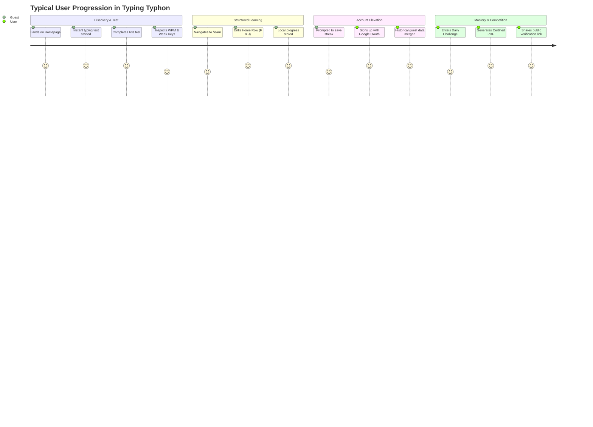
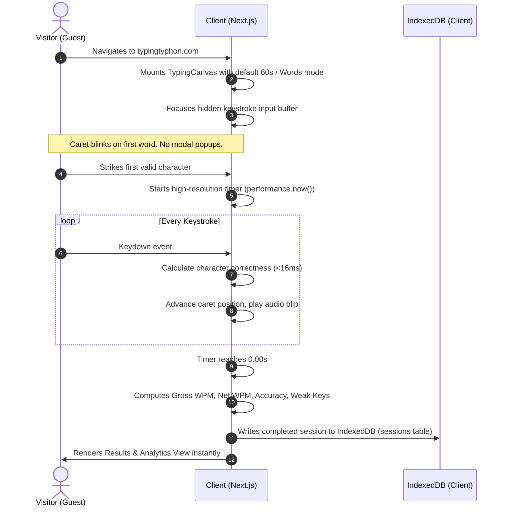
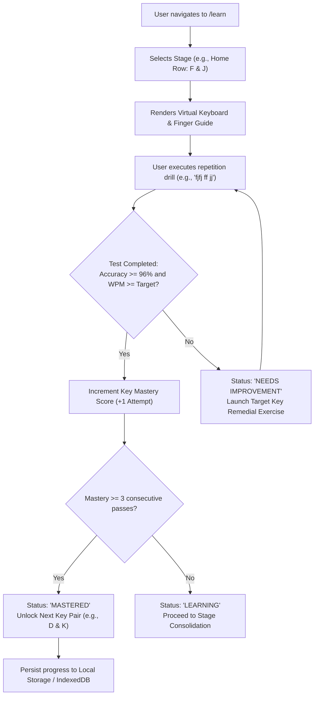
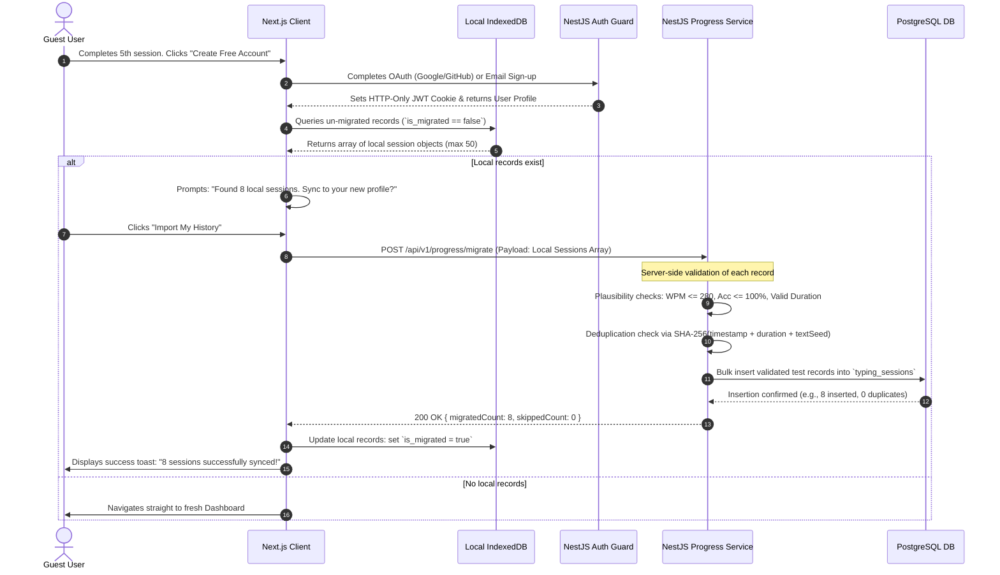
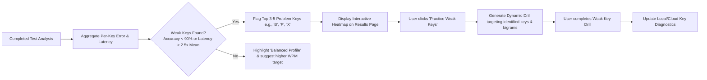
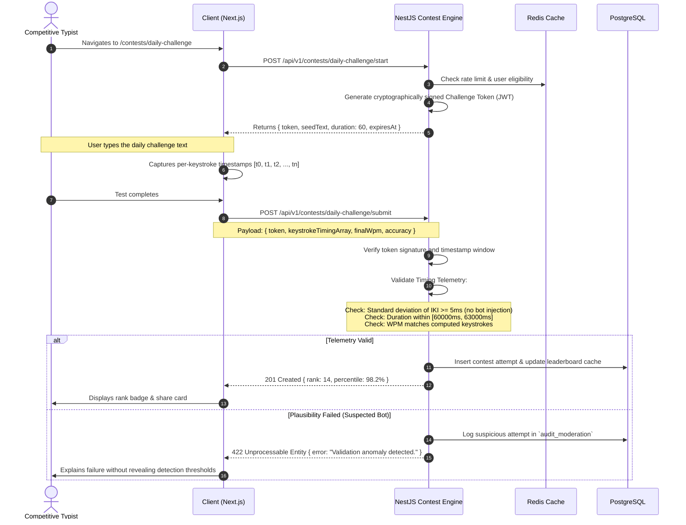
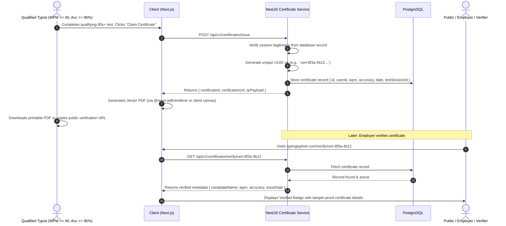

# Typing Typhon — End-to-End User Flows

**Document Version:** 1.0.0  
**Status:** Approved Architectural Baseline  
**Date:** October 2026  

---

## 1. Primary User Journey Matrix

Typing Typhon is built around the **Guest-First Axiom**: every core feature must deliver immediate value prior to any authentication request.

---

## 2. User Flow 1: First Visit & Instant Typing Test

*Objective: Zero friction between URL resolution and first keystroke.*

---

## 3. User Flow 2: Alphabet-by-Alphabet Curriculum & Mastery

*Objective: Progressive motor skill acquisition with real-time finger placement guidance.*

---

## 4. User Flow 3: Guest-to-Account Migration Pipeline

*Objective: Securely transfer local client history into cloud storage without data loss or score falsification.*

---

## 5. User Flow 4: Weak-Key Diagnostics & Remedial Practice

*Objective: Close the loop between diagnostic performance measurement and targeted practice.*

---

## 6. User Flow 5: Daily Challenge & Competitive Anti-Cheat Validation

*Objective: Provide a fair, verifiable competitive test for global leaderboards.*

---

## 7. User Flow 6: Verifiable Certificate Generation & Public Lookup

*Objective: Provide authentic, professional typing speed certificates.*

